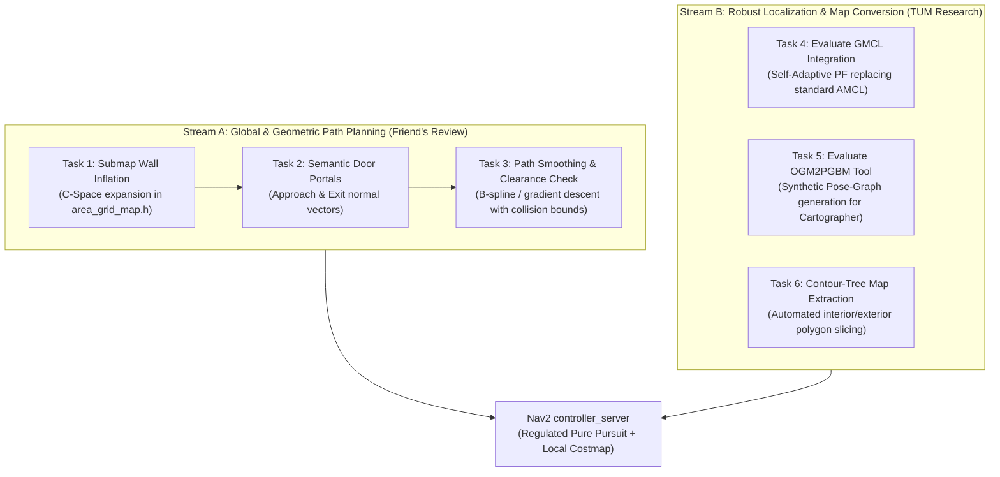

# Pending Engineering & Research Tasks

This document consolidates actionable tasks derived from:
1. **Geometric Path & Doorway Clearance Improvements** (addressing corner-cutting and wall proximity observed in RViz testing).
2. **TUM Research Integration** (*Occupancy Grid Map to Pose Graph-based Map: Robust BIM-based 2D-LiDAR Localization*, Vega Torres et al., TUM 2023).

---

## 1. System Architecture & Task Roadmap

The diagram below illustrates where each pending task fits into our semantic autonomous wheelchair pipeline:



---

## 2. Stream A: Path Planning & Doorway Clearance (From Geometric Review)

### Task 1: Submap Wall Inflation in `area_grid_map.h`

* **What is it?**
  Expanding the binary wall boundaries inside each room's local grid map by the robot's physical radius ($R = 0.25\text{ m}$) plus a safety buffer ($M = 0.10\text{ m}$), creating an inflated Configuration Space (C-Space).
* **Why do we need it?**
  Currently, `InitOccupancyMap_Area()` in `area_grid_map.h` draws walls with a thickness of only 2 pixels ($10\text{ cm}$). Standard A\* minimizes Euclidean distance with zero clearance cost, causing it to hug wall corners with only $5\text{ cm}$ of clearance. When the physical robot tracks this path, its outer chassis clips the wall.
* **How does it work?**
  1. In `InitOccupancyMap_Area()`, after drawing wall lines on `area_mat`, apply OpenCV morphological dilation:
     ```cpp
     int inflation_pixels = std::ceil((robot_radius + safety_margin) / resolution); // e.g. 0.35m / 0.05m = 7 pixels
     cv::Mat element = cv::getStructuringElement(cv::MORPH_RECT, cv::Size(2*inflation_pixels + 1, 2*inflation_pixels + 1));
     cv::dilate(area_mat, area_mat_inflated, element);
     ```
  2. Alternatively, apply `cv::distanceTransform()` to generate a continuous cost field where cells near walls carry a high traversal penalty.
* **Files Affected:**
  * `lidarbot_ws/src/lidarbot/lidarbot_osmag/include/osmAG/area_grid_map.h`
  * `lidarbot_ws/src/lidarbot/lidarbot_osmag/src/osmAG/path_graph.cpp`
* **Status:** `PENDING`

---

### Task 2: Semantic Door Portals (Perpendicular Approach & Exit Vectors)

* **What is it?**
  Treating each doorway not merely as a 1D line segment, but as a directed **semantic portal** with three sequential waypoints:
  $$\text{Approach Waypoint (Corridor)} \longrightarrow \text{Door Center} \longrightarrow \text{Exit Waypoint (Room)}$$
* **Why do we need it?**
  Currently, paths connect diagonally from the corridor directly into the door line, clipping the door frame. Aligning the trajectory perpendicular to the doorway ensures the wheelchair enters and exits cleanly through the middle.
* **How does it work?**
  1. For a passage defined by nodes $A(x_1, y_1)$ and $B(x_2, y_2)$, compute the doorway unit direction:
     $$\mathbf{u} = \frac{(x_2 - x_1, y_2 - y_1)}{\|(x_2 - x_1, y_2 - y_1)\|}$$
  2. Compute the perpendicular normal vector:
     $$\mathbf{n} = (-u_y, u_x)$$
  3. Generate approach and exit waypoints at distance $d \approx 0.5\text{ m}$ along $\pm \mathbf{n}$:
     $$\mathbf{p}_{\text{approach}} = \mathbf{p}_{\text{center}} + d \cdot \mathbf{n}, \quad \mathbf{p}_{\text{exit}} = \mathbf{p}_{\text{center}} - d \cdot \mathbf{n}$$
  4. Force global A\* to route: Start $\rightarrow \dots \rightarrow \mathbf{p}_{\text{approach}} \rightarrow \mathbf{p}_{\text{center}} \rightarrow \mathbf{p}_{\text{exit}} \rightarrow \dots \rightarrow$ Goal.
* **Files Affected:**
  * `lidarbot_ws/src/lidarbot/lidarbot_osmag/src/osmag_planner_node.cpp`
  * `lidarbot_ws/src/lidarbot/lidarbot_osmag/src/osmAG/path_graph.cpp`
* **Status:** `PENDING`

---

### Task 3: Path Smoothing with Clearance Verification

* **What is it?**
  Post-processing the raw 8-connected grid A\* path into a continuous, smooth trajectory while guaranteeing that no smoothed point violates minimum clearance.
* **Why do we need it?**
  Raw grid A\* produces jagged $45^\circ$ stair-step waypoints that cause wheelchair passengers discomfort and trigger abrupt steering commands in the controller.
* **How does it work?**
  1. Run line-of-sight shortcutting (Bresenham / ray-trace on the inflated submap) to remove redundant collinear points.
  2. Apply a gradient descent smoother or cubic B-spline with an explicit constraint:
     $$\text{dist}(p_i, \text{nearest\_wall}) \ge R_{\text{robot}} + M_{\text{safety}}$$
* **Files Affected:**
  * `lidarbot_ws/src/lidarbot/lidarbot_osmag/src/osmag_planner_node.cpp`
* **Status:** `PENDING`

---

## 3. Stream B: Robust Localization & Map Pipelines (From TUM Research)

### Task 4: Evaluate GMCL (General Monte Carlo Localization) Upgrade

* **What is it?**
  Benchmarking and evaluating General Monte Carlo Localization (`gmcl`) as an alternative to standard AMCL (`nav2_amcl`).
* **Why do we need it?**
  The TUM paper experimentally demonstrated that in real office environments with unmapped furniture and clutter:
  * Standard AMCL translational error increases $4\times$ (from $8.5\text{ cm}$ to $37.4\text{ cm}$) and struggles to recover when kidnapped (taking 40–80 seconds).
  * GMCL's Self-Adaptive Particle Filter clusters particles in Similar Energy Regions (SER), converging $2\times$ to $4\times$ faster with lower RMSE ($24.2\text{ cm}$).
* **How does it work?**
  1. Install `nav2_gmcl` in our ROS 2 Humble workspace.
  2. Create an alternative launch flag `use_gmcl:=true` in `navigation_osmag_launch.py`.
  3. Compare convergence time and rotation stability during simulated clutter and wheelchair kidnapping.
* **Files Affected:**
  * `lidarbot_ws/src/lidarbot/lidarbot_navigation/launch/navigation_osmag_launch.py`
  * `lidarbot_ws/src/lidarbot/lidarbot_navigation/config/nav2_osmag_params.yaml`
* **Status:** `PENDING`

---

### Task 5: Offline Pose-Graph Generation (`OGM2PGBM`) for Cartographer

* **What is it?**
  Generating a pre-compiled pose-graph map (`.pbstream` or `.posegraph`) from our 2D occupancy grid (`shanghaitech_merge_v1.pgm`) without running a physics simulation.
* **Why do we need it?**
  The TUM paper achieved state-of-the-art pose tracking ($4.1\text{ cm}$ RMSE) by running Google Cartographer in pure localization mode against a pre-baked pose-graph map. Normally, generating this requires teleoperating a robot through the building for hours. The open-source `Ogm2Pgbm` tool generates it in seconds via skeleton ray-casting.
* **How does it work?**
  1. Clone TUM's open-source tool: [`https://github.com/MigVega/Ogm2Pgbm`](https://github.com/MigVega/Ogm2Pgbm).
  2. Run the tool on `shanghaitech_merge_v1.pgm` to produce `shanghaitech_merge_v1.pbstream`.
  3. Benchmark Cartographer pure localization against AMCL/GMCL on the simulated wheelchair dataset.
* **Files Affected:**
  * `scripts/` (helper conversion script)
  * `lidarbot_ws/src/lidarbot/lidarbot_navigation/maps/`
* **Status:** `PENDING`

---

### Task 6: Automated Clean Map Extraction (Contour Hierarchy)

* **What is it?**
  Using OpenCV contour hierarchy (`RETR_TREE`) on CAD SVG/DXF exports to automatically classify:
  * **Outer Unnavigable Regions:** Gray (Unknown, $-1$)
  * **Navigable Rooms & Corridors:** White (Free, $0$)
  * **Structural Walls:** Black (Occupied, $100$)
* **Why do we need it?**
  Currently, 2D maps extracted from architectural drawings require tedious manual painting in GIMP/Photoshop to fill outdoor voids and clean up stray lines.
* **How does it work?**
  Implement an automated Python script (`scripts/cad_to_ogm.py`) utilizing the OpenCV parent/child contour hierarchy method detailed in Section 4.1 of the TUM paper.
* **Files Affected:**
  * `scripts/cad_to_ogm.py`
* **Status:** `PENDING`

---

## 4. Priority & Execution Order

| Phase | Task ID | Description | Impact | Complexity |
| :--- | :--- | :--- | :---: | :---: |
| **Phase 1 (Immediate)** | **Task 1** | Submap Wall Inflation in `area_grid_map.h` | Prevents robot from clipping walls | Low |
| **Phase 1 (Immediate)** | **Task 2** | Semantic Door Portals (Approach/Exit vectors) | Solves doorway transition collisions | Medium |
| **Phase 2 (Refinement)** | **Task 3** | Path Smoothing with Clearance Verification | Smooth wheelchair ride quality | Medium |
| **Phase 3 (Localization)** | **Task 4** | Evaluate GMCL vs AMCL | Robustness against clutter & kidnapping | Medium |
| **Phase 4 (Advanced)** | **Task 5 & 6** | `OGM2PGBM` Pose-Graph + Contour Pipeline | State-of-the-art $4\text{ cm}$ tracking & automated CAD | High |
