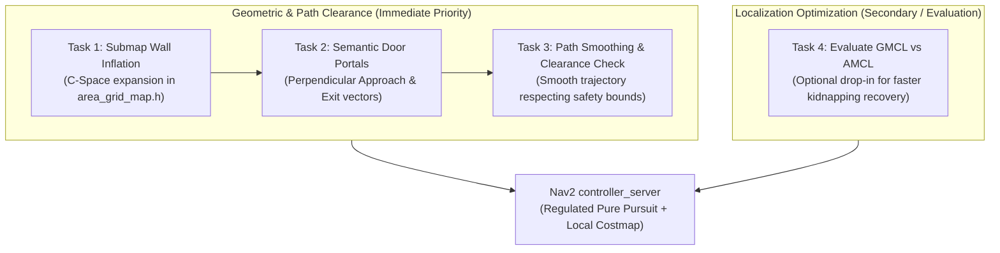

# Pending Engineering Tasks

This document contains the focused engineering roadmap to resolve path-wall proximity, doorway corner-cutting, and ensure smooth, robust semantic navigation for the autonomous wheelchair.

---

## 1. System Architecture & Roadmap



---

## 2. Active Engineering Tasks

### Task 1: Submap Wall Inflation in `area_grid_map.h`

* **What is it?**
  Expanding the binary wall boundaries inside each room's local raster grid by the robot's physical radius ($R = 0.25\text{ m}$) plus a safety buffer ($M = 0.10\text{ m}$), creating an inflated Configuration Space (C-Space).
* **Why do we need it?**
  Currently, `InitOccupancyMap_Area()` draws walls with a thickness of only 2 pixels ($10\text{ cm}$). Standard A\* minimizes Euclidean distance with zero clearance cost, causing it to hug wall corners with only $5\text{ cm}$ of clearance. When the physical robot tracks this path, its outer chassis clips the wall.
* **How does it work?**
  In `InitOccupancyMap_Area()`, after drawing wall lines on `area_mat`, apply OpenCV morphological dilation:
  ```cpp
  int inflation_pixels = std::ceil((robot_radius + safety_margin) / resolution); // e.g. 0.35m / 0.05m = 7 pixels
  cv::Mat element = cv::getStructuringElement(cv::MORPH_RECT, cv::Size(2*inflation_pixels + 1, 2*inflation_pixels + 1));
  cv::dilate(area_mat, area_mat_inflated, element);
  ```
  This makes all cells within $0.35\text{ m}$ of walls strictly impassable to the global A\* search.
* **Files Affected:**
  * `lidarbot_ws/src/lidarbot/lidarbot_osmag/include/osmAG/area_grid_map.h`
  * `lidarbot_ws/src/lidarbot/lidarbot_osmag/src/osmAG/path_graph.cpp`
* **Status:** `PENDING - HIGH PRIORITY`

---

### Task 2: Semantic Door Portals (Perpendicular Approach & Exit Vectors)

* **What is it?**
  Treating each doorway not merely as a 1D line segment, but as a directed **semantic portal** with three sequential waypoints:
  $$\text{Approach Waypoint (Corridor)} \longrightarrow \text{Door Center} \longrightarrow \text{Exit Waypoint (Room)}$$
* **Why do we need it?**
  Currently, paths connect diagonally from the corridor directly into the door line, clipping the door frame. Aligning the trajectory perpendicular to the doorway ensures the wheelchair enters and exits cleanly through the middle.
* **How does it work?**
  1. For a passage defined by nodes $A(x_1, y_1)$ and $B(x_2, y_2)$, compute the doorway unit direction:
     $$\mathbf{u} = \frac{(x_2 - x_1, y_2 - y_1)}{\|(x_2 - x_1, y_2 - y_1)\|}$$
  2. Compute the perpendicular normal vector:
     $$\mathbf{n} = (-u_y, u_x)$$
  3. Generate approach and exit waypoints at distance $d \approx 0.5\text{ m}$ along $\pm \mathbf{n}$:
     $$\mathbf{p}_{\text{approach}} = \mathbf{p}_{\text{center}} + d \cdot \mathbf{n}, \quad \mathbf{p}_{\text{exit}} = \mathbf{p}_{\text{center}} - d \cdot \mathbf{n}$$
  4. Force global A\* to route: Start $\rightarrow \dots \rightarrow \mathbf{p}_{\text{approach}} \rightarrow \mathbf{p}_{\text{center}} \rightarrow \mathbf{p}_{\text{exit}} \rightarrow \dots \rightarrow$ Goal.
* **Files Affected:**
  * `lidarbot_ws/src/lidarbot/lidarbot_osmag/src/osmag_planner_node.cpp`
  * `lidarbot_ws/src/lidarbot/lidarbot_osmag/src/osmAG/path_graph.cpp`
* **Status:** `PENDING - HIGH PRIORITY`

---

### Task 3: Path Smoothing with Clearance Verification

* **What is it?**
  Post-processing the raw 8-connected grid A\* path into a continuous, smooth trajectory while guaranteeing that no smoothed point violates minimum clearance.
* **Why do we need it?**
  Raw grid A\* produces jagged $45^\circ$ stair-step waypoints that cause wheelchair passengers discomfort and trigger abrupt steering commands in the controller.
* **How does it work?**
  1. Run line-of-sight shortcutting (Bresenham ray-trace on the inflated submap) to remove redundant collinear points.
  2. Apply a gradient descent smoother or cubic B-spline with an explicit constraint:
     $$\text{dist}(p_i, \text{nearest\_wall}) \ge R_{\text{robot}} + M_{\text{safety}}$$
* **Files Affected:**
  * `lidarbot_ws/src/lidarbot/lidarbot_osmag/src/osmag_planner_node.cpp`
* **Status:** `PENDING - MEDIUM PRIORITY`

---

### Task 4: Optional GMCL Evaluation (Drop-in AMCL Upgrade)

* **What is it?**
  Evaluating General Monte Carlo Localization (`nav2_gmcl`) as a drop-in parameter alternative to standard AMCL (`nav2_amcl`).
* **Why do we need it?**
  If testing in high-clutter environments reveals particle dispersion or slow kidnapping recovery, GMCL's Self-Adaptive Particle Filter converges $2\times$ to $4\times$ faster without altering our architecture.
* **How does it work?**
  Add a launch argument `use_gmcl:=false` (default: AMCL). If enabled, launch `gmcl` instead of `amcl`.
* **Files Affected:**
  * `lidarbot_ws/src/lidarbot/lidarbot_navigation/launch/navigation_osmag_launch.py`
* **Status:** `OPTIONAL / EVALUATION`

---

## 3. Descoped / Rejected Items

* **Cartographer Offline Pose-Graph Conversion (`OGM2PGBM`)**:
  * *Reason for Descoping:* Cartographer suffers from severe false loop-closure failure in dynamic clutter environments (as proven by TUM 2023). Our AMCL + EKF architecture is significantly more reliable, lighter, and already fully integrated.
* **CAD Contour Tree Slicing**:
  * *Reason for Descoping:* osmAG already handles building modeling semantically via `.osm` topometric XML files and pre-calibrated maps. Slicing raw CAD polygons is redundant.
