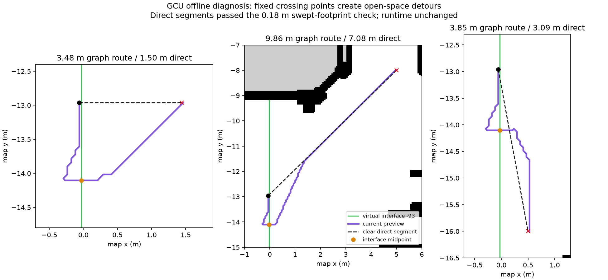

# GCU route quality and paper implementation audit

## Quick summary

- **Finding:** The v1 preview forced midpoint detours: 3.484 m for a clear 1.500 m query. The v2 follow-up now returns the direct validated route.
- **Cause:** A broad virtual corridor interface is reduced to one fixed crossing near its midpoint, with two extra offset anchors; eight-connected raster paths add smaller directional artifacts.
- **Paper fidelity:** The passage-graph idea is implemented, but our prototype is not a complete reproduction of either author runtime. Additional algorithm differences are listed below.
- **Status:** Bounded follow-up passed 47 unit tests, 10 offline and 15 live preview cases; the user confirmed the v2 display. Exact author-runtime parity remains unclaimed; passage-driven motion is Phase 06.

Date: 2026-11-06. Related: [Phase 05 record](phases/05_GCU_OSMAG_ROUTE_PREVIEW_AND_RELIABLE_HANDOFF.md), [plan](plans/05_GCU_OSMAG_ROUTE_PREVIEW_AND_RELIABLE_HANDOFF.md).

## Follow-up outcome (2026-11-06)

The [Phase 05 v2 record](phases/05_GCU_OSMAG_ROUTE_PREVIEW_AND_RELIABLE_HANDOFF.md#route-quality-follow-up-v2-2026-11-06) documents the completed bounded repair. Refined short/diagonal/down paths are 1.500/7.085/3.091 m instead of graph-reference 3.484/9.861/3.852 m. Refinement checks physical clearance, ordered area/interface crossings and closures. It cannot shortcut a disabled virtual interface merely because the raster is clear.

The 16 redundant interface-pair edges are now excluded. Parent compact graphs recursively summarize cached children, multi-source endpoint costs propagate level by level, and hierarchy query failure can use validated global passage-graph A*. The two-offset-anchor baseline remains our conservative adaptation. The geometric refinement is a labelled extension; neither reproduces unreleased author source or proves a global continuous optimum.

The sections below preserve the **initial v1 diagnosis and legacy-repository review**. Their measurements and original source snapshots are retained. Current source and updated evidence are in the v2 record; initial phrases about missing functionality refer to v1.

## What was inspected

The supplied annotated `2309.04791v1.pdf` is *osmAG: Hierarchical Semantic Topometric Area Graph Maps in the OSM Format for Mobile Robotics*. Relevant material is Section IV, Figure 8 and IV-A, printed pages 5–6. Its [public version](https://arxiv.org/html/2309.04791v1#S4) describes leaf-area raster A*, temporary start/goal attachments and a passage graph, and rejects routing costs through area centroids.

The local `osmAGNAV.pdf` is *osmAG-Nav: A Hierarchical Semantic Topometric Navigation Stack for Robust Lifelong Indoor Autonomy*, arXiv:2603.28271v1. Relevant sections are 5.2–5.4, Algorithms 1–2 and Figures 4–5 (printed pages 16–20), plus the path-overhead table on page 28. The [public version](https://arxiv.org/html/2603.28271v1#S5) explicitly uses passage centers and says raster costs do not represent exact continuous-space distances. Its benchmark reports positive path-length overhead against Grid A*; it does not establish globally shortest continuous trajectories.

The PDF figures and complete relevant text were inspected. Document content was treated as source material, not execution instructions. Source availability and the user's earlier approval of a labelled paper-based implementation remain as recorded in the [source audit](../../../simulation/gcu_ground_floor/phase5_diagnostics/source_audit.json).

## Reproduced cause of the bend

The existing accepted adjacent-sector query starts at approximately `(-0.05864, -12.96031)` and ends at `(1.44136, -12.96031)`. The straight line is 1.500 m. The original conservative swept-circle checker confirms it is clear for the 0.18 m radius; it also stays inside the union of the selected route's sectors.

The query crosses interface `-93`, a roughly 9.85 m virtual dividing segment at `x = -0.02932`, extending from `y = -19.02996` to `-9.17778`. The direct line crosses it at `y = -12.96031`. Our `center_crossing()` instead selects its midpoint near `y = -14.10387`, about 1.14 m away along that open interface.

It then creates anchors at approximately `(-0.26797, -14.10387)` and `(0.20932, -14.10387)`: one in each incident sector, each offset by `radius + resolution = 0.23864 m`. The assembled route must visit both anchors before continuing to the goal. This causes the backward/sideways bend even though the underlying occupancy map is clear. The code is in [anchor construction](../../../scripts/osmag_paper_planner.py#L112) and [expanded route assembly](../../../scripts/osmag_paper_planner.py#L201).

The green line in the standard preview is an admitted interface marker. It represents a topological transition; it is not itself physical wall geometry. A screenshot alone does not supply an exact map-frame goal. The checks below reproduce the same detour mechanism on declared GCU queries rather than claiming to recover the precise screenshot coordinates. A read-only live capture during this audit found no retained current preview messages; no new goal or motion command was sent.

| Offline query | V1 graph route | Clear direct segment | Fixed-center-only diagnostic |
| --- | ---: | ---: | ---: |
| Short adjacent sector | 3.484 m | 1.500 m | 3.007 m |
| Diagonal adjacent sector | 9.861 m | 7.085 m | 9.053 m |
| Downward adjacent sector | 3.852 m | 3.091 m | 3.113 m |
| Same sector | 3.962 m | 3.835 m | Not applicable |

The center-only column is a diagnostic polyline via the same interface midpoint, without our normal-offset anchors. It is not a run of the authors' code. It separates the effect of the fixed-center abstraction from the extra overhead introduced by our anchors/raster connections.



The [raw results](../../../simulation/gcu_ground_floor/phase5_diagnostics/route_quality_audit/results.json) retain route points, direct-segment clearance checks, actual crossings, source/map hashes and independent flat-graph costs.

## What “shortest” means here

For the audited cross-sector queries, SciPy's independent Dijkstra search returns exactly the same cost as our hierarchy query on the **same constructed graph**. That establishes agreement for those cases. It does not make the constructed graph an exact model of every possible continuous path.

A* cannot choose a free crossing location that is absent from its graph. It must use the stored anchors. In an obstacle-free sector, eight-connected grid A* can also produce horizontal/vertical/diagonal stair steps and small endpoint connector bends, without any hidden physical obstacle. No line-of-sight string pulling or continuous portal-crossing optimization was implemented in the v1 preview.

The purple v1 `/osmag/global_path` was a proposed geometric route; v2 publishes that reference on `/osmag/graph_path` and refined geometry on `/osmag/global_path`. Phase 05 does not execute it, so a bend in this path is not a recorded robot trajectory or a result of controller heading correction.

## Comparison with the papers

| Component | Authors' described method | V1 prototype / initial finding |
| --- | --- | --- |
| Area centers | 2023 Figure 8 rejects area-centroid detours; calculate passage-to-passage costs with local raster A*. | We already avoid area-centroid routing. The observed bend is tied to a **passage midpoint**, a different issue. |
| Passage state | 2026 Section 5.2 places passage vertices at geometric centers. | Two offset states per admitted interface and a fixed normal crossing, chosen nearest the midpoint. This is our conservative adaptation and adds overhead. Even an exact passage-center model can detour across a wide virtual opening. |
| Local raster | Rasterize the leaf polygon; 2026 reports 0.1 m resolution and geometry-aware grid cost. | Clip the supplied full-floor PGM to each leaf, add conservative footprint inflation and use about 0.05864 m cells. Costs/traces and exclusions consequently differ. |
| Redundant interfaces | Algorithm 1 skips pairs representing the same adjacent-area interface. | Our pair loop does not apply that filter. The audit enumerates candidate pairs and which corresponding edges are present. This is a fidelity gap, not established as the cause of the pictured bend. |
| Hierarchical lift | Recursive multi-source Dijkstra on cached leaf compact graphs and parent lift graphs, then common-parent compact A* and expansion. | `within()` searches the underlying child-subtree graph and caches those traces; `lift()` directly summarizes to the LCA child frontier. It is a reference cost-summary implementation, not the exact recursive parent-lift mechanism. GCU's floor-plus-leaves hierarchy cannot validate the full multi-level runtime method. |
| Hierarchy failure | Algorithm 2 falls back to global passage-graph A* if key hierarchy stages fail. | No explicit global graph fallback is implemented in the preview. Adding a validated graph fallback is distinct from creating unchecked geometric connections. |
| Failed raster search | The published 2026 method has a Euclidean fallback. | We intentionally reject/exclude unvalidated connections; adopting an unchecked straight edge would invalidate our footprint contract. Keep this difference explicit. |
| Floor/vertical policy | Same-floor filtering and explicit vertical transition costs. | Single ground-floor prototype; multi-floor policies are not implemented or certified. |
| Runtime execution | Section 5.4 publishes the topological route and dispatches passage-centered `NavigateToPose` goals with continuous handoff. | Deferred to Phase 06. The old independent metric executor is tested; the osmAG preview sends no navigation actions. |
| Rolling maps / localization | Sections 5.1 and 6 describe the rolling raster and structure-based localization. | Deferred to Phases 07–08; whole-floor raster and AMCL baseline remain. |

We cannot confirm exact author-runtime equivalence. The earlier statement that Phase 05 was complete referred to its bounded functional checks. The test set verified safe geometry, graph-cost agreement and process reliability, but did not require short open-space routes to approach the direct feasible lower bound. That was a route-quality acceptance gap. The original passing measurements remain valid; the broader planner-quality claim requires this follow-up.

## Recommended correction boundary

1. Keep an explicit author-aligned baseline: passage-center states/costs, redundant-interface filtering, recursive parent-lift caches and the validated global-graph fallback. Record intentional raster/footprint differences and unreleased-source limitations.
2. Distinguish real doorways from virtual corridor partition seams. Large arbitrary seams amplify fixed-center detours. Review whether each seam is needed as a leaf-area transition.
3. Add a separately labelled geometric refinement, such as collision-checked string pulling through the permitted area/portal corridor or optimization of crossing positions along virtual openings. A center-based route may remain the topological reference while the execution geometry is refined.
4. Preserve passage IDs, ordering, closures, forbidden holes and footprint clearance during refinement. A global straight-line bypass on the PGM alone is insufficient: with `-93` disabled, that same 1.500 m line remains physically clear but crosses a closed interface. The current graph correctly finds a long alternate route instead.
5. Add route-quality acceptance cases: clear direct connection, wide virtual interface, same-sector grid stair steps, a real narrow doorway, a blocked shortcut, courtyard exclusion and a closed passage. Compare both graph cost and physically feasible length, then assess actual motion in Phase 06.

Neither paper mandates a funnel smoother, so introducing one must be labelled as an implementation refinement rather than a recovered author component. No planner behavior, runtime file or historical acceptance archive was changed by this audit. The analysis used offline geometry only; no motion suite was started.

Reproduce from the repository root with the CAD Python environment:

```bash
docs/research/osm-AG/osm_cad_pipeline/osmAG-from-cad/venv/bin/python \
  scripts/audit_gcu_route_quality.py \
  --output /tmp/gcu_route_quality_repeat_01
```

The output directory must be new. Running the current audit uses v2 and displays both graph and refined geometry. The linked original results remain v1; reproduce their exact source using the frozen snapshot. The audit checks a clear shortcut, a blocked courtyard and the closed-interface counterexample without enabling motion.

## Follow-up: review of `osm_ag_2` (2026-11-06)

**Useful findings exist, but the old folder does not contain a complete fix for the broad-interface detour.** The review inventoried 1,180 non-Git files, 46 project source files, 11 OSM assets and 32 gallery images. It examined the planner, raster/A* code, generator/merging/export code, command history, README, earlier analysis, map assets and representative saved outputs. Generated build files and the bundled TinyXML2 library are not additional planning algorithms. The Stage 5 documentation links to the separately located ROS2 wrapper, which was inspected too. The nested repository remains unchanged at `a4c386f94c18cdf343003ca587a181b8b9765472`.

The [review evidence](../../../simulation/gcu_ground_floor/phase5_diagnostics/route_quality_audit/legacy_repo_review.json) records source hashes, map statistics and a small compiled legacy-A* probe. The old standalone driver was not rerun on GCU: its fixed endpoint IDs and older parser/schema need an adapter for a fair same-input comparison, and the driver writes images into the historical results folder.

### What can help

- **A single center state per passage.** [TraversePassage](osm_ag_2/osm_ag_repo/osmAG/src/data_load_save.cpp#L182) averages the two passage endpoints. [Find_PathInArea](osm_ag_2/osm_ag_repo/osmAG/src/path_graph.cpp#L159) searches between those centers; it does not add our two normal-offset anchors. This provides an author-code baseline for reducing the *additional* anchor overhead. It still fixes the crossing at the midpoint: the already measured GCU center-only diagnostic is about 3.007 m versus a 1.500 m clear direct segment, so this change alone does not remove the whole detour.
- **Redundant-interface filtering.** [The old pair loop](osm_ag_2/osm_ag_repo/osmAG/src/path_graph.cpp#L151) skips passage pairs with the same incident-area pair. This is directly useful for the fidelity gap identified above, although it does not free a crossing location along a wide opening.
- **Leaf-area raster and cached intra-area traces.** [area_grid_map.h](osm_ag_2/osm_ag_repo/osmAG/include/area_grid_map.h#L38) and [trajectory assembly](osm_ag_2/osm_ag_repo/osmAG/src/data_load_save.cpp#L275) provide a concrete older reference for polygon rasterization and stitching passage-to-passage traces. This is useful for an author-aligned baseline; it is still eight-connected grid planning rather than continuous portal optimization.
- **Merging cells belonging to the same region.** [mergeAreas](osm_ag_2/osm_ag_repo/ag_osm_generator/src/roomGraph.cpp#L51) and `mergeRoomCell()` group cells with a common room ID and remove internal transitions. That is a useful direction for unnecessary virtual corridor seams, subject to correct area identities. It is not a validated rule to merge arbitrary GCU rooms or erase real door closures.

### Why older paths can look straighter

There are two different old entrypoints, and neither is the same test as the current arbitrary-pose GCU preview:

1. **Standalone Stage 4:** [the driver](osm_ag_2/osm_ag_repo/osmAG/src/data_load_save.cpp#L1005) plans between two existing passage IDs, `-125384` and `-125433`. It does not exercise attaching an arbitrary robot pose just beside a broad virtual sector interface. Those IDs exist in `shanghaitech_merge_v1.osm`, whose passage lengths are about 0.89–2.48 m. Neither ID exists in the current GCU map. Some saved images reflect other historical source/data variants; the current hardcoded driver cannot reproduce every image with the same IDs.
2. **Linked ROS2 Stage 5:** [GoalCallback](../../../lidarbot_ws/src/lidarbot/lidarbot_osmag/src/osmag_planner_node.cpp#L199) interpolates a straight start-to-goal line whenever distance is at most 5 m **or** both points select the same nearest passage. This branch bypasses passage-graph planning and contains no occupancy, swept-footprint or passage-closure validation. It can explain straight local previews in that wrapper, but there is no per-click historical log proving which branch produced each saved screenshot. The useful idea is a *validated* direct connection, not restoring its unchecked distance rule.

The map-generation conventions differ too. [The old generator](osm_ag_2/osm_ag_repo/ag_osm_generator/src/Area_osm.cpp#L186) exports a small two-pixel horizontal segment around a detected connection point. In saved `big_map_7.osm`, all three passages are about 0.10 m long; GCU preserves shared interface geometry, including the approximately 9.85 m seam in the detour. Consequently, those old map pictures are not a controlled comparison of the same map and endpoint query. Artificially shrinking a GCU portal is not a justified geometry correction.

No funnel algorithm, line-of-sight path refinement, string pulling or free crossing-position optimization was found in the project planner sources. The visualization draws lines between the supplied waypoints; it does not optimize them. Polygon/keypoint simplification in the generator is map processing, not route smoothing.

### Why not switch back wholesale

A compiled test of the unchanged old `AStarCalc` used a free 12-by-5 grid, from `(1,2)` to `(9,2)`, with orthogonal step cost 10. It returned nine path points, whose eight steps total **80**, while reporting cost **10**. In [calcG](osm_ag_2/osm_ag_repo/osmAG/src/astarcal.cpp#L164), accumulation reads the destination point's existing parent; a newly discovered point's parent is still null when `calcG` is called. The parent assignment occurs afterward. Thus the returned edge cost is not a reliable sum of its path steps. This does not show that every old displayed path is wrong, but it prevents treating attractive saved paths as evidence of shortest-path correctness.

The old code also uses straight center-to-center fallbacks after some failed searches. Those would need independent geometry and closure validation before any execution reuse.

**Recommended reuse:** take the center-state baseline, duplicate-interface filter and relevant raster/merge logic; add a physically and semantically validated direct/refined route for the current wide virtual seam; keep the current rejection, footprint and closure guarantees. The old folder helps identify what to change, but does not supply an already verified drop-in solution. No source code or runtime behavior was changed during this review; the only execution was the tiny isolated C++ A* diagnostic on the Mac.
