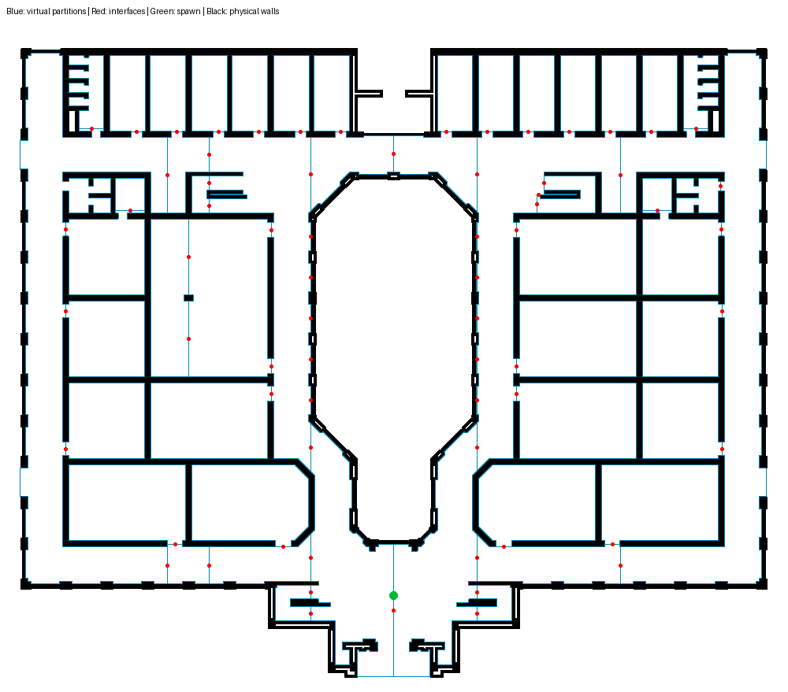

# GCU simulation readiness: map adapter and world assets

This step prepares the accepted ground-floor CAD result for the existing ROS 2
code and generates an aligned Gazebo world. It does **not** claim a completed
navigation experiment. The macOS host controls the existing Ubuntu 22.04 UTM
VM for ROS 2 Humble / Gazebo Fortress tests; results are recorded below.

## Current checkpoint (2026-11-01)

Phase 03 is finalized for bounded simulation checks: corrected sensor geometry,
stationary AMCL, local pose-prior recovery, direct-controller watchdog stopping and
three fresh-spawn short motion repeats were measured. The user reproduced motion
with Foxglove. The final five-case suite passed; all isolated test launches stopped
cleanly. One strict grazing-edge scan discrepancy remains a qualified limitation.
Autonomous navigation, contact validation, global recovery and Pi evaluation are
not complete.

Phase history is collected in [phases/README.md](phases/README.md). The current
achievement record is [Checkpoint 03](phases/03_GCU_LOCALIZATION_AND_CONTROLLED_MOTION.md),
with evidence, exact commands and limitations. The detailed work log retains earlier
failures and historical status updates. Next is footprint-feasible autonomous
navigation, then osmAG segmented execution.

## What the previous work contributed

`area_graph_1` provides the earlier GCU raw/pruned Voronoi diagnostics and the
same core Voronoi/alpha-shape approach. It helped identify that the courtyard was
already excluded from the pruned graph. It does not provide a ready GCU Gazebo
world or a hole-aware ROS loader. Its image-based segmentation is not substituted
for the accepted CAD pipeline.

The existing ShanghaiTech generators and `gz_launch.py` provided useful SDF and
bringup patterns. The older generators infer walls from area boundaries, which
would incorrectly turn our virtual region/sector seams into physical walls.
The new generator uses the occupancy image for physical collision geometry.

## Why an adapter is needed

The accepted map contains 34 reconstructed regions, including two multipolygon
areas, and 35 polyline interfaces. The older ROS loader accepts only simple area
ways and exactly two nodes per passage. It also did not resolve canonical named
area/parent references correctly.

`scripts/prepare_gcu_simulation.py` therefore:

1. Splits hole-bearing areas into simple sectors without filling or discarding
   their holes. The union is checked against the original geometry.
2. Preserves source-region identity in `source:area`, names the main corridor
   sectors as corridors, and adds one containing floor structure.
3. Derives shared boundaries, selects straight passage spans, and inserts their
   endpoint nodes into both adjacent area rings as consecutive shared edges.
4. Exports canonical named references plus an optional legacy numeric-reference
   copy. Neither contains area relations.
5. Extrudes exact black occupancy cells into coalesced rectangular wall boxes.
   No wall is created from a room/sector seam. Wall height is an explicit 2 m
   simulation assumption, not a measured CAD elevation.
6. Writes a matching PGM/YAML map with pixel-edge origin and the same physical
   scale/root frame. Exterior/unseeded space is unknown, not free.
7. Chooses a high-clearance corridor spawn instead of spawning at the root, which
   lies in the courtyard.

The resulting **59 traversable sectors are not 59 semantic rooms**: they represent
subdivisions of the original 34 regions. There is one additional floor container
and 68 two-node passage connections. The leaf graph is connected. All sectors have
simple, non-overlapping geometry and the courtyard remains outside their union.

## Generate or regenerate

From the project root, using the existing CAD pipeline environment:

```bash
docs/research/osm-AG/osm_cad_pipeline/osmAG-from-cad/venv/bin/python \
  scripts/prepare_gcu_simulation.py

docs/research/osm-AG/osm_cad_pipeline/osmAG-from-cad/venv/bin/python \
  -m unittest discover -s tests -p test_gcu_simulation.py
```

The default input is the accepted trial-12 manifest. Override `--manifest` and
`--output` to use another validated floor. The script currently identifies the
accepted map's `room_1` as the corridor; adapting another map also requires checking
that semantic identification. `--gazebo-api fortress` is the default, matching the
existing `ros_ign_gazebo` launch; use `--gazebo-api gz` for a compatible newer Gazebo
installation. Do not mix system-plugin names across those versions.

Generated files are in `simulation/gcu_ground_floor/`:

| File | Purpose |
| --- | --- |
| `gcu_ground_floor.osm` | Canonical, named-reference simple-way map |
| `gcu_ground_floor_legacy.osm` | Same geometry, numeric references for comparison |
| `gcu_ground_floor.sdf` | Static physics/visual world; 830 coalesced wall boxes |
| `gcu_ground_floor.pgm`, `.yaml` | Matching Nav2 occupancy map |
| `regions_pixels.geojson` | Sector geometry in image pixels; not WGS84 |
| `alignment_preview.png` | Physical walls, virtual partitions, interfaces and spawn |
| `readiness_report.json` | Counts, origin, spawn, clearance warnings and runtime status |



Blue boundaries are **virtual** partitions. Red points are passage interfaces.
Black pixels are the physical walls; the green marker is the proposed spawn.

## ROS loader changes

`lidarbot_osmag/src/osmAG/data_load_save.cpp` now resolves canonical area names
and parent references after all areas are parsed, while retaining legacy numeric
references. It rejects missing/duplicate references, self-parenting and hierarchy
cycles, guards malformed/empty polygons, and refuses unsupported area relations
rather than silently dropping a courtyard-bearing area.

`osmag_map_check` is a new offline CLI linked against the real C++ loader. It
checks shared passage edges, valid references, connected leaf topology, and
optionally that the root is excluded from every traversable sector. It sends no
robot commands. It was compiled and run successfully in the Ubuntu UTM VM on 2026-10-31.
Both canonical and legacy maps passed: 60 areas, 59 traversable sectors and
68 passages. The navigation node also compiled successfully.
The package CMake manifest is now exempted from the repository's broad `*.txt`
ignore rule so it can be included with these changes.

### Gate 1: build and parse on the Linux ROS 2 machine

From the project root on the ROS 2 Humble machine:

```bash
source /opt/ros/humble/setup.bash
cd lidarbot_ws
colcon build --packages-select lidarbot_osmag --symlink-install
source install/setup.bash
cd ..
ros2 run lidarbot_osmag osmag_map_check \
  "$PWD/simulation/gcu_ground_floor/gcu_ground_floor.osm" \
  --expect-root-excluded
```

Expected: 60 areas total, 59 traversable sectors and 68 passages, then `PASS`.
A successful parser check is not yet a collision-free route or Nav2 test.

### Gate 2: validate and view the world

On the Fortress machine, check the SDF first:

```bash
ign sdf -k simulation/gcu_ground_floor/gcu_ground_floor.sdf
```

After the existing robot packages have been built and their workspace sourced,
launch **the world/robot only**, without the osmAG navigation node:

```bash
ros2 launch lidarbot_gz gz_launch.py \
  world:="$PWD/simulation/gcu_ground_floor/gcu_ground_floor.sdf" \
  x_pose:=-0.05864395131342248 \
  y_pose:=-12.960313240266368 \
  z_pose:=0.15 yaw_pose:=0.0 use_robot_localization:=false
```

These spawn values come from the generated report. If regenerating for another
floor, use its own values. Verify robot scale, collision walls, open doorways,
LiDAR `/scan`, simulation clock and odometry. Then overlay the metric map and
semantic boundaries in RViz and confirm the coordinate alignment.

## UTM rendering profile

The tested sensor configuration uses Ogre 1 with software rendering. Generate a
separate VM profile (run this from the project root with the Python dependencies
installed), then point the existing robot launch at that SDF:

```bash
python3 scripts/prepare_gcu_simulation.py \
  --render-engine ogre --output /tmp/gcu_ground_floor_utm
export LIBGL_ALWAYS_SOFTWARE=1
export LIBGL_DRI3_DISABLE=1
source /opt/ros/humble/setup.bash
source /home/ubuntu/lidarbot_ws/install/setup.bash
ros2 launch lidarbot_gz gz_launch.py \
  world:=/tmp/gcu_ground_floor_utm/gcu_ground_floor.sdf \
  x_pose:=-0.05864395131342248 y_pose:=-12.960313240266368 \
  z_pose:=0.15 yaw_pose:=0.0 use_robot_localization:=false
```

Run from a terminal **inside the logged-in Ubuntu desktop**, which supplies
`DISPLAY` and `XAUTHORITY`. A guest-agent or SSH session does not automatically
inherit those values. The default export remains Ogre 2; this option explicitly
selects the renderer that passed the UTM test. The automated VM test used a
separate ROS domain (77) and Gazebo partition and stopped its launch afterwards.

## What passed locally and in UTM

On 2026-10-31, an isolated `/home/ubuntu/edgeosmag_test_ws` was created in the
existing Ubuntu 22.04 ARM64 VM (ROS 2 Humble, Fortress 6.16.0, four vCPUs,
approximately 4 GB RAM). The previous robot workspace was used as an installed
dependency and was not modified.

- Release build of `lidarbot_osmag`: passed (12.3 seconds).
- Actual C++ loader/checker, canonical and legacy exports: passed.
- `ign sdf -k`: `Valid.`
- Headless world physics, 200 iterations: exited successfully.
- Stationary robot/sensor bringup: passed with Ogre 1 and the logged-in Ubuntu
  desktop session. Simulation clock, LiDAR, odometry and camera calibration
  messages and 640×480 RGB camera images were received. The final probe recorded
  225 clock messages, 3 scans, 47 odometry messages and 7 camera images.
  No velocity commands were sent.
- Ogre 2 without a desktop connection failed graphics initialization (EGL/device
  access and OpenGL errors); Ogre 1 without a working X display also failed.
  These were renderer/session failures, separate from map validation.
- Autonomous navigation: not tested.

Evidence: [`test_summary.json`](../../../simulation/gcu_ground_floor/utm_test_results/test_summary.json),
[`sensor_probe.json`](../../../simulation/gcu_ground_floor/utm_test_results/sensor_probe.json),
and [`build.log`](../../../simulation/gcu_ground_floor/utm_test_results/build.log).

These VM observations are separate from the generated `readiness_report.json`,
which records static checks and deliberately does not assert a complete runtime test.


Four Python tests exercise hole-preserving partitioning, exact collision-mask
coverage, passage endpoint insertion, and the complete GCU artifact contract.
The GCU integration checks all named references, shared boundary nodes, containment,
non-overlapping leaf geometry, the excluded courtyard, connected topology, SDF
wall counts and the spawn/map registration. The original accepted CAD artifacts
are unchanged.

## Navigation gate remains open

The current Nav2 configuration uses a 0.18 m robot radius. Eleven inferred
interfaces have midpoint wall clearance below that radius; the smallest measured
midpoint clearance is about 0.059 m. Some arise from sectorization near small
obstacles. These interfaces must not be assumed traversable by the robot simply
because the point-based topology is connected. The report lists them.

Before autonomous motion, validate passage approach points and complete paths
against a footprint-inflated metric map; exclude or reroute infeasible connections.
The existing planner node also has a straight-line fallback when planning fails.
That must be removed or collision-validated before using it for GCU motion.
Do not launch `sim_osmag_bringup.launch.py` with GCU and start issuing goals yet.

The navigation phase should then implement/test the osmAG-Nav segmented
`NavigateToPose` execution architecture. The present `FollowPath` bridge is a
baseline, not a completed replication of the paper's rolling-window stack.

For research, this step establishes an auditable map-to-simulator conversion and
exposes the overhead of simple-sector compatibility (34 regions → 59 sectors).
It is engineering evidence, not yet a demonstrated novel efficiency result.


## References used for the integration boundary

- Local `osmAGNAV.pdf`, sections 3–5 and 7: canonical areas/passages, hierarchy,
  segmented execution and runtime interfaces.
- Local `docs/research/osm-AG/osm_ag_2/osmAG.pdf`, section III: closed area ways and
  shared passage nodes.
- [Official Fortress SDF world examples](https://gazebosim.org/docs/fortress/sdf_worlds/):
  SDF world structure and Fortress system-plugin names.

## GUI flickering investigation (2026-10-31)

The user observed wall flickering in the Ogre 1 GUI. The VM's Ogre log identifies
`llvmpipe (LLVM 15.0.7, 128 bits)`: rendering is performed by the guest CPU.
The generated 830 wall boxes are static, have no duplicates, and have no meaningful
volume overlap (sum of footprints minus union is approximately 3.7e-11 m² from
rounding). The supplied server log shows successful startup and user Ctrl-C,
not a spontaneous server crash. The Wayland warning alone does not diagnose flicker.

The leading hypothesis is GUI / Mesa / VM rendering, pending a visual A/B test.
Gazebo [issue #1492](https://github.com/gazebosim/gz-sim/issues/1492) describes
similar VM flickering and reports disabling anti-aliasing as a workaround.
`gui_utm.config` is a copy of Fortress's installed GUI profile with Ogre 1 and
`<anti_aliasing>0</anti_aliasing>`; it does not change walls, collisions or sensors.
Its effectiveness on this VM is **not yet visually confirmed**.

Keep the world server running using the earlier command. Close the previous GUI
and run this in an Ubuntu desktop terminal:

```bash
source /opt/ros/humble/setup.bash
export IGN_PARTITION=gcu_visual_test
export LIBGL_ALWAYS_SOFTWARE=1
export LIBGL_DRI3_DISABLE=1
QT_QPA_PLATFORM=xcb ign gazebo -g --render-engine ogre \
  --gui-config /home/ubuntu/edgeosmag_test_ws/assets/gui_utm.config
```

The profile has already been copied into the isolated VM test assets. For a fresh
checkout, use the repository's `simulation/gcu_ground_floor/gui_utm.config` path.
If flickering persists, compare an installed `shapes.sdf` example with the same
renderer/profile in a separate partition. If that also flickers, the fault is
independent of the CAD world. Do not change segmentation parameters to address it.

### Follow-up: anti-aliasing workaround failed (2026-11-01)

The user still observed flickering with `gui_utm.config`, then the shell printed
`Killed` on two GUI launches. Disabling anti-aliasing is therefore **not a verified
fix on this VM**. `Killed` indicates forced process termination; the Wayland
warning does not explain its cause. Guest diagnostics found approximately 3 GB
available RAM and 4 GB unused swap after reboot, and no historical OOM kill
matching the incident. This does not prove what memory usage was at termination.
Do not disable OOM protection or upgrade graphics drivers without further evidence.

To isolate rendering from CAD geometry, stop the GCU launch and GUI, then run the
installed stock example in an Ubuntu desktop terminal:

```bash
source /opt/ros/humble/setup.bash
IGN_PARTITION=gcu_shapes_diagnostic \
LIBGL_ALWAYS_SOFTWARE=1 LIBGL_DRI3_DISABLE=1 QT_QPA_PLATFORM=xcb \
ign gazebo -r /usr/share/ignition/ignition-gazebo6/worlds/shapes.sdf \
  --render-engine ogre \
  --gui-config /home/ubuntu/edgeosmag_test_ws/assets/gui_utm.config
```

Observe whether this scene flickers too. If killed again, immediately run
`echo $?` (137 is consistent with SIGKILL), then inspect
`journalctl -k -b --no-pager | tail -80` and
`journalctl -u systemd-oomd -b --no-pager | tail -40`.
A stock-world flicker would isolate the problem from the CAD conversion. A stable
stock world would instead justify checking GCU scene complexity and GUI settings.

The automated stock-world GUI check remained alive for 20 seconds and stopped
cleanly (exit 0). This checks process survival only; visual flickering was not
measured, so the user observation below remains necessary.

## Working headless server and Foxglove connection

In an Ubuntu desktop terminal (keep the desktop logged in for the tested Ogre
sensor context), start the simulator without the Gazebo GUI:

```bash
source /opt/ros/humble/setup.bash
source /home/ubuntu/lidarbot_ws/install/setup.bash
export ROS_DOMAIN_ID=77
export IGN_PARTITION=gcu_foxglove
export LIBGL_ALWAYS_SOFTWARE=1
export LIBGL_DRI3_DISABLE=1
ros2 launch lidarbot_gz gz_launch.py \
  world:=/home/ubuntu/edgeosmag_test_ws/assets/gcu_ground_floor_ogre.sdf \
  x_pose:=-0.05864395131342248 y_pose:=-12.960313240266368 \
  z_pose:=0.15 yaw_pose:=0.0 use_robot_localization:=false
```

The `gz_launch.py` server already uses `-s`. Do not open `ign gazebo -g` for this
workflow. The `_ogre.sdf` is the isolated VM copy with its Sensors engine set to
Ogre 1; on another machine generate it with `--render-engine ogre` as above.

In a second Ubuntu terminal, install the bridge once if needed with
`sudo apt install ros-humble-foxglove-bridge`, then run:

```bash
source /opt/ros/humble/setup.bash
source /home/ubuntu/lidarbot_ws/install/setup.bash
export ROS_DOMAIN_ID=77
ros2 launch foxglove_bridge foxglove_bridge_launch.xml \
  address:=0.0.0.0 port:=8765
```

Use `hostname -I` in Ubuntu to find its address. In Foxglove on macOS, open a
Foxglove WebSocket connection to `ws://UBUNTU_IP:8765`; the confirmed session used
`192.168.64.2`, but that address may change. Keep both processes running while
starting the alignment launch below. Select `/camera/image_raw` in an **Image
panel**, not only as a layer in the 3D panel.

## Foxglove milestone: stationary map alignment

The user confirmed live Foxglove LiDAR visualization on 2026-11-01. The screenshot
still shows invalid `map` frame selectors and an unconfigured Image topic. Stock
Gazebo shapes also flickered, so use the headless server with Foxglove on macOS.

`scripts/gcu_foxglove_alignment.launch.py` adds the map server and lifecycle
manager, a wheel-velocity EKF providing `odom -> base_footprint`, and a temporary
known-spawn `map -> odom` transform. It sends no velocity commands. This is an
alignment diagnostic, not AMCL or ground-truth tracking. The EKF uses explicitly
supplied parameters rather than depending on installed parameter-file node names.

Prerequisites: the current simulator remains running with
`use_robot_localization:=false`, no other EKF/AMCL/map server is active, and all
terminals use the same ROS domain (77 in the headless instructions). Do not run
this alongside another publisher for either transform edge. Start after a fresh
simulator spawn if the robot has moved since startup.

The launch was copied to the isolated Ubuntu test workspace. In another Ubuntu
terminal:

```bash
source /opt/ros/humble/setup.bash
source /home/ubuntu/lidarbot_ws/install/setup.bash
export ROS_DOMAIN_ID=77
ros2 launch /home/ubuntu/edgeosmag_test_ws/gcu_foxglove_alignment.launch.py \
  map:=/home/ubuntu/edgeosmag_test_ws/assets/gcu_ground_floor.yaml
```

For a checkout elsewhere, use its `scripts/gcu_foxglove_alignment.launch.py` path
and its `simulation/gcu_ground_floor/gcu_ground_floor.yaml` map path. Python syntax
was checked locally; the new launch's runtime alignment remains to be verified.

In Foxglove, set fixed and display frames to `map`; enable `/map`, `/scan`, `/tf`
and `/tf_static`. Choose `/camera/image_raw` in the Image panel. No 3D Gazebo wall
meshes are published by this launch: the occupancy map provides the floor layout.

### Acceptance checks, in order

1. Map server reaches `active`; `/map` is visible and its resolution is
   0.05864395131342248 m/cell. Keep unknown courtyard/exterior distinct from free.
2. TF chain is `map -> odom -> base_footprint -> ... -> lidar_link`, without
   missing-frame, duplicate-parent or timestamp errors. Check with
   `ros2 run tf2_ros tf2_echo map lidar_link` from a sourced domain-77 terminal.
3. Stationary LiDAR aligns with occupied walls on both sides and ahead/behind;
   no consistent translation, rotation or mirrored geometry. Use approximately
   three cells (0.18 m) as an initial diagnostic tolerance on long flat walls,
   not a demonstrated navigation-accuracy result. Returns need not outline the
   entire building because of sensor range, occlusion and sampling.
4. Actual camera images update; clock advances; robot pose stays stable while
   stationary for 60 seconds. Record simulation time separately from wall time.
5. Save a Foxglove screenshot showing map plus scan, a camera screenshot, and
   the observed errors/gaps. Passing these closes the stationary visualization
   milestone, not the complete osmAG-Nav simulation milestone.

Then test localization (replace the fixed map->odom publisher with AMCL), controlled
motion and collision/doorway behavior, footprint-feasible metric routes, and finally
osmAG room-to-room segmented execution. The existing unsafe planner fallback and
11 narrow inferred interfaces must be addressed before autonomous route tests.
The final simulation milestone requires reproducible route trials with completion,
collisions, localization/goal errors and latency recorded; an attractive map overlay
alone is insufficient. These measurements provide a reproducible research baseline,
not yet evidence of a novel EdgeOsmAG contribution.

## Phase 03 investigation: sensor-plane correction

The stationary investigation found a physical model issue beyond the viewer
flicker: the caster collision was 2 mm below the drive-wheel contact plane.
Gazebo measured ~1.09 degrees forward pitch, making the LiDAR see the floor at
~6.57 m. The corrected support geometry keeps the model level; in a 60-second
Ogre 1 trial p95 scan/map range error fell from 2.14 m to 0.028 m. One grazing-edge
ray still fails the strict initial gate. A subsequent bounded stationary AMCL
smoke test passed with a nonzero-uncertainty prior; controlled motion remains
pending.
See the [phase 03 plan, measurements and corrected-model command](plans/03_GCU_LOCALIZATION_AND_CONTROLLED_MOTION.md).
The earlier Foxglove screenshots used the original model and remain historical
qualitative evidence, not sensor-accuracy acceptance.


Stationary AMCL is now available through `scripts/gcu_amcl.launch.py` with
`simulation/gcu_ground_floor/amcl.yaml` and its one-shot uncertain-prior helper.
Stop the entire fixed-transform alignment launch before starting it. The isolated
45-second smoke test passed with ~2.5 cm / 0.23 degree error relative to the known
spawn, nonzero pose covariance, active AMCL, dynamic map-to-odom TF and zero robot
movement commands. This is one stationary seeded trial, not recovery or navigation.
See the phase 03 plan for the tested Ubuntu command and full limitations.


## Latest phase 03 controlled-motion smoke test

A separate evaluation-only PosePublisher wrapper and `/gcu_ground_truth` bridge
now provide timestamped model truth without feeding navigation TF. The simulator
uses its own wheel-separation config (0.117 m effective collision-center separation),
leaving hardware parameters unchanged. AMCL's current motion profile uses 120
beams, 0.03 m/rad update triggers and 0.2 s transform tolerance.

One bounded isolated trial passed: 0.40798 m forward, 45.847 degree left turn,
zero reported post-settle drift, and p95 localization error 0.06844 m / 2.656 degrees
across 375 same-timestamp pose pairs. This is tuned single-trial evidence, not
recovery, contact validation, a watchdog test or autonomous navigation acceptance.
See the phase 03 plan for the reproduction commands and rejected earlier trials.


The user subsequently reproduced the same bounded motion test in Foxglove:
0.40798 m forward, 45.847 degree turn, p95 localization error 0.03862 m / 2.1756
degrees across 414 timestamp-matched pairs. The pasted report's metrics were
recomputed and confirmed; sampled recording frames show camera/view changes and
broad scan/map agreement. See the phase 03 plan for evidence. Recovery and watchdog
checks remain open; this does not close the full localization/navigation milestone.
