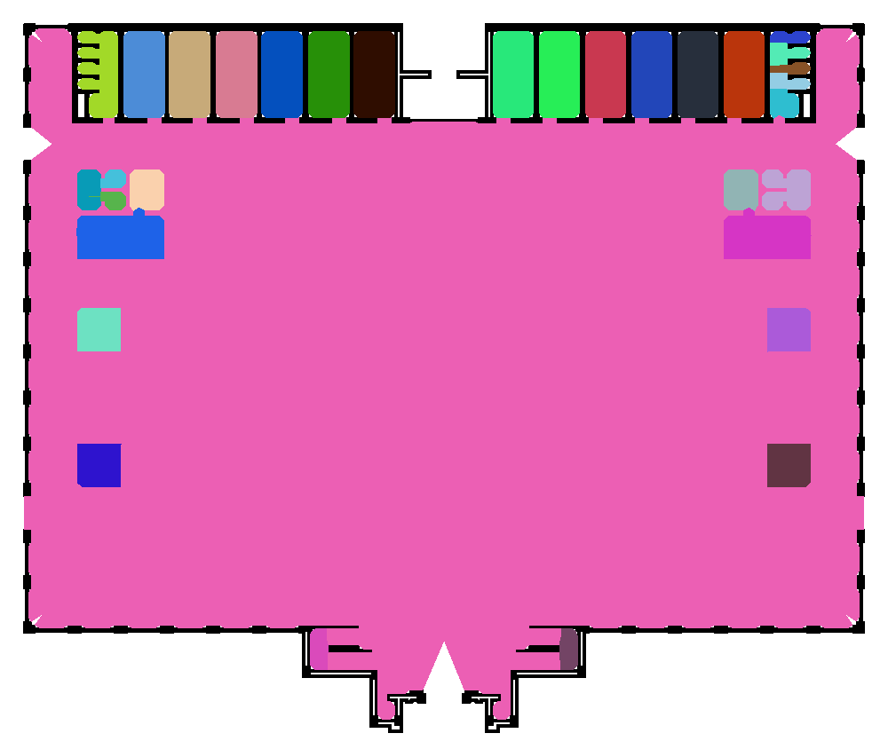
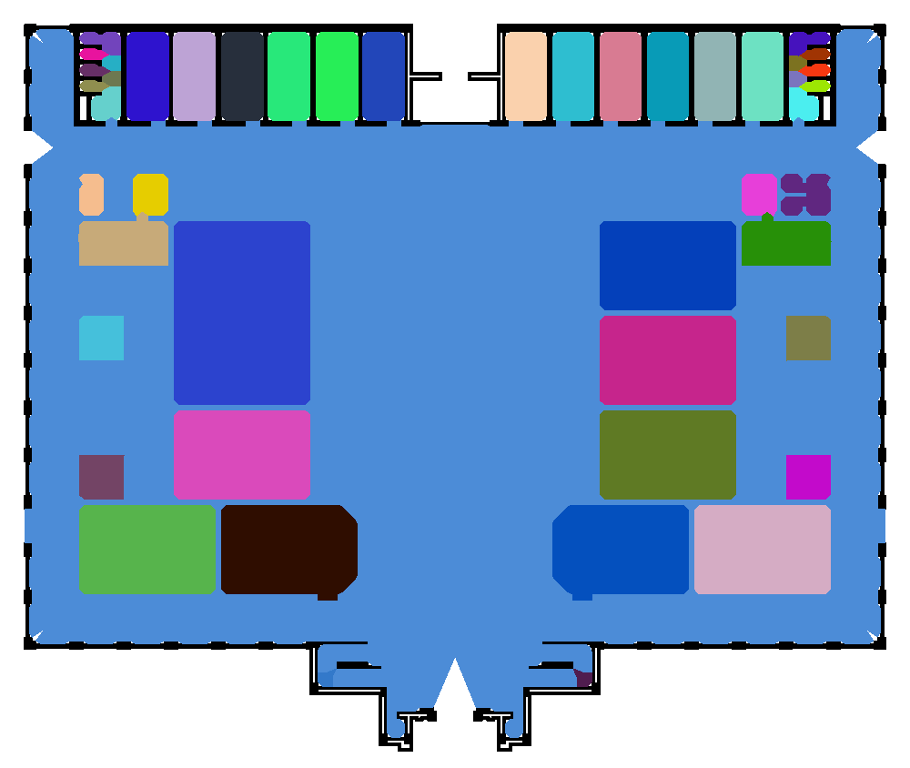
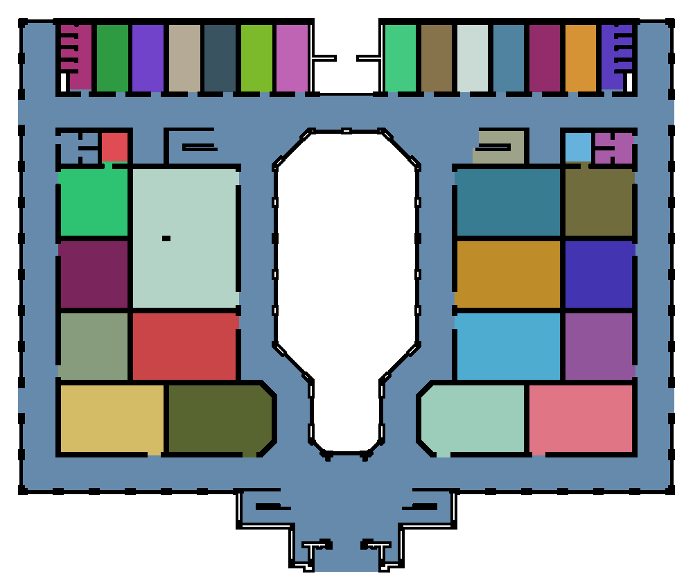

# GCU CAD-to-osmAG: accepted method and improvement record

The accepted result is retained in
`osmAG-from-cad/runs/local-cad/gcu_config_parameters_testing_12/`.
The historical trial name is kept so existing IDE tabs and links continue to work.
Use **`osmAG-from-cad/config/repro_gcu.yaml`** as the single GCU configuration.

## Before and after

These reference images are local CAD-derived artifacts in Git-ignored `runs/`;
they are intentionally not distributed on GitHub. Reproduction generates the
current after-image when the local source drawing is available.

### Original segmentation



At the original scale/threshold settings, many larger rooms were absorbed into a
large hall. The central enclosure was also painted as hall space.

### After parameter tuning, before geometry reconstruction



Fixed alpha 120 improved room separation, but the left/right side-room geometry
remained incomplete. Increasing alpha further or enabling wall filling did not
resolve the problem; wall filling removed many valid small-room detections.

### Accepted reconstruction



The six marked side-room sample points have distinct region labels, separate from
the corridor. The central enclosed white component is excluded. The corridor
remains connected around it. Colours identify regions; they are not semantic room
names or navigation costs.

## What was actually wrong

The Voronoi skeleton and the final filled map are different representations.
Tracing the current pipeline showed that the marked side rooms already had
separate labels before polygon reconstruction. The pruned skeleton also had no
path inside the central enclosure. The information existed upstream.

The later stages had several problems:

1. **Invalid edge lifetime:** an edge was deleted before its twin was read. This
   caused the original segmentation fault. Twin handling and endpoint splitting
   were corrected, with regression coverage.
2. **Incorrect area calculation:** the legacy boundary selector used a product of
   x coordinates rather than the shoelace cross product. A 10×10 square returned
   500, and translating it changed that to 2500 instead of keeping its area 100.
   The formula and empty-polygon handling were corrected.
3. **Lossy polygon reconstruction:** the legacy merger retained one selected
   boundary chain rather than reliably retaining holes and all region coverage.
   Some input faces were invalid. Fixing the area formula alone did not recover
   the missing rooms or central exclusion.
4. **Artificial barriers from filtering:** simply deleting small region basins
   could remove the free-space connection between a room and the corridor.
5. **Address-dependent cut ordering:** graph cuts were processed in heap-address
   order. This made later geometry sensitive to allocation differences. Cuts and
   twin orientation now use geometric ordering, with repeated-run checks.

These are findings about the local implementation. They do not establish the
provenance of defects in the original published release or invalidate its paper.

## How the accepted reconstruction works

The existing C++ Voronoi/alpha-shape detector is retained. An optional Python stage,
`reconstruct_regions.py`, replaces its lossy final face geometry:

```text
DXF layer filtering → SVG/bounds → occupancy PNG
  → Voronoi graph → pruning → room-labelled graph
  → growth of room labels through free pixels inside the building envelope
  → exact raster-cell polygons, including holes
  → shared region interfaces → osmAG export
```

- Four-neighbour growth cannot cross walls or cut diagonally through closed corners.
- The building envelope prevents propagation into exterior map space.
- Unseeded disconnected components remain excluded. This handles the central
  enclosure without a manually drawn forbidden polygon.
- Small basins lose their seeds and neighbouring labels regrow into their free
  pixels. Filtering does not create an artificial wall.
- Raster cells are polygonized with their full extent, rather than tracing only
  pixel centres. Adjacent regions therefore share boundaries exactly.
- Passage polylines follow those shared boundaries instead of connecting centroids
  through walls. They are inferred interfaces, not measured doorway widths.
- Areas with holes use **OSM multipolygon relations**, with outer and inner ways.
  Downstream readers must support these relations to retain the central exclusion.

The legacy native geometry is still available as an implementation option, but the
accepted GCU configuration enables reconstruction and discards its superseded
legacy output files after successful reconstruction.

## Accepted parameters

| Setting | Value | Purpose |
| --- | --- | --- |
| Retained DXF layers | `PDF_WALL-2,PDF_Column,PDF_Win,PDF_Railing` | Main-building structure |
| `preprocessing.target_size` | 1000 | Raster width for this drawing |
| `map_preprocessing.resolution` | 0.05864395131342248 m/pixel | Inch units and padded CAD bounds |
| `preprocessing.line_thickness` | 3 | Wall rasterization |
| Denoising / furniture removal / wall filling | Disabled | Preserve this clean drawing's structure |
| `area_graph.alpha.fixed_value` | 120 | Room-label separation |
| `geometry_reconstruction.enabled` | `true` | Select corrected output geometry |
| Small-region minimum | 5 m² | Remove tiny seeds, then regrow neighbours |
| `pipeline.keep_legacy_outputs` | `false` | Remove superseded native map/CSV outputs |
| `pipeline.keep_region_trace` | `false` | Remove verbose face-merging trace files |

The scale follows this DXF's `$INSUNITS=1` (inches):
`2308.816980843405 padded CAD units × 0.0254 / 1000 pixels`.
Recalculate it if the selected layers, padding or raster size changes.
`PDF_WALL-5` contains a separate drawing detail and is excluded from this main-building recipe.

Native polygon simplification/spike settings apply to the legacy exporter. They
are not applied to the accepted exact-cell reconstruction. Generic door/corridor
width settings do not select alpha while a positive fixed alpha is configured.

## Reproduce and inspect

Use [commands_simplified](commands_simplified) for the complete copy-paste sequence.
The main command, from `osmAG-from-cad/`, is:

```bash
./venv/bin/python run_pipeline.py --config config/repro_gcu.yaml \
  --case gcu_config_parameters_testing_12
```

Rerunning this case overwrites its generated outputs. The two saved before-images
under `references/` are retained. To try a new drawing/configuration, use a separate
case/output folder rather than overwriting the accepted GCU case.

The manifest identifies the selected output paths. In `area_graph/`, use:

| File suffix | Meaning |
| --- | --- |
| `_reconstructed_roomGraph.png` | Accepted colour map |
| `_reconstructed_osmAG.osm` | Accepted geographic osmAG export |
| `_reconstructed_room_areas.csv` | Accepted region areas in m²; no header row |
| `_reconstructed_regions.geojson` | Exact geometry in image-pixel coordinates, y downward |
| `_reconstructed_labels.npy` | Integer raster labels; 0 means unassigned |
| `_reconstructed_report.json` | Reconstruction counts and interpretation notes |
| `_voronoi_skeleton.png` | Raw graph, including unbounded-ray diagnostics |
| `_after_dead_end_removal.png` | Pruned graph before room detection |
| `stage_01_room_labels.csv` | Labelled graph segments used by reconstruction |
| `building_envelope.png` | Automatic exterior boundary mask |

Pixel-coordinate GeoJSON is a diagnostic, not a WGS84 GIS layer. Geographic
coordinates are in the OSM export. The manifest and effective configurations are
kept for reproducibility.

## Validation and remaining limits

The finalized, geometry-ordered build produces **34 regions and 35 passage
interfaces**. Three independent local executions produced identical label rasters
and byte-identical OSM files. Stabilizing the cuts changed small boundaries and
split one previously merged small region compared with the earlier accepted
33-region/33-interface run; the six marked rooms and central exclusion remain
correct. Region colours/IDs can therefore differ from the earlier screenshot.
`validation_report.json` records the final checks and OSM SHA-256. The repeatability
check does not establish bit-identical behavior across different compiler/platform
versions. Raw diagnostic source IDs may vary without changing canonical geometry.

Regression checks cover wall barriers, diagonal contacts, an unseeded central
component, small-basin regrowth, polygon-area translation invariance, hole export,
and passage interfaces incident to both adjacent polygons. GCU integration checks
verify the six room probes, corridor continuity, valid non-overlapping polygons,
resolvable OSM references, and connected passage topology.

The geographic root still contains example latitude/longitude. Supply surveyed
root coordinates before using absolute geographic positioning. The output does
not certify door widths, wheelchair clearances or semantic room names. Optional
DXF text naming has not been validated for multipolygon areas. Closed unseeded
spaces are excluded geometrically; they are not automatically classified as
courtyards or forbidden areas. Other CAD drawings still require correct units and
layer selection, followed by validation.

## Cleanup

Superseded GCU trial folders, duplicate experimental configs, exploratory DXF/log
files and the temporary AddressSanitizer build were removed after verification.
The accepted trial-12 folder, two before-images, source/filtered GCU inputs,
implementation, tests and normal build remain. Non-GCU runs and drawings remain
untouched. Future debug artifacts can be retained by changing the two `keep_*`
settings above.


## Applying the workflow to another floor

The first-floor result is retained separately in `runs/local-cad/gcu_first_floor/`.
The filtered drawings are not identical: first floor has 1150 entities, ground
floor 624. Both declare inch units, but padded widths are 2872.920846533137 versus
2308.816980843405 CAD units, producing 1000×690 versus 1000×844 rasters. A detached
symbol to the right of the first-floor building expands its bounds and shrinks
the building inside its image. Similar-looking layouts are therefore different
inputs to the detector.

The first-floor test inherited the ground-floor scale and fixed alpha. Its current
bounds imply 0.07297218950194169 m/pixel. Alpha approximately 78 at that scale has
the physical radius of ground-floor alpha 120. These are proposed comparison
settings, not a verified correction of all missed rooms. Removing detached details
and recalculating scale is preferable. If rooms remain merged, inspect their
source wall/door geometry and graph labels.

`commands_simplified` now includes `--dxf`, a separate scaled first-floor case,
non-GCU layer inspection/filtering, and a units/bounds scale calculator. Neither
existing floor result was changed during this documentation update.
