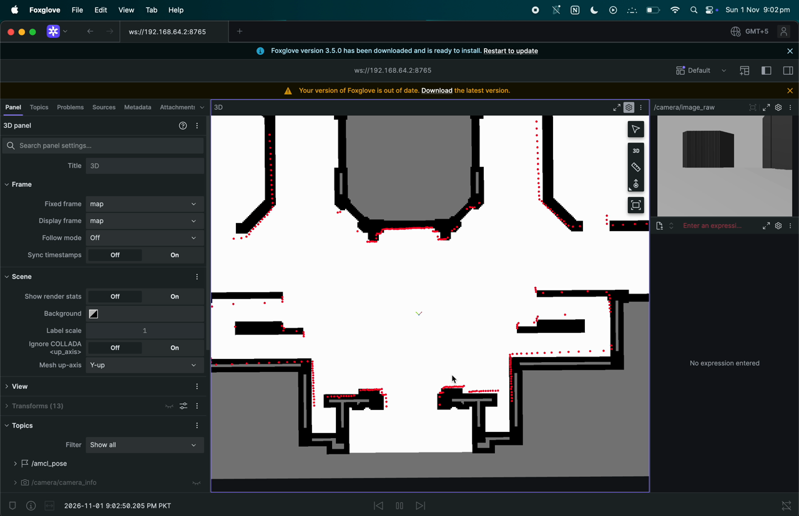

# Checkpoint 03: GCU localization and controlled motion

## Quick summary

- **Goal:** Localize the simulated robot and verify bounded translation, turning and stopping.
- **Result:** All five frozen simulation checks passed using AMCL and wheel-odometry EKF; the user reproduced motion in Foxglove.
- **Limit:** A grazing-corner LiDAR discrepancy remains; these were supervised motion checks.
- **Next checkpoint:** Add and evaluate autonomous Nav2 planning and execution.

Date: 2026-11-01. Status: **complete for bounded simulation smoke-test scope,
with the grazing-edge sensor limitation retained**. Autonomous navigation is not
complete. Previous checkpoint: [simulation/visualization](02_GCU_SIMULATION_VISUALIZATION.md).

## What changed

- Corrected the caster support height and base-to-footprint offset. The old model
  pitched forward ~1.09 degrees and the LiDAR hit the floor at ~6.57 m. The corrected
  model is level; p95 stationary range error fell from ~2.14 m to ~0.028 m.
- Added a Gazebo-specific controller profile matching the 0.117 m simulated contact
  separation. Hardware controller parameters were not changed.
- Added lifecycle-managed map/AMCL bringup and a wheel-velocity EKF. AMCL owns
  dynamic `map -> odom`; the old fixed transform is not used alongside it.
- Added an initial-pose helper with explicit 0.25 m / 10 degree standard deviations.
  A zero-covariance integration trial was rejected and retained in the work log.
- Validated a 120-beam AMCL profile with 0.03 m/rad update triggers and 0.2 s
  transform tolerance; the prior, frozen acceptance limits and rejected trials
  remain available for review.
- Added an evaluation-only pose publisher, ground-truth bridge, bounded-motion
  checker, local recovery/controller-watchdog checks and a sequential repeat suite.
  Ground truth is never published on navigation TF or supplied to AMCL. It is used
  by the test supervisor to bound motion and by the evaluator to measure errors.

## Evidence and acceptance

Existing environment: Ubuntu 22.04 ARM64 / UTM, ROS 2 Humble, Gazebo Fortress.
The five-case final suite used domain 78 and separate Gazebo partitions, leaving
the user's domain-77 Foxglove session untouched. All five cases passed; all test
launches exited cleanly. The final suite used a frozen configuration.

| Check | Acceptance | Measured result |
| --- | --- | --- |
| Local pose-prior recovery | <=0.15 m and <=3 degrees for 3 consecutive updates, within 30 simulation seconds | 0.0409 m / 0.399 degrees at 2.744 simulation seconds; 6 no-motion update requests |
| Direct controller watchdog | Stop within 1.0 simulation second of command silence; coast <=0.05 m; drift <=0.01 m | Stop at 0.702 s, coast 0.0300 m; no explicit zero or other command observed before the stop |
| Three fresh-spawn motion repeats | 0.4 ±0.05 m, 45 ±5 degrees, p95 localization <=0.25 m / 5 degrees | All passed; details below |

| Repeat | Travel (m) | Turn (degrees) | P95 position error (m) | P95 heading error (degrees) | Timestamp-matched pairs |
| --- | ---: | ---: | ---: | ---: | ---: |
| 1 | 0.41038 | 46.128 | 0.08711 | 2.320 | 372 |
| 2 | 0.40918 | 45.847 | 0.04058 | 2.052 | 380 |
| 3 | 0.41038 | 45.988 | 0.04556 | 2.419 | 364 |

All repeats reported zero post-settle translation drift at recorded precision.
The user also reproduced the movement with Foxglove: 0.40798 m / 45.847 degrees,
p95 error 0.03862 m / 2.176 degrees across 414 pairs. Sampled screen-recording frames
show camera changes and broad scan/map agreement. Nine local Python tests cover
geometry, raycasting and rejection of occupied/unknown/outside-map motion segments.
The isolated-workspace packager also passed a creation/no-overwrite smoke check.

- [Final suite summary](../../../../simulation/gcu_ground_floor/phase3_diagnostics/final_acceptance/summary.json)
- [Software versions and file hashes](../../../../simulation/gcu_ground_floor/phase3_diagnostics/final_acceptance/environment_manifest.json)
- [Recovery trace](../../../../simulation/gcu_ground_floor/phase3_diagnostics/final_acceptance/recovery/report.json)
- [Watchdog trace](../../../../simulation/gcu_ground_floor/phase3_diagnostics/final_acceptance/watchdog/report.json)
- [User-run data](../../../../simulation/gcu_ground_floor/phase3_diagnostics/motion_user_report.json)



## Reproduction

Full interactive commands and experiment history are in the
[phase 03 work log](../plans/03_GCU_LOCALIZATION_AND_CONTROLLED_MOTION.md).
The existing prepared VM workspace can rerun the final suite from an Ubuntu desktop
terminal; choose a NEW output directory for each run:

```bash
python3 /home/ubuntu/edgeosmag_test_ws/run_gcu_phase3_suite.py \
  --execute \
  --workspace /home/ubuntu/edgeosmag_test_ws \
  --robot-workspace /home/ubuntu/lidarbot_ws \
  --output /home/ubuntu/edgeosmag_test_ws/results/phase3_acceptance_repeat_01
```

For a fresh repository checkout **inside Ubuntu**, prepare a new workspace first:

```bash
python3 scripts/prepare_gcu_phase3_workspace.py \
  --destination /tmp/gcu_phase3_workspace
python3 /tmp/gcu_phase3_workspace/run_gcu_phase3_suite.py \
  --execute --workspace /tmp/gcu_phase3_workspace \
  --robot-workspace /home/ubuntu/lidarbot_ws \
  --output /tmp/gcu_phase3_acceptance_01
```

This requires an existing compatible installed robot workspace, Humble/Fortress,
NumPy/Pillow/PyYAML and a logged-in desktop for the tested Ogre sensor context.
The packager copies inputs and resolves the simulation controller path; it does
not install ROS or modify the existing robot installation. Fresh-bundle packaging
was smoke-checked locally; measured runtime results use the prepared UTM workspace.

## Limits and next checkpoint

- One grazing-corner beam still fails the original strict stationary range predicate.
  Nearby rays change first-hit surface over ~0.1 degree. This is retained as a
  qualified sensor limitation, not hidden by changing the predicate. Phase closure
  accepts it for these bounded tests; it does not assert perfect scan accuracy.
- Recovery was a local uncertain-prior correction while stationary, with explicit
  no-motion updates. Global/kidnapped localization and recovery during motion were
  not tested. The watchdog check covers the simulated controller directly, not the
  full mux/network/hardware failure chain.
- Repeats use the same short route, map and simulator; they are not randomized,
  held-out trials or statistically generalizable performance measurements.
- No contact sensor, narrow doorway, dynamic obstacle, Nav2 autonomous goal or
  osmAG segmented execution was tested. Eleven inferred narrow interfaces and the
  planner's unvalidated straight-line fallback remain open for navigation work.
- UTM performance is not Raspberry Pi performance. These are reproducible engineering
  baselines for later EdgeOsmAG evaluation, not a novel efficiency result.

Next checkpoint: footprint-feasible short Nav2 routes with collision/goal checks,
followed by osmAG segmented room-to-room execution. Keep LLM/camera semantics and
Pi optimization separate until the navigation baseline is established.
