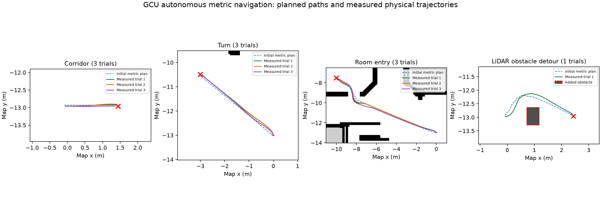

# Checkpoint 04: GCU autonomous metric navigation

## Quick summary

- **Goal:** Execute selected destinations autonomously using Nav2 in the GCU simulation.
- **Result:** All 16 original functional checks passed, including nine nominal repeats, detour, rejection and cancellation; the user confirmed operation.
- **Open issues:** Consecutive-goal final-heading failure and two evaluation-bridge crashes during shutdown.
- **Next checkpoint:** Resolve those issues, then integrate osmAG hierarchical routing, rolling raster maps and passage-goal handoffs. Current routes use Nav2 A*.

Date: 2026-11-03. Status: **qualified completion of the original selected-route simulation matrix; consecutive-goal heading and evaluation-bridge shutdown issues remain open**. Previous checkpoint:
[localization and controlled motion](03_GCU_LOCALIZATION_AND_CONTROLLED_MOTION.md).

This checkpoint adds the metric executor needed for osmAG-Nav. Nav2 computes and
executes routes from AMCL, wheel odometry, LiDAR and occupancy costmaps. Evaluation
uses separately bridged Gazebo truth; it does not steer the robot or stop it at
the target coordinate. The old osmAG executor remains disabled.

Follow-up (2026-11-05): [Phase 05](05_GCU_OSMAG_ROUTE_PREVIEW_AND_RELIABLE_HANDOFF.md) validates a separate controller/teardown repair with three two-goal sequences, five cleanup controls and the original 16-case matrix. The original failures and evidence described here remain historical records.

## What changed

- Audited all 13 collision geometries: conservative nominal XY radius 0.14485 m;
  retained the 0.18 m navigation circle and 0.02 m costmap padding.
- Added static/scan/inflation costmaps, strict NavFn planning, Regulated Pure
  Pursuit and `NavigateToPose` with explicit compute/follow behavior trees.
- Connected the controller to the existing EKF output `/odometry/filtered`.
  Matched turn acceleration to the existing simulation drive limit. Corrected
  plugin discovery, both navigator trees and stationary initialization readiness.
- Added validated click-to-navigate and cancellation for Foxglove. The initial
  full path is retained; `/plan` shows Nav2's active route. Rejected goals
  clear the public route and report a reason. Busy clicks retain the active goal.
- Instrumented every robot collision geometry and verified robot–obstacle contact
  reporting with a separate positive control. Counted wall/obstacle events while
  excluding expected ground support. Independently checked sampled truth paths
  against the permitted occupancy domain and added obstacle geometry.
- Retained valid routes and replanned on invalidation/goal changes to prevent
  symmetric obstacle detours from alternating at each periodic plan update.
- Selected Cyclone DDS for the isolated VM after repeated Fast DDS lifecycle
  reply failures; all manual terminals and the automated runner use that backend.
- Added fixed fixtures, declared acceptance gates/timeouts, repeat tests, input
  fingerprints, continuous-rest scoring and lossless raw evidence packaging.


## Acceptance results

All **16 frozen-suite cases passed** using Cyclone DDS, with no parameter changes
between trials. This includes nine nominal runs, the contact positive control,
three native rejection tests, a LiDAR obstacle detour, moving-goal cancellation
and UI rejection/route clearing. All test launch groups exited with code 0;
all 15 navigation lifecycle shutdown calls returned success. The child-process log audit found two evaluation-only ground-truth bridge
segfaults after SIGINT during simulator teardown (`turn_02` and UI rejection).
These remain unresolved; zero launch-group exits did not expose child failures.
The recorded navigation checks passed, but shutdown is not crash-free.

The final settings request <=0.10 m/s translation and 0.20 rad/s in-place rotation,
with 1.5 rad/s² turn acceleration and a 0.04 rad goal-heading tolerance. Acceptance
limits remain <=0.20 m / 10° final error, P95 localization <=0.25 m / 5°,
>=1 s continuous rest at <=0.01 m/s and <=0.02 rad/s, zero observed wall/obstacle
contacts and zero sampled swept-circle intrusions. Sampling requires >=90%
timestamp matching and <=0.15 s gaps.

| Fresh-start trial | Final position (m) | Final heading (°) | P95 localization (m / °) | Matched pairs | Simulation time (s) | Checker wall time (s) |
| --- | ---: | ---: | ---: | ---: | ---: | ---: |
| corridor_01 | 0.0808 | 0.776 | 0.0684 / 1.788 | 384 | 19.19 | 30.58 |
| corridor_02 | 0.0876 | 0.085 | 0.0340 / 1.107 | 365 | 18.28 | 30.44 |
| corridor_03 | 0.0877 | 0.103 | 0.0772 / 0.690 | 365 | 18.25 | 29.15 |
| room_entry_01 | 0.0441 | 6.420 | 0.1243 / 4.485 | 3029 | 151.36 | 288.56 |
| room_entry_02 | 0.0327 | 6.217 | 0.0914 / 4.259 | 3208 | 160.27 | 316.67 |
| room_entry_03 | 0.0500 | 5.966 | 0.1117 / 4.432 | 3130 | 156.49 | 255.23 |
| turn_01 | 0.0906 | 2.691 | 0.1078 / 2.689 | 1188 | 59.35 | 112.33 |
| turn_02 | 0.0708 | 2.350 | 0.0864 / 2.636 | 1237 | 61.86 | 118.60 |
| turn_03 | 0.0609 | 2.860 | 0.0751 / 2.585 | 1358 | 67.87 | 129.66 |

Worst nominal final error: **0.091 m / 6.42°**. Worst per-run P95
localization: **0.124 m / 4.48°**. Wall times are from the evaluator,
including readiness/preflight; simulation durations begin after its readiness
steps. They are not Pi performance measurements.

| Additional check | Observed result |
| --- | --- |
| Contact positive control | Raised-box fixture produced robot–obstacle contact reports; all 13 bridge topics present |
| Occupied and courtyard-unknown goals | Native action aborted before motion; no substitute route |
| Fully blocked passage | Free goal across a disconnected closure; native action aborted before motion |
| LiDAR obstacle detour | Reached target; 0.082 m / 2.93° final error; no observed contact or scoring-map intrusion |
| Cancel moving goal | Native action CANCELED; continuously confirmed stop began within 0.250 simulation seconds of the request |
| Click-to-navigate | First corridor repeat used the bridge; validated full displayed route and native action success |
| UI courtyard rejection | Rejected before sending a navigation action; public route cleared |

All nominal/failure-case trials observed one `/cmd_vel` publisher (`controller_server`).
All 13 contact bridge publishers were present. Ground truth also triggers the
cancellation test stimulus after 0.25 m displacement; it does not control nominal
goal completion. The detour obstacle is static and absent from the navigation
map; LiDAR/costmaps discover it. Moving people and global localization recovery
are outside this checkpoint. Twenty-one local Python tests pass; the isolated
workspace packager also passed creation/no-overwrite checks (39 source/input files).

## Evidence

- [Results and development history](../../../../simulation/gcu_ground_floor/phase4_diagnostics/autonomous_acceptance/results.json)
- [Frozen contract](../../../../simulation/gcu_ground_floor/phase4_diagnostics/autonomous_acceptance/contract.json), [input fingerprints](../../../../simulation/gcu_ground_floor/phase4_diagnostics/autonomous_acceptance/frozen_inputs.json), [repository verification](../../../../simulation/gcu_ground_floor/phase4_diagnostics/autonomous_acceptance/source_verification.json)
- [Environment and middleware versions](../../../../simulation/gcu_ground_floor/phase4_diagnostics/autonomous_acceptance/environment.json), [loaded middleware libraries](../../../../simulation/gcu_ground_floor/phase4_diagnostics/autonomous_acceptance/cyclone_runtime_libraries.json)
- [Independent metric, fixture and source verification](../../../../simulation/gcu_ground_floor/phase4_diagnostics/autonomous_acceptance/independent_verification.json)
- [Teardown crash review and full logs](../../../../simulation/gcu_ground_floor/phase4_diagnostics/autonomous_acceptance/teardown_review.json)
- [Shutdown audit](../../../../simulation/gcu_ground_floor/phase4_diagnostics/autonomous_acceptance/shutdown_audit.json)
- [Interface screening](../../../../simulation/gcu_ground_floor/phase4_diagnostics/interface_audit.json)

Final recorded reports and selected logs are losslessly compressed in `trials/`.
The results JSON identifies each raw report and its SHA-256. Development runs,
interrupted trials and earlier suites are bundled in
[development_history.tar.gz](../../../../simulation/gcu_ground_floor/phase4_diagnostics/autonomous_acceptance/development_history.tar.gz),
with original paths and all 165 member fingerprints in its
[manifest](../../../../simulation/gcu_ground_floor/phase4_diagnostics/autonomous_acceptance/development_history_manifest.json).
Historical `full_report` paths in the results JSON refer to archive members;
the verification script reads both unpacked final evidence and archived history.
Earlier successes are not substituted for final-suite repeats. The detailed
[work log](../plans/04_GCU_AUTONOMOUS_METRIC_NAVIGATION.md) explains rejected
settings and middleware attempts.



## Scope and limits

An additional consecutive-goal regression reaches the return point but aborts
during a large final-heading correction. Its final yaw error was 71.6°; this
regression remains failed and is retained in the evidence. The selected-route
matrix does not establish reliable arbitrary consecutive goal orientations.
Further work must repair that controller behavior before claiming that scope.


These are small engineering acceptance trials in UTM. They do not establish a
statistical success rate, validate all room entrances, measure Pi 4B performance,
or complete osmAG-Nav's area/passage-based execution. The known raw grazing-corner
LiDAR discrepancy from Phase 03 remains; no special ray filter was introduced.

The interface audit found a sampled local straight crossing for 58 of 68 exported
interfaces, with 10 unresolved by that search. It checks the full map, including
the previously flagged narrow interfaces. These counts are local geometric
screening results. A graph edge does not certify a robot route, and a failed
sampled crossing does not prove all curved crossings impossible. Phase 05 must
filter/repair and validate interfaces before executing an osmAG route.

Contact claims are limited to observed events from the instrumented model.
Fortress publishes contact messages at physics rate here despite the sensor rate
setting; detailed event records are capped, observed event totals are retained.
The separate positive fixture and bridge/manifest checks verify the measurement
setup. Independent truth sweeps are sampled at approximately 20 Hz and use
conservative segment checks; this is not a formal continuous-time proof.

Development and startup failures are retained alongside the frozen acceptance
trials. Geometry/contact sensing, localization and the tested metric executor now
form a reusable comparison baseline. Potential paper material includes the
interface-feasibility audit and reproducible failure analysis; novelty and edge
resource savings still require separate experiments and comparisons.

## Reproduction and your visual check

Tests used Ubuntu 22.04 ARM64 in UTM, ROS 2 Humble and Gazebo Fortress. Physics
runs headlessly; LiDAR/camera still use the sensor renderer in the logged-in
Ubuntu desktop session. Foxglove renders the ROS visualization on macOS.
The Gazebo GUI is not required. These tests are simulation tests.

The existing VM workspace is `/home/ubuntu/edgeosmag_test_ws`. For a fresh checkout
**in Ubuntu**, prepare a new workspace from the repository root. Replace the
example path consistently if needed; existing destinations are refused:

```bash
source /opt/ros/humble/setup.bash
source /home/ubuntu/lidarbot_ws/install/setup.bash
sudo apt-get install ros-humble-rmw-cyclonedds-cpp
python3 scripts/prepare_gcu_phase4_workspace.py \
  --destination /home/ubuntu/gcu_phase4_workspace
python3 /home/ubuntu/gcu_phase4_workspace/prepare_gcu_contact_assets.py \
  --workspace /home/ubuntu/gcu_phase4_workspace \
  --output /home/ubuntu/gcu_phase4_workspace/assets/contact_v2
python3 /home/ubuntu/gcu_phase4_workspace/prepare_gcu_navigation_fixtures.py \
  --workspace /home/ubuntu/gcu_phase4_workspace \
  --contact-assets /home/ubuntu/gcu_phase4_workspace/assets/contact_v2 \
  --output /home/ubuntu/gcu_phase4_workspace/assets/navigation_fixtures
```

To rerun the frozen automated matrix in the existing prepared VM workspace, use
a new output directory each time. It starts fresh isolated simulations, changes
ROS domain between trials, writes traces and shuts down its launches. Leave the
Ubuntu desktop logged in:

```bash
python3 /home/ubuntu/edgeosmag_test_ws/run_gcu_navigation_suite.py \
  --execute \
  --workspace /home/ubuntu/edgeosmag_test_ws \
  --robot-workspace /home/ubuntu/lidarbot_ws \
  --domain 90 \
  --output /home/ubuntu/edgeosmag_test_ws/results/phase4_acceptance_repeat_01
```

For an interactive Foxglove check, stop earlier simulator, alignment, planning and
navigation launches first. Start these four Ubuntu terminals. Do not run the old
osmAG execution node or the fixed-transform alignment alongside this setup.

**Terminal 1 — headless physics and instrumented robot**

```bash
source /opt/ros/humble/setup.bash
source /home/ubuntu/lidarbot_ws/install/setup.bash
export ROS_DOMAIN_ID=77
export RMW_IMPLEMENTATION=rmw_cyclonedds_cpp
export IGN_PARTITION=gcu_nav_manual
export LIBGL_ALWAYS_SOFTWARE=1
export LIBGL_DRI3_DISABLE=1
ros2 launch /home/ubuntu/edgeosmag_test_ws/gcu_contact_sim.launch.py \
  assets:=/home/ubuntu/edgeosmag_test_ws/assets/contact_v2 \
  world:=/home/ubuntu/edgeosmag_test_ws/assets/contact_v2/world.sdf
```

**Terminal 2 — map, wheel EKF and AMCL**

```bash
source /opt/ros/humble/setup.bash
source /home/ubuntu/lidarbot_ws/install/setup.bash
export ROS_DOMAIN_ID=77
export RMW_IMPLEMENTATION=rmw_cyclonedds_cpp
ros2 launch /home/ubuntu/edgeosmag_test_ws/gcu_amcl.launch.py \
  map:=/home/ubuntu/edgeosmag_test_ws/assets/gcu_ground_floor.yaml \
  params:=/home/ubuntu/edgeosmag_test_ws/assets/amcl.yaml
```

**Terminal 3 — wait for localization, then autonomous Nav2**

```bash
source /opt/ros/humble/setup.bash
source /home/ubuntu/lidarbot_ws/install/setup.bash
export ROS_DOMAIN_ID=77
export RMW_IMPLEMENTATION=rmw_cyclonedds_cpp
python3 /home/ubuntu/edgeosmag_test_ws/wait_gcu_localization.py --request-updates
```

Continue only when that prints `"ready": true`. Then in the same terminal:

```bash
ros2 launch /home/ubuntu/edgeosmag_test_ws/gcu_navigation.launch.py \
  params:=/home/ubuntu/edgeosmag_test_ws/assets/nav2_autonomous.yaml \
  tree:=/home/ubuntu/edgeosmag_test_ws/assets/navigate_strict.xml \
  through_tree:=/home/ubuntu/edgeosmag_test_ws/assets/navigate_through_strict.xml
```

**Terminal 4 — Foxglove bridge**

```bash
source /opt/ros/humble/setup.bash
export ROS_DOMAIN_ID=77
export RMW_IMPLEMENTATION=rmw_cyclonedds_cpp
ros2 launch foxglove_bridge foxglove_bridge_launch.xml \
  address:=0.0.0.0 port:=8765
```

In macOS Foxglove, connect to `ws://UBUNTU_IP:8765` (`hostname -I` shows the Ubuntu
address). Set fixed/display frames to `map`. Enable `/map`, `/scan`,
`/robot_description`, `/gcu/navigation_target` and `/gcu/navigation_path`.
The latter retains the validated full route drawn at goal selection. Enable
`/plan` in a different color for the active metric route; it updates when the path becomes invalid or the goal changes.
The controller-owned costmap/footprint topics are `/local_costmap/costmap` and
`/local_costmap/published_footprint`; the global costmap is
`/global_costmap/costmap`. The older plan-only standalone `/costmap/costmap` is not
used by the autonomous controller.

Add Raw Messages for `/gcu/navigation_status` and an Image panel on
`/camera/image_raw`. Configure the 3D Publish **2D pose/goal** tool as
`geometry_msgs/msg/PoseStamped` on `/gcu/navigation_goal`. Click-drag on free
space to select position and heading. This topic requests movement. Start with
the short corridor target, not an arbitrary far or narrow room.

A deterministic short goal from another sourced domain-77 terminal is:

```bash
ros2 topic pub --once /gcu/navigation_goal geometry_msgs/msg/PoseStamped \
  '{header: {frame_id: map}, pose: {position: {x: 1.4413560486865775, y: -12.960313240266368}, orientation: {w: 1.0}}}'
```

Expect `planning` -> `sending` -> `executing` -> `succeeded`, a full route and
visible robot/camera movement followed by stopping. Unknown/occupied/insufficient
clearance goals must be `rejected` with a reason and an empty public route.
Busy clicks leave the active goal unchanged. Cancel, wait for cancellation, then
select another destination:

```bash
ros2 topic pub --once /gcu/navigation_cancel std_msgs/msg/Empty '{}'
```

Before closing navigation, cancel any moving goal and shut down lifecycle nodes:

```bash
ros2 service call /gcu_navigation_lifecycle/manage_nodes \
  nav2_msgs/srv/ManageLifecycleNodes '{command: 4}'
```

Then Ctrl-C navigation, localization, bridge and simulator terminals. The native
path is a metric Nav2 path. Area/passage-derived osmAG routing is the next phase.

## Handoff to Phase 05

Resolve the consecutive-goal heading regression and the ground-truth bridge
shutdown issue (including child-process failure propagation) before claiming general
metric navigation, then connect the osmAG area/passage route to this `NavigateToPose` executor
and verify that osmAG coordinates share the tested map/TF frame.
Review the legacy planner's fallback and missing-TF behavior, screen/repair
interfaces, select robot-feasible passage approach poses, and verify ordered
area transitions while displaying the osmAG route separately from the metric
path. Then test room-to-room routes and a blocked interface with safe rerouting
or abort. This completes the missing topometric integration before EdgeOsmAG
hardware/LLM/camera experiments.
