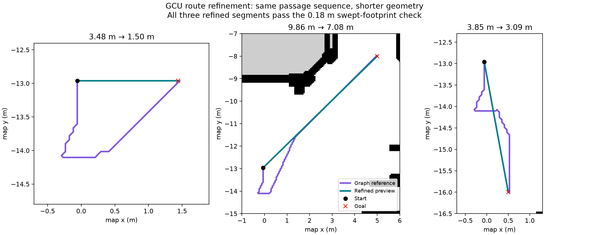
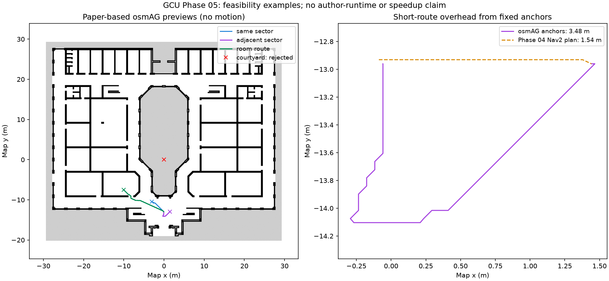

# Phase 05 — Reliable metric execution and osmAG route preview

## Quick summary

- **Goal:** Prepare a trustworthy osmAG route/transition contract before enabling osmAG-driven motion.
- **Result:** Complete for the bounded Phase 05 scope: 47 unit tests, 10 offline and 15 live preview cases passed; the user confirmed the updated Foxglove preview works. Earlier metric acceptance is preserved.
- **Scope:** Our labelled paper-based reference implementation; exact author runtime reproduction, rolling maps and structural localization remain pending.
- **Next:** Phase 06 will pass ordered passage goals to Nav2 and validate actual crossings; Phase 05 preview remains motion-free.

Date: 2026-11-05; bounded follow-up completed 2026-11-06. Previous checkpoint: [Phase 04](04_GCU_AUTONOMOUS_METRIC_NAVIGATION.md). Plan: [Phase 05](../plans/05_GCU_OSMAG_ROUTE_PREVIEW_AND_RELIABLE_HANDOFF.md).

User acceptance (2026-11-06): after switching to the prepared v2 workspace, the user confirmed that the updated preview works well in Foxglove. This closes the interactive preview check and the bounded Phase 05 checkpoint. It is user-reported visual acceptance, separate from the instrumented tests below; it does not certify osmAG-driven motion or complete osmAG-Nav reproduction.

The [route-quality and paper audit](../GCU_ROUTING_PAPER_AUDIT.md) identified fixed-crossing detours and hierarchy differences after the initial functional acceptance. The bounded v2 follow-up below resolves those findings within the approved reference implementation. The conservative two-anchor graph remains an explicitly labelled variant; exact author-runtime parity is not claimed.

## Route-quality follow-up (v2, 2026-11-06)

A topology-preserving visibility refinement now shortens the expanded graph path. Each shortcut must remain inside the ordered area corridor, cross the selected interfaces in order, avoid every disabled passage and pass the unchanged 0.18 m swept-footprint check. Work is bounded to 512 candidate shortcuts; an exhausted search retains remaining validated reference segments. No unchecked direct-distance rule is used.

| Declared offline query | Graph reference | Refined preview |
| --- | ---: | ---: |
| Short adjacent sector | 3.484 m | **1.500 m** |
| Diagonal adjacent sector | 9.861 m | **7.085 m** |
| Downward adjacent sector | 3.852 m | **3.091 m** |
| Same sector | 3.962 m | **3.835 m** |
| Room route | 12.661 m | **11.631 m** |
| Short goal with interface `-93` closed | 82.438 m | **82.142 m** |



The first four refined routes equal the endpoint Euclidean distance and are therefore shortest for those clear queries. In general this is a shorter feasible route **within the chosen passage sequence**, not a proof of a globally shortest continuous route over all possible sequences. Closure `-93` is a logical transition barrier even when the reference raster shows open floor.

The graph builder now excludes 16 redundant intra-area pairs representing the same adjacent-area interface (280 undirected edges instead of 296; 116 states retained). Parent summaries recursively use cached child compact graphs; endpoint costs propagate level by level using multi-source Dijkstra. A failed hierarchy query falls back to A* on existing validated passage edges and validated endpoint attachments. It never creates a geometric connection after a failed raster search. Deeper hierarchy and forced-fallback fixtures exercise behavior that the shallow GCU map cannot demonstrate alone.

`/osmag/global_path` now publishes refined geometry. `/osmag/graph_path` preserves the expanded fixed-anchor reference. `/osmag/route_status` reports `graph_cost_m`, `refined_length_m`, ordered IDs, actual refined crossings, validation and `planner_version: phase5_preview_v2`. The conservative two-offset-anchor model remains for the graph baseline; the refinement is our extension, not an author-code component.

New evidence: [10 offline cases](../../../../simulation/gcu_ground_floor/phase5_diagnostics/preview_refinement_v2/results.json), [15 live ROS cases](../../../../simulation/gcu_ground_floor/phase5_diagnostics/preview_refinement_v2/live_report.json), [clean runtime teardown](../../../../simulation/gcu_ground_floor/phase5_diagnostics/preview_refinement_v2/live_run.json) and [independent replay](../../../../simulation/gcu_ground_floor/phase5_diagnostics/preview_refinement_v2/verification.json). All 47 unit tests passed. The live test observed no velocity publishers, commands or navigation actions, zero measured drift and one owner per required TF edge. Actual localized start differed slightly from the declared offline start; live short/diagonal/down routes were 1.528/7.106/3.094 m and matched their actual endpoint distances. These are previews, not robot trajectories.

No metric motion suite was repeated: the executor/profile did not change. Earlier results and their failures remain frozen. `preview_v1_source.tar.gz` preserves earlier preview source; the [v1 evidence replay](../../../../simulation/gcu_ground_floor/phase5_diagnostics/independent_verification_v1_replay.json) explicitly matches changed files to that archive instead of attributing old measurements to v2. The isolated v2 Ubuntu workspace is `/home/ubuntu/edgeosmag_phase5_preview_v2_ws`; the previous preview workspace remains historical.

## What changed and how this relates to the paper

The new planner attaches start/goal to feasible passage states, recursively lifts costs through cached compact levels, searches at the lowest common ancestor, then expands cached raster paths and refines their geometry. This follows the architecture described in §§5.2–5.3 of [osmAG-Nav v1](https://arxiv.org/abs/2603.28271v1). It is **our paper-based implementation**, not a port of the authors' 2026 runtime. Their [project page](https://jiajiezhang7.github.io/osmAG-Nav/) still marked runtime code “Upon Acceptance” when audited; the user approved this implementation choice. The [source audit](../../../../simulation/gcu_ground_floor/phase5_diagnostics/source_audit.json) records revisions and compatibility gaps.

The earlier local `lidarbot_osmag` package remains separate. Its direct `FollowPath` execution and synthetic-start/straight-line fallback paths are not enabled by this preview. The new planner rejects failed raster connections and unresolved interfaces explicitly.

The hierarchy search is exercised on a declared deeper fixture and compared against an independent shortest-path implementation. GCU itself has only a floor plus 59 leaf sectors: the preview does not demonstrate building-scale hierarchy compression. Its costs still depend on the whole-floor reference PGM. The existing Nav2 profile still uses a whole-floor global map and a 6 × 6 m controller costmap. The paper's separate 50 × 50 m rolling planning raster (§5.1), proxy goals and AGLoc localization are later milestones.

## Original v1 execution and preview evidence

Tests exercised ROS interfaces with headless physics and desktop-backed sensors. UTM CPU load includes Gazebo, software sensor rendering and the evaluation harness; Pi navigation resource measurements will place simulation/evaluation on a separate machine. The original figure below was rendered from recorded v1 paths; the current v2 comparison is above.

| Check | Result |
| --- | --- |
| Unit tests | 34 passed |
| Offline preview cases | 8/8 passed; independent graph-cost comparisons agree |
| Live ROS preview | 13/13 passed; no commands/actions and zero measured drift |
| Live TF ownership | One publisher per required edge; duplicate fixture detected |
| Consecutive-goal regression | 3 fresh runs / 6 goals passed |
| Short shutdown controls | 5/5 passed with clean child exits |
| Original metric matrix | 16/16 passed, including nine nominal repeats, detour, rejection and cancellation |
| Evaluation bridge comparison | 80 matching timestamps; maximum payload difference zero |

Across the ten successful nominal/detour matrix goals, maximum final position error was 0.115 m and maximum heading error was 5.92°. The recorded values in the results table are authoritative.

The original [independent verification](../../../../simulation/gcu_ground_floor/phase5_diagnostics/independent_verification.json) recomputes trace metrics and checks archived hashes and repository/source consistency at initial acceptance. The v1 replay linked above uses the frozen preview snapshot when current source differs. [Metric results](../../../../simulation/gcu_ground_floor/phase5_diagnostics/metric_results.json) list every final matrix case. [Live preview results](../../../../simulation/gcu_ground_floor/phase5_diagnostics/live_preview_report.json) contain the received ROS paths and rejection reasons. The full history is kept losslessly in `runtime_evidence.tar.gz` with a per-file SHA-256 manifest, including failed runs and earlier source variants.

[Offline results](../../../../simulation/gcu_ground_floor/phase5_diagnostics/preview_acceptance_final/results.json) record eight cases and independent graph-cost comparisons. [Passage audit](../../../../simulation/gcu_ground_floor/phase5_diagnostics/preview_acceptance_final/passage_audit.json) records 58 admitted and 10 excluded interfaces, 116 directed states and 296 undirected edges. Exclusion means the sampled conservative crossing search did not certify that interface; it does not prove that every possible crossing is impossible.

Coordinates agree across 2,559 serialized OSM/raster vertices within about 0.00000073 m, including three non-collinear landmarks. This is file-coordinate consistency, not a physical survey. Live tests independently check publisher ownership of `AGmap -> map`, `map -> odom` and `odom -> base_footprint`; AMCL retains ownership of `map -> odom`.

The preview checks valid routes, courtyard/wall/outside rejection, unsupported frames, invalid orientation, missing/stale TF, a disconnected graph, a closed passage and repeated requests. The duplicate-TF detector is exercised using two publishers on an isolated fixture edge, without overwriting actual localization transforms.

## Historical v1 route examples



These are historical v1 motion-free planning outputs, retained to explain the diagnosed detour. The adjacent-sector example is 3.48 m versus a previously recorded 1.54 m Nav2 metric path. Fixed passage anchors and conservative sector constraints add overhead; this is not a same-run speed or optimality comparison. Closing passage `-93` gives a footprint-valid route of about 82.44 m around the courtyard. Algorithm agreement on this graph does not establish equivalence to the authors' unreleased implementation or the shortest path in continuous geometry.

## Execution and teardown repairs

A Nav2 rotation shim over the existing regulated pure pursuit controller handles requested final heading. Existing speed limits, footprint and acceptance thresholds are unchanged. The saved Phase 04 return goal reached its position but had about 71.6° heading error. The rotation shim explicitly handles final heading after entering the position tolerance. The failure was intermittent: a fresh baseline run also passed, so deterministic reproduction and a proven general RPP root cause are not claimed.

Runtime checks exposed duplicate group signalling, native bridge teardown crashes and a Gazebo SIGINT hang. The harness now sends SIGINT to launch parents once, stops the evaluation bridge first, requests Gazebo shutdown through `/server_control`, waits for the actual server process to exit before signalling its launcher, and checks every child exit. The RPC acknowledgement alone is insufficient because renderer teardown can still be running. A config-file wrapper links the installed `ros_gz_bridge` conversions and releases transport subscriptions/handles before ROS context shutdown; the installed robot workspace remains unchanged. This targets observed teardown behavior, without claiming a proven upstream root cause. The [installed bridge API](https://github.com/gazebosim/ros_gz/tree/humble/ros_gz_bridge) is version-sensitive (tested 0.244.20).

The evaluation-only model-pose bridge publishes `/gcu_ground_truth`, never `/tf`. Its payloads matched the native bridge exactly at 80 simulation timestamps. An initial timestamp-conversion defect was caught during comparison and corrected before accepted navigation trials. Failed and interrupted attempts remain in the evidence archive. Successful goals alone are insufficient if a child process crashes during cleanup.

## Run the preview yourself in Ubuntu

**Upgrading from the earlier commands:** Change Terminal 3 from `edgeosmag_phase5_preview_ws` to **`edgeosmag_phase5_preview_v2_ws`** in both the launch path and `assets` argument. The earlier directory still contains v1. Stop its preview launch with Ctrl-C before starting v2; simulator, AMCL and Foxglove bridge commands stay the same. Click a fresh goal and check `planner_version: phase5_preview_v2` in `/osmag/route_status`. Display `/osmag/global_path` for the refined result; `/osmag/graph_path` deliberately shows the original graph geometry. Foxglove can retain a previous displayed path after the publisher stops.

Keep the Ubuntu desktop logged in for the sensor renderer. Gazebo physics runs without its GUI; Foxglove renders on macOS. The installed robot is `/home/ubuntu/lidarbot_ws`. The prepared workspaces used here are `/home/ubuntu/edgeosmag_phase5_ws` and `/home/ubuntu/edgeosmag_phase5_preview_v2_ws`.

For a **fresh checkout**, run from the repository root in Ubuntu. Use new destination directories; preparers refuse overwriting an existing workspace. The examples below use the same names as the prepared VM, so skip preparation there.

```bash
source /opt/ros/humble/setup.bash
source /home/ubuntu/lidarbot_ws/install/setup.bash
sudo apt-get install python3-shapely python3-pyproj ros-humble-rmw-cyclonedds-cpp
python3 scripts/prepare_gcu_phase5_workspace.py \
  --destination /home/ubuntu/edgeosmag_phase5_ws --build-support
python3 /home/ubuntu/edgeosmag_phase5_ws/prepare_gcu_contact_assets.py \
  --workspace /home/ubuntu/edgeosmag_phase5_ws \
  --output /home/ubuntu/edgeosmag_phase5_ws/assets/contact_v2
python3 /home/ubuntu/edgeosmag_phase5_ws/prepare_gcu_navigation_fixtures.py \
  --workspace /home/ubuntu/edgeosmag_phase5_ws \
  --contact-assets /home/ubuntu/edgeosmag_phase5_ws/assets/contact_v2 \
  --output /home/ubuntu/edgeosmag_phase5_ws/assets/navigation_fixtures
python3 scripts/prepare_gcu_osmag_preview.py \
  --destination /home/ubuntu/edgeosmag_phase5_preview_v2_ws --build-probe
```

The existing Humble/Fortress robot dependencies, development headers and Foxglove bridge must already be installed, as in Phase 04. The support builds use the VM's installed `ros_gz_bridge`, ignition transport11 and msgs8 libraries. They do not overwrite the robot installation.

Stop previous simulation/navigation launches. In **each Ubuntu terminal**, first run:

```bash
source /opt/ros/humble/setup.bash
source /home/ubuntu/lidarbot_ws/install/setup.bash
export ROS_DOMAIN_ID=77
export RMW_IMPLEMENTATION=rmw_cyclonedds_cpp
export IGN_PARTITION=gcu_phase5_manual
export LIBGL_ALWAYS_SOFTWARE=1
export LIBGL_DRI3_DISABLE=1
```

Terminal 1 — simulator:

```bash
ros2 launch /home/ubuntu/edgeosmag_phase5_ws/gcu_phase5_sim.launch.py \
  assets:=/home/ubuntu/edgeosmag_phase5_ws/assets/contact_v2 \
  world:=/home/ubuntu/edgeosmag_phase5_ws/assets/contact_v2/world.sdf
```

Terminal 2 — wheel/EKF odometry, map and AMCL:

```bash
ros2 launch /home/ubuntu/edgeosmag_phase5_ws/gcu_amcl.launch.py \
  map:=/home/ubuntu/edgeosmag_phase5_ws/assets/gcu_ground_floor.yaml \
  params:=/home/ubuntu/edgeosmag_phase5_ws/assets/amcl.yaml
```

Terminal 3 — preview:

```bash
python3 /home/ubuntu/edgeosmag_phase5_ws/wait_gcu_localization.py --request-updates
ros2 launch /home/ubuntu/edgeosmag_phase5_preview_v2_ws/gcu_osmag_preview.launch.py \
  assets:=/home/ubuntu/edgeosmag_phase5_preview_v2_ws/assets
```

Terminal 4 — Foxglove bridge:

```bash
ros2 launch foxglove_bridge foxglove_bridge_launch.xml address:=0.0.0.0 port:=8765
```

Connect macOS Foxglove to `ws://UBUNTU_IP:8765`; `hostname -I` shows the current VM address. Use `map` as fixed/display frame. Enable `/map`, `/scan`, `/robot_description`, `/osmag/map_markers` and `/osmag/global_path`. Optionally enable `/osmag/graph_path` in another color to compare the original graph geometry with the refined path. Add Raw Messages for `/osmag/route_status` and Image for `/camera/image_raw`. `AGmap` is the checked identity alias above `map`.

Configure the 3D **2D pose/goal** publish tool to `geometry_msgs/msg/PoseStamped`, topic **`/osmag/preview_goal`**, frame `map`. Wait for status `idle` with `ready: true`, then click-drag a free goal. A complete refined path appears; the robot stays stationary. Clear nearby goals should now connect directly without the old midpoint bend. Compare `graph_cost_m` and `refined_length_m` in status. Rejected goals clear both paths and give a reason. Sector/interface markers use blue/green/red for geometry/admitted/unresolved interfaces. They are geometric sectors, not semantic room names.

For a deterministic room preview in another sourced terminal:

```bash
ros2 topic pub --once /osmag/preview_goal geometry_msgs/msg/PoseStamped \
  '{header: {frame_id: map}, pose: {position: {x: -10.0, y: -7.5}, orientation: {w: 1.0}}}'
```

A courtyard rejection:

```bash
ros2 topic pub --once /osmag/preview_goal geometry_msgs/msg/PoseStamped \
  '{header: {frame_id: map}, pose: {position: {x: 0.0, y: 0.0}, orientation: {w: 1.0}}}'
```

To preview a closure without moving, set the disabled passage list and publish the same short goal again. The alternate may be much longer; the raw status includes the selected passage IDs.

```bash
ros2 param set /gcu_osmag_route_preview disabled_passages "['-93']"
ros2 topic pub --once /osmag/preview_goal geometry_msgs/msg/PoseStamped \
  '{header: {frame_id: map}, pose: {position: {x: 1.4413560486865775, y: -12.960313240266368}, orientation: {w: 1.0}}}'
ros2 param set /gcu_osmag_route_preview disabled_passages "['']"
```

This launch starts no Nav2 controller/action server. Phase 04's `/gcu/navigation_goal` requests motion; it is a separate workflow. Phase 06 will connect the new passage route to metric execution.

For orderly manual shutdown, in a sourced terminal with the same partition:

```bash
ign service -s /server_control --reqtype ignition.msgs.ServerControl \
  --reptype ignition.msgs.Boolean --timeout 5000 --req 'stop: true'
```

Then Ctrl-C the launches once. Automated tests additionally stop the evaluation bridge before the simulator and audit all child exits; arbitrary simultaneous terminal closures were not the acceptance procedure.

## Reproduce acceptance checks

Automated runners create fresh isolated simulations and new output directories; stop the manual stack first. These commands use the prepared workspaces in Ubuntu, with ROS sourced and the desktop logged in:

```bash
python3 /home/ubuntu/edgeosmag_phase5_preview_v2_ws/run_gcu_osmag_preview_test.py \
  --navigation-workspace /home/ubuntu/edgeosmag_phase5_ws \
  --preview-workspace /home/ubuntu/edgeosmag_phase5_preview_v2_ws \
  --output /home/ubuntu/edgeosmag_phase5_preview_v2_ws/results/manual_acceptance_01
python3 /home/ubuntu/edgeosmag_phase5_ws/run_gcu_navigation_suite.py --execute \
  --workspace /home/ubuntu/edgeosmag_phase5_ws \
  --robot-workspace /home/ubuntu/lidarbot_ws --domain 140 \
  --output /home/ubuntu/edgeosmag_phase5_ws/results/matrix_repeat_01
```

A consecutive-goal trial (repeat three times using different output directories) is:

```bash
python3 /home/ubuntu/edgeosmag_phase5_ws/run_gcu_navigation_test.py --execute \
  --workspace /home/ubuntu/edgeosmag_phase5_ws \
  --robot-workspace /home/ubuntu/lidarbot_ws --domain 122 \
  --sim-timeout 150 --wall-timeout 870 \
  --follow-up-goal -0.05864395131342248 -12.960313240266368 0 \
  --output /home/ubuntu/edgeosmag_phase5_ws/results/serial_repeat_01
```

For five short cleanup controls, run the same runner with `--positive-control` instead of `--execute`/`--follow-up-goal`, `--sim-timeout 30 --wall-timeout 180`, and five fresh output directories. The raised fixture must produce contact events, and every process must exit cleanly. Do not combine selected successes while hiding failed runs.

Offline checks from the repository root, using Python with NumPy, SciPy, OpenCV, Pillow, PyYAML, Shapely and pyproj:

```bash
python3 -m unittest discover -s tests -v
python3 scripts/check_osmag_routes.py --assets simulation/gcu_ground_floor \
  --output /tmp/gcu_offline_repeat_01
python3 scripts/verify_gcu_preview_refinement.py \
  --evidence simulation/gcu_ground_floor/phase5_diagnostics/preview_refinement_v2
```

## Next acceptance boundary

Phase 06 must execute the ordered, feasible passage transitions with `NavigateToPose`, validate actual doorway crossings, handle cancellation/failures and compare arrival/route results with the Phase 04 metric baseline. Preview success does not certify navigation along the displayed path. Full osmAG-Nav, rolling map behavior, structural localization, hardware savings and LLM/camera fusion remain future work.
