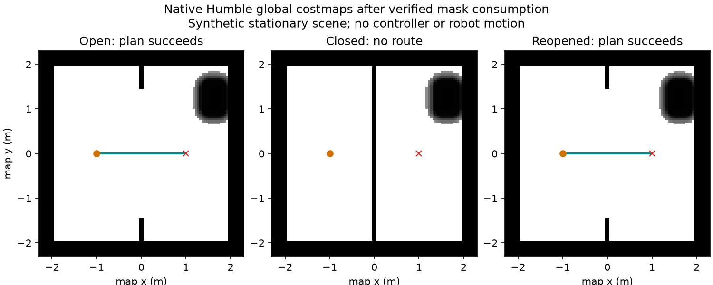

# Phase 06C1 — Constraint masks and native plan-only updates

## Quick summary

- **Goal:** Enforce selected areas/passages and closures in both Nav2 costmaps before enabling mission motion.
- **Passed:** All 95 unit tests, seven offline GCU checks and native open → closed/no-plan → reopened/valid-plan checks. Both costmaps matched each revision; all native children exited zero.
- **Scope:** Synthetic stationary scene using Humble 1.1.19, not physical navigation or live sensor-layer refresh. Earlier failed attempts remain preserved.
- **Next:** Integrate the constraints with the real simulation adapter and fresh sensor checks, then run one short GCU crossing in 06B2. Full Phase 06 remains incomplete.

Initial work: 2026-11-06; native plan-only fix accepted 2026-11-08. Previous: [06B1](06B1_GCU_ROS_MISSION_MOCK.md). Overall sequence: [Phase 06 plan](../plans/06_GCU_OSMAG_SEGMENTED_NAVIGATION.md). This is a bounded synthetic integration checkpoint, not Phase 06 completion.

## November 8 resolution

The diagnostic retained the failed close revision's raw global/local grids, publication/receipt timestamps and message counts. The global costmap retained exactly **116 newly forbidden cells as free**. The local costmap had applied every required restriction and was receiving fresh updates. Its old “stale” label came from retaining an intermediate error after later successful observations; the checker now removes an error when that source passes.

The installed 1.1.19 header and [tagged filter source](https://github.com/ros-navigation/navigation2/blob/1.1.19/nav2_costmap_2d/plugins/costmap_filters/keepout_filter.cpp) replace the mask without a mask-update `updateBounds()` override. This explains why a stationary static global map can keep old cells outside its existing update region, whereas the rolling local map refreshes. Current Humble branch source has additional bounds-update handling; it must not be assumed to match the installed binary.

The compatibility transaction now publishes a new mask, requests native `ClearEntireCostmap` refreshes on both costmaps, and waits for observed cells and fresh free probes before planning. Static geometry is reloaded unchanged through its existing transient-local source. The passing scene demonstrates open → valid plan, closed → no plan, reopened → valid plan; reopening also proves that old lethal cells are removed.

**Live execution requirement:** this refresh resets costmap layers, including obstacle observations in a real sensor-enabled profile. A future executor must hold motion during the transaction and require fresh static/mask/sensor readiness before resuming. This synthetic test has no obstacle layer or scan source and does not certify that prerequisite. The workaround is a transitional static-map compatibility policy, not an efficiency result or an upstream plugin patch.

Teardown now explicitly deactivates the planner and standalone local costmap, verifies their `inactive` states, then terminates the processes. This joins their update threads before destruction. The earlier lifecycle-manager shutdown/cleanup attempt still segfaulted locally despite a successful service reply; the exact underlying destruction race is not established. Direct deactivation plus ordinary process destruction resolved the observed test crash. Installed packages and accepted robot workspaces were not modified.

| Native revision | Global and local constraints | Planning result |
| --- | --- | --- |
| 1 — open | Both verified after publication | Valid footprint-checked plan |
| 2 — closed | Both verified after refresh | No route; action status 6 |
| 3 — reopened | Both verified; old restriction cleared | Valid footprint-checked plan |

The full accepted session took **2.77 s**, with child exits `[0, 0, 0]`, no critical log errors, zero velocity publishers/messages and no `NavigateToPose` server. These are stationary synthetic results; no robot moved. The [accepted report](../../../../simulation/gcu_ground_floor/phase6_diagnostics/06c1_native_followup/report.json), [run/teardown record](../../../../simulation/gcu_ground_floor/phase6_diagnostics/06c1_native_followup/run.json), [independent replay](../../../../simulation/gcu_ground_floor/phase6_diagnostics/06c1_native_followup/verification.json) and exact source/binary fingerprints are retained separately from November 6's failed evidence. Replay recomputes masks, both received costmaps, publication freshness, plan validity and clean exits.



Both November 8 attempts, including the diagnostic failure, remain archived. The earlier [evidence replay](../../../../simulation/gcu_ground_floor/phase6_diagnostics/06c1_constraints/historical_verification_replay.json) explicitly matches changed source to `source_before_followup.tar.gz`; old results are not attributed to current code. A final process audit found no remaining test-domain processes.

## Implemented geometry and consumption contract

[The mask builder](../../../../scripts/osmag_constraint_mask.py) creates versioned, read-only grid snapshots. Zero permits occupancy; 100 forbids it. The original physical map is combined conservatively: physical walls and unknown cells never become traversable. Area interiors are inset by a cell half diagonal before sampling, and boundary segments are conservatively rasterized in local bounding boxes. Tiny holes are preserved; numerical seam tolerance is 1e-7 m.

Every area boundary is closed except named open interfaces. This matters because simply joining the selected polygons could open an unexported or unselected shortcut between neighboring route areas. Explicit closures override overlapping openings. Mission, route, closure and mask revisions, geometry, physical-map hash and footprint settings contribute to the snapshot hash. A reopened mask is rebuilt; it cannot mutate its predecessor.

Before activation, the builder checks the current footprint using radius 0.18 m plus the existing 0.02 m padding. If that footprint intersects a forbidden region, it rejects the mask. In particular, the saved GCU start lies only about 0.029 m from virtual interface `-93`; closing that seam conflicts with the starting footprint. The builder rejects this case rather than carving an exception. A separate offline fixture starts at `x=-0.5` to test the closure barrier. That fixture is not a command to teleport a running robot.

The mask is **raw keepout geometry**, not footprint inflation or a complete execution guarantee. Full swept-footprint checks remain necessary. Native controller collision behavior, update ordering during handoff and a safe execution start remain later gates.

`ConsumptionGate` checks observed costmap cells rather than counting subscriptions. It requires both fresh global/local observations, full global coverage, matching validated resolution, retained restrictions and nonblocked free probes. Old restrictions must disappear from those probes when reopened. Odom grids require a checked transform; the synthetic native fixture uses a verified identity transform. Native messages do not echo a mask revision hash, so these checks establish observed constraints in the relevant overlap, not native ownership of our metadata.

## Historical November 6 results and failures

[Offline results](../../../../simulation/gcu_ground_floor/phase6_diagnostics/06c1_constraints/results.json) passed seven GCU cases in about 10.0 s: open refined route, rejection of the straddling-start closure, closure at a clear start, reopen snapshot replacement, physical/unknown preservation, rejection of unmasked costmap observations and fresh two-costmap readiness. Unit fixtures also cover narrow/partial openings, unselected and unexported boundaries, tiny holes, stale observations and revision guards.

The native fixture starts only Humble `planner_server`, standalone `nav2_costmap_2d`, a lifecycle manager and a synthetic map/TF/checker. It has no controller, navigator, robot or Gazebo. Installed costmap/planner/map-server packages are **1.1.19**. Physical-map and filter parameters are retained separately from accepted GCU runtime profiles.

Two native attempts were preserved:

1. Humble rejected YAML aliases generated by PyYAML. The writer now emits alias-free parameters, and a regression test covers this failure.
2. The initial open mask was verified in both native costmaps, and `ComputePathToPose` returned a footprint-valid path. On the close update, the checker timed out. Its final observations reported `mask_constraints_not_consumed` globally and `costmap_not_fresh_after_mask` locally. Both plugins logged receipt of the new mask; that receipt does not satisfy consumption. The standalone local costmap then exited **-6** with `terminate called without an active exception`. The other native children exited zero; the checker exited one.

Those were observed failures, not established root causes at that checkpoint. The failed revision had not retained raw grids; November 8's diagnostic above supplied the missing evidence. Its resolution did not relax the cell/freshness gates. The earlier archive still records a failure and an unattempted reopen revision.

[Native report](../../../../simulation/gcu_ground_floor/phase6_diagnostics/06c1_constraints/native_report.json), [runner result](../../../../simulation/gcu_ground_floor/phase6_diagnostics/06c1_constraints/native_run.json), source snapshots, raw initial grids and both attempts' logs are retained in a compact SHA-256-checked archive. [Verification](../../../../simulation/gcu_ground_floor/phase6_diagnostics/06c1_constraints/verification.json) distinguishes evidence integrity/offline success from **native integration failure**. A final process check found no remaining processes in test domain 193. Unrelated VM services and accepted robot workspaces were preserved.

## Reproduction and resume point

From the repository root on macOS:

```bash
PYTHONDONTWRITEBYTECODE=1 \
docs/research/osm-AG/osm_cad_pipeline/osmAG-from-cad/venv/bin/python \
  -m unittest discover -s tests -p test_osmag_constraint_mask.py -v

PYTHONDONTWRITEBYTECODE=1 \
docs/research/osm-AG/osm_cad_pipeline/osmAG-from-cad/venv/bin/python \
  scripts/check_gcu_constraint_masks.py --output /tmp/gcu_06c1_masks_repeat_01

PYTHONDONTWRITEBYTECODE=1 \
docs/research/osm-AG/osm_cad_pipeline/osmAG-from-cad/venv/bin/python \
  scripts/verify_constraint_mask_evidence.py \
  --evidence simulation/gcu_ground_floor/phase6_diagnostics/06c1_constraints
```

Use new output directories. To replay the accepted November 8 evidence on macOS:

```bash
PYTHONDONTWRITEBYTECODE=1 \
docs/research/osm-AG/osm_cad_pipeline/osmAG-from-cad/venv/bin/python \
  scripts/verify_constraint_costmap_followup.py \
  --evidence simulation/gcu_ground_floor/phase6_diagnostics/06c1_native_followup
```

To repeat this **synthetic plan-only** check in Ubuntu from a fresh checkout:

```bash
source /opt/ros/humble/setup.bash
python3 scripts/prepare_constraint_costmap_test.py \
  --destination /home/ubuntu/edgeosmag_phase6c1_repeat_ws
python3 /home/ubuntu/edgeosmag_phase6c1_repeat_ws/run_constraint_costmap_test.py \
  --workspace /home/ubuntu/edgeosmag_phase6c1_repeat_ws \
  --output /home/ubuntu/edgeosmag_phase6c1_repeat_ws/results/check_01 --domain 193
```

The domain must be free. No desktop renderer or robot installation is required. The prepared accepted workspace is `/home/ubuntu/edgeosmag_phase6c1_fix04_ws`; diagnostic and earlier failed workspaces remain historical. The checker itself owns the two native lifecycle transitions; no lifecycle-manager process is started in the accepted configuration.

Next is 06B2 integration: apply this verified transaction to the sensor-enabled GCU profile, prove sensor freshness after refresh, and execute one short crossing using the real mission adapter. Keep that a separate bounded batch. No new user Foxglove test is needed for this synthetic checkpoint.
