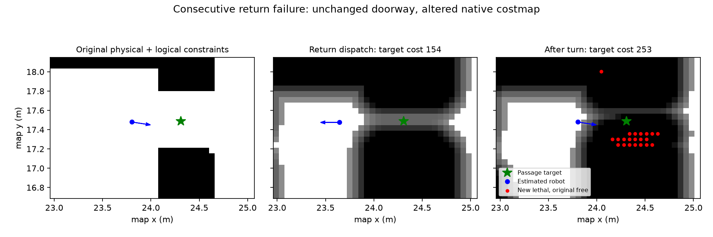

# 06D2: consecutive doorway missions — bounded fixture verified

## Quick summary

- **Built:** Verified IMU publication/yaw-rate fusion and an aligned local rolling raster. All 116 unit tests pass.
- **Result:** One physical-doorway out-and-back passes independent replay in one unchanged runtime: 0.113 m / 0.92° outbound, 0.109 m / 0.79° return.
- **Scope:** Both crossings, continuous handoffs, final rest, footprint/contact checks and clean exits pass. This is one bounded fixture, not full Phase 06 acceptance.
- **Status:** Phase 06 is now accepted for bounded scope; see the [consolidated completion record](06_GCU_SEGMENTED_NAVIGATION.md). Earlier pending statements below retain their historical scope.

Latest result supersedes the earlier in-progress findings below; earlier failed attempts remain preserved.

Recorded November 9, 2026. Predecessor: [doorway and two-passage evidence](06D_GCU_NOMINAL_MISSIONS.md). Full Phase 06 remains incomplete.

## Implementation and controls

The first query starts at `(24.95, 17.5052195965, π)` and ends at `(23.55, 17.5052195965, π)`. The return requests `(24.95, 17.5052195965, 0)`. Both cross physical passage `-121`, in opposite directions. Offline admission proves each nominal query with the existing padded 0.20 m mask check; runtime replans from localized TF, never from the return fixture's nominal spawn. Only the first pose is used to spawn the simulator robot.

The same executor/state model advances from generation 1 to generation 2. Restart requires the previous mission to have succeeded, confirmed rest and resolved all action handles. The actor's final-action timestamp and clock watchdog are refreshed. Route/mask revision increments, old grid receipts are discarded, and native costmaps are cleared under the verified rest hold. Fresh grids/scans and padded native plans are required before the return is dispatched. Localization and Nav2 are not restarted between destinations. Raw session truth includes the intermission.

| Attempt | Result |
| --- | --- |
| 01, local publication 5 Hz | Outbound passes at 0.1216 m / 1.58°. Return is cancelled when the most recent local grid becomes about 0.502 simulated seconds old, exceeding the unchanged 0.5 s guard. No mask mismatch at failure. All five native processes exit 0. |
| 02, local publication 10 Hz | Outbound passes at 0.1107 m / 1.22°. Return dispatches with fresh plans and mask receipts. Native GridBased replanning later cannot find a valid path to `(24.31, 17.49)` and the navigation action aborts. The harness incorrectly waits until its 80 s simulation deadline before reporting failure. All five native processes exit 0. |

Attempt 02 retains the 5 Hz local update rate, 6 × 6 m map-frame rolling window, 0.10 m/s cap, controller, behavior tree and footprint/padding. Only local publication changes to 10 Hz. The [installed Humble update loop](https://github.com/ros-navigation/navigation2/blob/1.1.19/nav2_costmap_2d/src/costmap_2d_ros.cpp) publishes after a due-cycle check inside its update loop; requested publication frequency is not an independent update or freshness guarantee. The last recorded return readiness in attempt 02 is valid, with global/local ages about 0.151/0.165 s and no cell errors. This does not establish repeated freshness robustness.

## Findings and next diagnostic

A second bug was in test orchestration: a native action abort moved the state model into cancellation/failure without necessarily setting the adapter's watchdog fault field. The harness watched that field and final success, so it kept waiting until the journey timeout. The source now checks failure/cancellation states immediately after each step. This change was subsequently live-tested in attempt 03: the native abort is reported immediately instead of waiting for the journey timeout. The older `pending_failfast.tar.gz` remains historical.

The native planner failure is not yet explained. A valid initial plan and later invalid replan may involve sensor obstacles, inflation, pose changes or goal-cell validity. Capture the native global grid and precise start/goal at the abort before adjusting controller or planner settings. Do not increase timeouts, relax the footprint or disable the failure checks to obtain a pass.

## Evidence and reproduction

- [Attempt 01](../../../../simulation/gcu_ground_floor/phase6_diagnostics/06d_consecutive_initial/): original runtime/source/admission archive, outbound result and failed-session replay.
- [Attempt 02](../../../../simulation/gcu_ground_floor/phase6_diagnostics/06d_consecutive_publish10/): both runtime masks, full session truth/actions, exact sources/parameters, admission archive, 114-test log, hashes, verification tools and empty final process audit.

Both evidence verifications explicitly return `trial_passed: false`. There were no observed wall/unclassified contacts. The recurring Python `Destroyable` teardown warning appears in attempt 02; its cause remains open. Failed return handling does not count as successful fault-test acceptance.

```bash
PYTHONDONTWRITEBYTECODE=1 docs/research/osm-AG/osm_cad_pipeline/osmAG-from-cad/venv/bin/python scripts/verify_gcu_consecutive.py \
  --evidence simulation/gcu_ground_floor/phase6_diagnostics/06d_consecutive_publish10 --trial 02
```

The old Ubuntu workspaces `edgeosmag_phase6_consecutive_ws` and `edgeosmag_phase6_consecutive_publish_ws` retain their executed source versions. Do not rerun them expecting the pending fail-fast change. Resume with a freshly admitted source-pinned fixture and new workspace/output. `admit_gcu_consecutive_fixture.py` supports `--assets`, `--name`, three-value `--spawn`, `--via`, `--goal`, and a new `--output` path. It starts no ROS or simulator.

Remaining gates include the successful consecutive return, the planned enclosed-sector nominal/repetition matrix, faults and final user Foxglove acceptance. Earlier single-doorway and two-passage successes remain valid and separately preserved. No full phase or research novelty claim is made here.


## Consolidated follow-up: native blockage and missing IMU path

No new checkpoint is opened. Attempt 03 captures raw native costmaps, target/pose,
and recent scans at dispatch and failure. The target changes from traversable cost
154 to blocked cost 253; the raw-cost connectivity diagnostic changes from connected
to disconnected. There are **21 new lethal cells inside originally permitted free
cells** in the doorway crop. The static geometry and mask are unchanged. Heading
error grows to about 9° during the return turn. Evaluated true-pose scan endpoints
have mean capped wall distances about 0.027–0.032 m versus 0.056–0.061 m under the
localized transform. This supports pose/scan misregistration as a contributor; it
is not an exclusive-cause proof or a replacement for live navigation acceptance.



| Attempt | Outcome and implication |
| --- | --- |
| 03, instrumented original AMCL | Outbound passes; return aborts. Fast failure reporting is verified. Native grids establish the blockage; all native exits are clean. |
| 04, AMCL sigma_hit 0.075 | Fails on the outbound leg. Rejected; the default 0.2 is retained. No further AMCL parameter sweep is queued. |
| 05, measured IMU yaw-rate candidate | Stops before motion with `stale_or_unowned_imu`. The source/bridge declares an IMU, but no usable samples arrive. All native exits are clean. This is a valid rejection, not a successful fusion trial. |

The audited EKF launch previously fused wheel translation and encoder yaw rate
only. A candidate now retains wheel translation and replaces encoder yaw rate with
measured `/imu_broadcaster/imu` angular velocity Z. Absolute IMU orientation and
Gazebo truth are not fused. A mandatory freshness/one-publisher guard blocks motion
when that required IMU input is unavailable, as it did in attempt 05.

The executed world contains Physics, UserCommands, SceneBroadcaster, Sensors and
Contact systems, but **no Imu system**. The IMU sensor declaration and bridge alone
did not produce usable measurements. The installed plugin library is recorded in
`plugin_audit.json`. The preparer now adds `ignition-gazebo-imu-system` only for the
explicit IMU candidate. This final change is **staged and syntax-checked, not yet
live-verified**; `pending_imu_world_plugin.tar.gz` records it separately. Older
accepted profiles and actual executed worlds remain unchanged.

Evidence stays grouped under this checkpoint: [capture 03](../../../../simulation/gcu_ground_floor/phase6_diagnostics/06d_return_capture/),
[rejected sigma experiment 04](../../../../simulation/gcu_ground_floor/phase6_diagnostics/06d_return_sigma075/),
and [IMU availability rejection 05](../../../../simulation/gcu_ground_floor/phase6_diagnostics/06d_return_imu_guard/).
Each archive retains its executed sources and parameters. Replays explicitly report
`trial_passed: false`. The final process/unit audit is empty. The 115-test log
predates the final pending world-plugin repair; the recurring teardown warning
remains open.

### What remains after this batch

1. **Finish this same checkpoint:** stationary IMU publication/fusion verification,
   then the unchanged physical-doorway out-and-back with strict pose, footprint,
   crossing, contact and freshness checks. Re-admit a new source-pinned fixture;
   old workspaces do not contain the pending world-plugin repair.
2. **Complete the remaining nominal/repetition matrix:** enclosed-sector and
   multi-transition routes required by the existing Phase 06 plan. The successful
   single-doorway and corridor multi-passage records remain valid.
3. **Fault handling and final acceptance:** cancellation/closures/stale inputs,
   warning/cleanup follow-up, then user Foxglove acceptance and final regressions.

These are remaining work groups within the existing Phase 06 plan, not additional
checkpoint numbers. No new trial is left running after this bounded batch.


## Verified resolution: IMU system and raster-lattice alignment

No new checkpoint number was created. The existing 06D2 work now passes one
out-and-back fixture, using the original AMCL sigma_hit 0.2, obstacle marking,
0.18 m body, 0.02 m padding, 0.10 m/s cap and the same collision/pose gates.

1. **Stationary 06:** The added Gazebo Imu system produces 800 samples over eight
   simulated seconds at 100 Hz, with one publisher, fresh stamps and `imu_link`
   transforms. Maximum stationary yaw rate is 0.000565 rad/s. Zero displacement,
   velocity commands or navigation sends; native shutdown passes. Independent
   replay verifies the actual world plugin and EKF configuration.
2. **Motion 07:** IMU availability alone is insufficient. The outbound leg stops
   on predicted local collision, despite global connectivity. Inspection finds
   the local rolling raster on a half-cell-shifted lattice: a sampled keepout
   edge extends about half a cell farther into the passage. This remains failed.
3. **Motion 08:** The local costmap explicitly uses the fixed map's origin and
   float32 wire resolution. Rolling updates preserve the same cell lattice; the
   runtime checks that alignment, with zero measured phase error. Both legs pass.
   No footprint, inflation, marking or collision threshold is weakened.

The EKF retains wheel translation and uses measured IMU angular velocity Z rather
than encoder yaw rate. Absolute IMU orientation and evaluation truth are not fused.
The required-IMU freshness/ownership guard remains active. Motion 08 logs 5,593 IMU
samples; integrated yaw differs from recorded truth by **0.0070°**, evaluated only
afterward. Active-window sample gaps are at most 0.03/0.04 s, below the unchanged
0.15 s IMU age limit. The best-effort full log has a 0.22 s gap during the verified
intermission hold. Replay checks freshness in active windows and boundary coverage,
and separately verifies continuous truth through the hold; it does not claim a
lossless full-session IMU log.

| Measure | Outbound | Return |
| --- | --- | --- |
| Final truth error | 0.11292 m / 0.9164° | 0.10889 m / 0.7897° |
| Localization p95 | 0.04614 m / 1.3882° | 0.06239 m / 0.8699° |
| Confirmed passage | `-121`, corridor → room | `-121`, room → corridor |
| Rest near intermediate handoff | 0.0 s | 0.0 s |
| Final rest interval | 24.2–25.2 s | 61.45–62.45 s |

The session takes **208.09 wall seconds**, including startup/shutdown. One robot,
localization instance, executor and five native process groups serve both missions;
state generations advance from 1 to 2. Full-session truth/localization coverage is
1,104/1,104 with maximum 0.05 s gap. Both padded reference/native preflights and
0.18 m swept-body replays pass, with zero observed wall/unclassified contacts
across 13 instrumented collision topics. All native exits are 0 and the final
process/unit audit is empty. This run's checker log is empty; the older intermittent
`Destroyable` warning is not declared generally fixed by one clean run.

Evidence: [stationary 06 and failed motion 07](../../../../simulation/gcu_ground_floor/phase6_diagnostics/06d_imu_plugin_followup/)
and [passing motion 08](../../../../simulation/gcu_ground_floor/phase6_diagnostics/06d_imu_aligned_followup/).
Archives contain actual runtime sources/worlds/parameters, raw grids, IMU/pose/action
records, hashes, independent verification and test logs. The pending world-plugin
repair described earlier is now live-verified in this explicit candidate profile.
Older accepted profiles and failed controls remain unchanged.

Offline replay from the repository root:

```bash
PYTHONDONTWRITEBYTECODE=1 docs/research/osm-AG/osm_cad_pipeline/osmAG-from-cad/venv/bin/python scripts/verify_gcu_imu_stationary.py --evidence simulation/gcu_ground_floor/phase6_diagnostics/06d_imu_plugin_followup
PYTHONDONTWRITEBYTECODE=1 docs/research/osm-AG/osm_cad_pipeline/osmAG-from-cad/venv/bin/python scripts/verify_gcu_consecutive.py --evidence simulation/gcu_ground_floor/phase6_diagnostics/06d_imu_aligned_followup --trial 08
```

Latest tested Ubuntu workspace: `/home/ubuntu/edgeosmag_phase6_imu_aligned_ws`.
With the desktop logged in and no other domain-195 stack running:

```bash
source /opt/ros/humble/setup.bash
source /home/ubuntu/lidarbot_ws/install/setup.bash
python3 /home/ubuntu/edgeosmag_phase6_imu_aligned_ws/run_gcu_segmented_crossing.py \
  --workspace /home/ubuntu/edgeosmag_phase6_imu_aligned_ws \
  --output /home/ubuntu/edgeosmag_phase6_imu_aligned_ws/results/consecutive_manual_01 \
  --fixture /home/ubuntu/edgeosmag_phase6_imu_aligned_ws/assets/mission_fixture.json --execute
```

Use a new output directory per run. The harness owns startup and teardown; do not
combine it with older manual launches. This is an isolated test, not yet the final
Foxglove click-to-mission interface.

### What remains after this checkpoint

The [existing six-run nominal/repetition matrix](06D_GCU_NOMINAL_MISSIONS.md)
has since passed independent replay for all three query types, with two fresh
runs each. It remains separate from this out-and-back result.

1. **Fault and comparison checks:** cancellation, closures, local obstacles and
   stale required inputs, including IMU loss for this profile, with measured
   stopping/recovery and clean teardown. Assess/rerun affected matched baseline
   gates for the changed localization profile.
2. **Final user acceptance:** Foxglove mission/segment visibility, arrival and
   cancellation, final regressions and cleanup/teardown follow-up.

The consecutive-goal gate is verified for this fixture; these remaining groups
stay within the original Phase 06 plan. No new checkpoint branches or unattended
suite are queued. Full Phase 06 and full osmAG-Nav reproduction remain incomplete.
