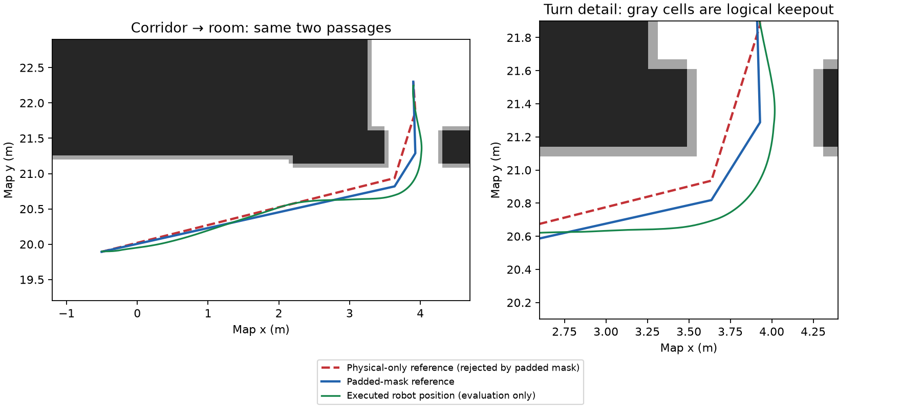
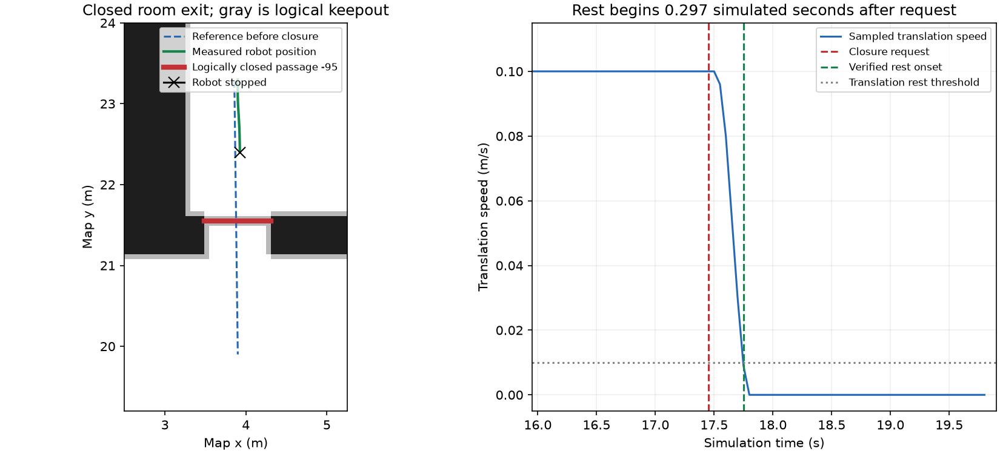

# 06D: nominal doorway and multi-passage missions — nominal matrix verified

## Quick summary

- **Built:** Segmented navigation, padded constraints, cancellation/recovery and click-to-goal review interface. **135 unit tests pass.**
- **Verified:** Six nominal runs, consecutive missions, live cancel, closed-passage stop/no-route, required IMU-input loss, physical obstacle detour, two matched metric comparisons and ten final interface checks have retained passing evidence.
- **Status:** Bounded Phase 06 accepted November 13, 2026 after short-distance user visual confirmation; [completion record](06_GCU_SEGMENTED_NAVIGATION.md). All test processes stopped.
- **Scope:** Static global raster/AMCL remains. This is a labelled paper-based implementation, not a claim of complete author-runtime reproduction or general fault robustness.

Recorded November 8; updated November 11, 2026. [Phase 06 plan](../plans/06_GCU_OSMAG_SEGMENTED_NAVIGATION.md); [accepted short corridor predecessor](06B2B_GCU_FIRST_SEGMENTED_CROSSING.md). The declared nominal matrix is now verified; earlier diagnostic attempts remain below. This does not close full Phase 06.

## Fixture and implementation

The first admitted fixture crosses physical doorway `-121`, about 0.704 m wide, from corridor 25 into room sector 43. Spawn is `(24.95, 17.5052195965, π)` and goal `(23.55, 17.5052195965, π)`. The 1.4 m reference route passes the original padded 0.20 m footprint check. Spawn and AMCL prior change together at initialization; there is no mission-time teleportation.

[`phase6_fixtures/`](../../../../simulation/gcu_ground_floor/phase6_fixtures/) retains the admitted doorway query and two proposed longer queries. The latter have two/three passages but fail the current padded mask check and **must not run**. They are proposals, not accepted fixtures. `gcu_mission_fixture.py` rejects failed-padding cases and verifies the admitted inputs. The generalized checker handles the requested final heading and every ordered passage; local free-space probes follow the localized robot instead of relying on distant start/goal endpoints.

## Trials and diagnosis

| Trial | Result |
| --- | --- |
| Doorway 01 | No motion: native preflight failed the unchanged padded-footprint check. Exact segment-to-cell analysis found only 0.17055 m clearance from a **logical mask cell**, below the required 0.20 m. This was a real rejection, not merely sampling conservatism. |
| Doorway 02 | Post-keepout inflation passed preflight. Motion cancelled on an older per-scan wall watchdog. Investigation found the staging directory had supplied an older executor, rather than the accepted clock-correct version. That attempt remains failed. |
| Doorway 03 | The exact accepted executor was restored and source hashes checked before startup. Motion cancelled because local mask consumption could not be confirmed; one expected blocked cell was missing. No wall/unclassified contacts were observed. All native processes exited cleanly. |
| Stationary timing 01 | Eight simulated seconds, zero displacement/commands/navigation sends. Initial mask-delivery delay clears; 2,905 local blocked cells checked. Clean exits. |
| Doorway 04 | Failed as expected with the old observation policy. Eight distinct raw-grid captures each fail using stamped TF and pass exactly using latest TF. Clean exits. |
| Doorway 05 | Corrected native-TF observation policy. Ordered doorway crossing, early handoff, arrival/rest, footprint and contact gates pass; independent replay passes. All five native processes exit 0. |

Installed Humble 1.1.19 [applies filters after the normal plugin layers](https://github.com/ros-navigation/navigation2/blob/1.1.19/nav2_costmap_2d/src/layered_costmap.cpp). Therefore the earlier physical-wall inflation did not inflate later keepout cells. The candidate now applies a second inflation layer after `mission_keepout` in both costmaps, using the same 0.35 m inflation radius/cost scaling. The footprint, padding, speed, controller and behavior tree are unchanged. [Nav2's keepout guidance](https://github.com/ros-navigation/docs.nav2.org/blob/rolling/docs/configuration_and_development/configuration_guide/core_servers/costmap_2d/costmap_filters/keepout_filter.md) describes inflation for footprint-aware keepout behavior; the live preflight confirms this ordering works with our installed Humble build. Doorway 05 passes this repaired profile; broader nominal acceptance remains pending.

## Native transform mismatch resolved for the doorway fixture

The native Humble 1.1.19 [`KeepoutFilter::process`](https://github.com/ros-navigation/navigation2/blob/1.1.19/nav2_costmap_2d/plugins/costmap_filters/keepout_filter.cpp) looks up **latest TF (`TimePointZero`)**, independently of the costmap publication timestamp. Our checker instead interpolated `map ← odom` at that timestamp. AMCL post-dates its transform, so these policies can rasterize different boundary cells while the robot moves.

Doorway 04 captured eight distinct local grids. The old transform predicted 3–59 missing blocked cells per grid; replay with latest TF found **zero missing cells in all eight**. Repeating with float32 mask resolution did not change that result. This is evidence of an observer timing mismatch, rather than a broken keepout mask. The regression test retains the real grids and checks both policies.

The checker now uses the same latest-TF policy as the native filter and records the transform timestamp separately from the grid timestamp. It still rejects a mismatching grid; it does not accept cost 99 as lethal 100, ignore edge cells, reduce the footprint or extend freshness limits. Previously validated observations retain the existing 0.75 s global / 0.5 s local age limits. Grid and TF messages arrive independently: two transient post-startup mismatches were still captured in Doorway 05 and cleared before that existing age gate expired. Latest TF at receipt is not an instrumented acknowledgement of the exact transform used inside the native filter; broader motion tests must still check this limitation.

## Passing doorway measurements

Doorway 05 completes the 1.4 m reference mission in about 82 wall seconds including startup and shutdown. Final truth error is **0.10902 m / 0.8126°**. Localized and independent truth monitors confirm `-121`; handoff precedes the superseded intermediate result, with no one-second handoff rest. Final truth rest is confirmed over simulated seconds 26.6–27.6. The continuous sampled swept-circle check uses the unchanged 0.18 m body; native path preflights retain the padded 0.20 m check. No wall/unclassified contacts were recorded across the 13 instrumented collision topics. Localization p95 is 0.04481 m / 2.491°. Independent replay matches 379/380 truth samples (99.74%), with maximum 0.05 s truth gap; the earlier online summary freezes before final lifecycle samples.

All five native parent processes and audited children exit cleanly, the server actually exits after pause/stop, and the final isolated-domain audit is empty. The checker logs one `cannot use Destroyable because destruction was requested` warning during teardown. Its cause remains open: successful mission scoring and zero process leftovers are not a claim of warning-free ROS teardown. The embedded state-model report retains its historical `pure_mock_model_no_motion` component label; the runtime scope, action/command and independent truth evidence establish this actual simulation run.

## Evidence and remaining work

[`06d_nominal_doorway/`](../../../../simulation/gcu_ground_floor/phase6_diagnostics/06d_nominal_doorway/) retains all three failed trials, actual executed source versions, parameters, fixture hashes, raw mission/pose/contact evidence, 108-test output and the zero-leftover audit. `pending_diagnostics.tar.gz` preserves the originally unexecuted instrumentation version; the subsequent executed captures are recorded below. Runtime-source checks now reject the stale-copy mistake before physics starts. The accepted 06B2B evidence remains separate and unchanged.

[`06d_costmap_timing/`](../../../../simulation/gcu_ground_floor/phase6_diagnostics/06d_costmap_timing/) retains stationary 01, failed Doorway 04, passing Doorway 05, raw native grids, exact runtime sources/assets, source/artifact hashes, independent verification, the 109-test log and cleanup audit. Earlier failed attempts remain unchanged. The preparer now explicitly copies the observation/mask helpers along with the executor, preventing those helpers from silently coming from an older baseline.

Offline reproduction from the repository root:

```bash
PYTHONDONTWRITEBYTECODE=1 docs/research/osm-AG/osm_cad_pipeline/osmAG-from-cad/venv/bin/python -m unittest discover -s tests
PYTHONDONTWRITEBYTECODE=1 docs/research/osm-AG/osm_cad_pipeline/osmAG-from-cad/venv/bin/python scripts/replay_gcu_costmap_timing.py simulation/gcu_ground_floor/phase6_diagnostics/06d_costmap_timing/doorway04.tar.gz results/doorway_04
PYTHONDONTWRITEBYTECODE=1 docs/research/osm-AG/osm_cad_pipeline/osmAG-from-cad/venv/bin/python scripts/verify_gcu_segmented_crossing.py --evidence simulation/gcu_ground_floor/phase6_diagnostics/06d_costmap_timing --trial 05 --case-prefix doorway
```

The fresh tested Ubuntu workspace is `/home/ubuntu/edgeosmag_phase6_nominal_timing_fixed_ws`; the old doorway workspace still contains the old checker. A new bounded trial, with no other domain-195 stack running:

```bash
source /opt/ros/humble/setup.bash
source /home/ubuntu/lidarbot_ws/install/setup.bash
python3 /home/ubuntu/edgeosmag_phase6_nominal_timing_fixed_ws/run_gcu_segmented_crossing.py \
  --workspace /home/ubuntu/edgeosmag_phase6_nominal_timing_fixed_ws \
  --output /home/ubuntu/edgeosmag_phase6_nominal_timing_fixed_ws/results/doorway_manual_01 \
  --fixture /home/ubuntu/edgeosmag_phase6_nominal_timing_fixed_ws/assets/mission_fixture.json --execute
```

The output directory must be new. Adding `--diagnose-stationary` runs the bounded no-navigation capture instead. These are isolated test commands, not the final interactive Foxglove mission interface.

Next: admit safe padded multi-passage queries, then run bounded nominal repetitions/consecutive destinations, faults and final Foxglove acceptance. Do not launch the two rejected longer proposals. This step tests the paper-based passage-to-Nav2 executor at a physical doorway; it does not establish full osmAG-Nav reproduction or a research novelty claim.


## November 9: multi-passage admission and interface controls

The original longer proposals remain rejected. A new, straight **7.5 m** query
from `(-0.5, 19.9, 0)` to `(7, 19.9, 0)` is admitted with the existing padded
0.20 m check. It crosses `-91`, then `-94`, through corridor sectors 8 → 15 → 22.
These are virtual corridor subdivisions, not two physical doors; the separate
Doorway 05 result supplies the physical-door test.

`admit_gcu_mission_fixture.py` creates a new, source-pinned fixture from a fresh
planner/mask proof and refuses to overwrite an existing fixture. The live checker
now rechecks the contract recalculated from the localized start against its own
padded mask before publishing it or sending a navigation goal. A valid frozen
query alone cannot certify a shifted runtime route. Independent replay now checks
rest around **every** handoff, rather than only the first. A regression with a stop
only at the second handoff verifies that distinction.

| Trial | Result |
| --- | --- |
| Multi 01, local grid in `odom` | Failed after confirming `-91`: local readiness expired. Four post-startup raw grids each match the earlier stamped transform exactly, while latest-at-receipt TF predicts 1–8 missing cells. The previous latest-TF repair alone does not remove independent-message delivery races. No contacts; all five native processes exit 0. |
| Multi 02, local grid in `map` | Failed before dispatch: 77–86 cells were falsely reported missing across eight captured grids. Exact float32 mask resolution gives zero missing cells in all eight. All five native processes exit 0. |
| Multi 03, shared frame and wire-resolution checker | Passed: ordered `-91`, `-94`; both early handoffs; 0.04896 m / 0.6534° final error; final rest; zero observed contacts; no mask-mismatch captures. Independent replay and all five native exits pass. |

The candidate explicitly sets the local costmap's `global_frame` to `map`, shared
with its fixed keepout mask. The native [Humble costmap implementation](https://github.com/ros-navigation/navigation2/blob/1.1.19/nav2_costmap_2d/src/costmap_2d_ros.cpp)
configures its frame separately from its rolling-window flag. The 6 × 6 m window,
0.10 m/s speed cap, body/padding, sensor inputs, controller and behavior tree stay
unchanged. This is our integration choice, not an author-runtime equivalence claim.
It avoids an unobservable filter/checker TF race by using identical frames rather
than accepting a fitting transform from history or ignoring boundary cells.

The tradeoff is that AMCL map corrections can shift the local rolling grid, whereas
`odom` remains the continuous odometry frame. Ordinary tracking/contacts are tested
here; deliberate localization jumps and dynamic obstacles still need fault-stage
tests. Older accepted profiles and their workspaces are preserved; this frame is
explicit in the new fixture and does not change the preparer's default.

`OccupancyGrid.info.resolution` is serialized as float32. The native keepout filter
constructs its mask from that message. The checker had accepted float32 grid
resolution but still indexed the expected mask using double-precision source YAML.
For grids whose centers land near mask-cell edges, those calculations select
different cells. It now indexes the mask using **exact float32 serialization**,
without a new epsilon, widened threshold or acceptance of cost 99 as lethal 100.
The real-grid regression retains all eight failing inputs. This is a second
interface bug, separate from the transform-delivery race.

Failed evidence remains in
[`06d_multi_odom_failure/`](../../../../simulation/gcu_ground_floor/phase6_diagnostics/06d_multi_odom_failure/)
and [`06d_multi_map_preflight_failure/`](../../../../simulation/gcu_ground_floor/phase6_diagnostics/06d_multi_map_preflight_failure/),
with original runtime sources/assets, raw native grids, source/artifact hashes and
replays that explicitly retain `trial_passed: false`. Multi 02 dispatched no goal.
The updated [fixture guide](../../../../simulation/gcu_ground_floor/phase6_fixtures/README.md)
includes the offline admission command and identifies the historical profiles.
This is still static-map Phase 06 work; sharing `map` does not implement the
paper's Phase 07 rolling global raster.


### Passing multi-passage result and reproduction

Multi 03 takes **199.93 wall seconds**, including startup/shutdown. The 7.5 m
reference route uses three `NavigateToPose` goals. Independent replay confirms
`-91` then `-94`, handoffs at simulated seconds 11.638 and 74.3 before the
superseded results, and **0.0 s measured rest around each handoff**. Final truth
rest is confirmed over seconds 87.9–88.9. Final error is **0.04896 m / 0.6534°**.
All 1,605 final recorded truth samples have timestamp-matched localization, with
maximum truth gap 0.05 s. Online localization p95 is 0.08104 m / 0.9025°.
The unchanged 0.18 m swept-body check and padded 0.20 m reference/native preflight
checks pass. All 13 collision topics are present, with zero wall/unclassified
contacts. No native-grid mismatch is captured in this run.

All five native processes and audited children exit 0, the simulator server
actually exits, and the final domain-195 process/unit audit is empty. The previously
recorded `Destroyable` warning appears again in the Python checker at teardown;
it remains an open cleanup issue, not a hidden warning-free claim.

[`06d_multi_map_wire/`](../../../../simulation/gcu_ground_floor/phase6_diagnostics/06d_multi_map_wire/)
retains the passing raw trial, exact runtime sources/parameters, admission source,
hash manifest, 112-test output, independent verification and cleanup audit.
The two failed controls remain separate. Latest fixture:
[`two_corridor_seams_map_wire.json`](../../../../simulation/gcu_ground_floor/phase6_fixtures/two_corridor_seams_map_wire.json).

Independent replay from the repository root:

```bash
PYTHONDONTWRITEBYTECODE=1 docs/research/osm-AG/osm_cad_pipeline/osmAG-from-cad/venv/bin/python scripts/verify_gcu_segmented_crossing.py \
  --evidence simulation/gcu_ground_floor/phase6_diagnostics/06d_multi_map_wire \
  --trial 03 --case-prefix multi
```

Tested Ubuntu workspace: `/home/ubuntu/edgeosmag_phase6_multi_wire_ws`. With the
Ubuntu desktop logged in and no other domain-195 test stack running:

```bash
source /opt/ros/humble/setup.bash
source /home/ubuntu/lidarbot_ws/install/setup.bash
python3 /home/ubuntu/edgeosmag_phase6_multi_wire_ws/run_gcu_segmented_crossing.py \
  --workspace /home/ubuntu/edgeosmag_phase6_multi_wire_ws \
  --output /home/ubuntu/edgeosmag_phase6_multi_wire_ws/results/multi_manual_01 \
  --fixture /home/ubuntu/edgeosmag_phase6_multi_wire_ws/assets/mission_fixture.json --execute
```

Use a new output-directory name for every attempt. This isolated acceptance
harness manages its own simulator/localization/Nav2 processes and teardown; do not
combine it with the older manual launch commands. It does not start Foxglove.
Earlier doorway commands above reproduce their retained earlier workspace, not
this new profile.

This accepts **one two-passage corridor fixture**, not repeated robustness,
room-to-room navigation, consecutive destinations, localization-jump tolerance,
dynamic obstacle handling or full Phase 06. Next is a small repetition/consecutive
mission group using this explicit same-frame profile, with no simulator respawn
between consecutive destinations. Fault handling and user Foxglove acceptance
remain after that. The timing/serialization controls are useful reproducibility
and integration evidence; they alone do not establish a research novelty claim.

## November 9: padded corridor-to-room route and repetitions

The earlier `offline_candidates.json` proposals remain rejected and unchanged.
Their physical-only reference can clear the body yet fail the stricter **0.20 m
body-plus-padding** test against the logical execution mask at a turn. Changing
controller tuning cannot make that reference satisfy its admission contract.

The optional `PaperPlanner(execution_padding=.02)` variant now reconstructs leaf
connections against the selected mission mask, then applies the existing
visibility refinement with the same mask-aware footprint check. It preserves the
graph's selected areas, ordered passages, closures and endpoints. Unavailable
connections produce an explicit route error, with no fallback to the rejected
reference. The original physical graph search/cost remains separately identified;
this does not prove continuous global optimality or equivalence to author runtime.
Query timing includes this additional mask construction and refinement.

Fresh fixture [`corridor_to_room_masked.json`](../../../../simulation/gcu_ground_floor/phase6_fixtures/corridor_to_room_masked.json)
runs from `(-0.5, 19.9, 0)` to `(3.9, 22.3, π/2)` through `-91`, then `-95`,
entering room 33 from corridor sectors 8 and 15. Its **5.803 m** reference passes
the unchanged padded check. It uses the verified measured-IMU yaw-rate fusion,
map-frame aligned local raster and 10 Hz local publication profile from
[06D2](06D2_GCU_CONSECUTIVE_MISSIONS.md). No controller, speed, footprint,
freshness or arrival threshold was relaxed. Both fresh runs use the same fixture,
source and parameters; each starts a new isolated runtime.



The red physical-only reference is rejected by the padded logical mask. Blue is
the admitted reference; green is the first trial's measured robot position, used
only for evaluation. Nav2 can track a different safe curve inside the permitted
corridor; the reference is not a guarantee of an identical executed trajectory.

| Fresh trial | Final truth error | Wall time including startup/shutdown | Status |
| --- | --- | --- | --- |
| Nominal 01 | 0.05613 m / 0.4899° | 179.95 s | Live and independent replay pass |
| Nominal 02 | 0.04885 m / 0.3675° | 208.87 s | Live and independent replay pass |

Trial 01 confirms both passages in order and both handoffs before the superseded
intermediate result, with no measured rest at either handoff. Final truth rest
lasts one simulated second. Localization p95 is 0.07594 m / 1.9336°; independent
replay matches 1,303/1,304 truth samples with maximum 0.10 s gap. Swept body,
padded reference/native preflight and all 13 instrumented contact-topic gates
pass, with zero observed contacts. All five native parents and audited children
exit cleanly. The known Python `Destroyable` teardown warning is retained.

Trial 02 also confirms both ordered passages, early handoffs without measured
handoff rest, final rest, zero observed contacts, body clearance and clean native
exits. Localization p95 is 0.09128 m / 1.2130°. The final isolated-domain and
systemd-unit audit is empty. Both trials retain the teardown warning. This pair
completes **two of six** required nominal runs; the prior accepted out-and-back
remains a separate consecutive-goal result.

Evidence and reproduction are under
[`06d_nominal_enclosed_room/`](../../../../simulation/gcu_ground_floor/phase6_diagnostics/06d_nominal_enclosed_room/).
Actual prepared IMU launch parameters are archived separately from the unchanged
root launch; the replay reports that historical-source difference explicitly.
Two new regressions exercise a formerly rejected corner and a blocked selected
interface. All 118 tests pass.

Offline admission, using a new output filename, starts no simulator:

```bash
PYTHONDONTWRITEBYTECODE=1 docs/research/osm-AG/osm_cad_pipeline/osmAG-from-cad/venv/bin/python scripts/admit_gcu_mission_fixture.py \
  --assets simulation/gcu_ground_floor --name corridor_to_room_masked \
  --spawn -0.5 19.9 0 --goal 3.9 22.3 1.5707963267948966 \
  --minimum-passages 2 --local-costmap-frame map --constrain-route \
  --imu-yaw-rate --align-local-grid --output /tmp/gcu_corridor_room_reproduced.json
```

For the isolated live harness on the logged-in Ubuntu VM, with no other domain
195 test stack running, use a new output directory each time:

```bash
source /opt/ros/humble/setup.bash
source /home/ubuntu/lidarbot_ws/install/setup.bash
python3 /home/ubuntu/edgeosmag_phase6_nominal_room_ws/run_gcu_segmented_crossing.py \
  --workspace /home/ubuntu/edgeosmag_phase6_nominal_room_ws \
  --output /home/ubuntu/edgeosmag_phase6_nominal_room_ws/results/nominal_manual_01 \
  --fixture /home/ubuntu/edgeosmag_phase6_nominal_room_ws/assets/mission_fixture.json --execute
```

This harness owns startup and shutdown and does not start Foxglove. Remaining
gates stay grouped: finish the nominal matrix; run fault/local-obstacle and
matched-baseline checks, assessing the changed localization profile; then final
Foxglove acceptance and cleanup. Prior results on older profiles do not count as
matched repetitions of this frozen variant. Phase 06 is not complete.

## Nominal matrix follow-up: adjacent sectors and room-to-room

This continues the existing nominal group without adding checkpoint numbers or
changing execution code. The adjacent query is `(-0.5, -12.9603132403, 0)` to
`(1.4413560487, -12.9603132403, 0)`, a **1.941 m** route from corridor sector 14
to 16 through `-93`. Two fresh runs pass independent replay, with the same
padded-mask route variant, measured IMU fusion, aligned local raster and native
controller profile used by the preceding corridor-to-room pair.

| Query / fresh trial | Final truth error | Full wall time | Status |
| --- | --- | --- | --- |
| Adjacent 01 | 0.05742 m / 1.1674° | 77.82 s | Live and independent replay pass |
| Adjacent 02 | 0.08836 m / 1.0899° | 80.34 s | Live and independent replay pass |
| Room-to-room 01 | 0.06083 m / 0.3075° | 299.25 s | Live and independent replay pass |
| Room-to-room 02 | 0.05138 m / 1.1398° | 272.59 s | Live and independent replay pass |

Both adjacent runs confirm ordered crossing, handoff before the superseded
result, zero measured handoff rest, final rest, body/reference/native-preflight
clearance and zero observed contacts across all 13 collision topics. Independent
replay matches 473/473 truth samples in each run, with maximum 0.05 s gap.
Localization p95 is 0.04732 m / 0.3586° and 0.03725 m / 0.4067°. All five native
parents and audited children exit cleanly; both Python checker logs are empty.
The pair's final process/unit audit is empty. This does not resolve the earlier
intermittent `Destroyable` warning.

[`06d_nominal_adjacent_sector/`](../../../../simulation/gcu_ground_floor/phase6_diagnostics/06d_nominal_adjacent_sector/)
retains both raw trials, independently replayed results, actual source/parameter
snapshots, a byte-identical input comparison and cleanup audit. The retained
118-test log covers the unchanged worker code; the unit suite was not rerun
between identical live trials.

The admitted room-to-room query starts inside room 33 at `(3.9, 22.3, -π/2)`
and targets room 34 at `(6.9493, 22.3, π/2)`. It follows `-95`, `-94`, `-106`
through corridor sectors 15 and 22. Its **8.858 m** conservative reference passes
the padded mask check and includes several turns. It is not a claim of a globally
shortest continuous path. Both fixtures were admitted and staged before their
first live attempts, with 150 s simulation / 700 s checker wall deadlines.

The isolated Ubuntu workspaces are
`/home/ubuntu/edgeosmag_phase6_nominal_adjacent_ws` and
`/home/ubuntu/edgeosmag_phase6_nominal_rooms_ws`. The same harness command above
applies with the selected workspace substituted and a new output directory.
Run only one domain-195 stack at a time; the harness owns startup/teardown and
does not start Foxglove. Fresh fixture names are `adjacent_sector_masked.json`
and `room_to_room_masked.json`; older rejected proposals remain unchanged.

Both room-to-room trials confirm `-95`, `-94`, `-106` in order, with each of
the three handoffs preceding the superseded intermediate result and zero measured
rest at every handoff. Final truth rest is verified at simulated seconds
105.95–106.95 and 105–106. Localization p95 is 0.14613 m / 1.8490° and
0.14955 m / 1.7863°. Independent replay matches 1,994/1,995 and 1,969/1,969
truth samples, with maximum 0.05 s gaps. Padded reference/native preflights,
swept body and all 13 contact-topic gates pass, with zero observed contacts.
All five native parents and audited children exit cleanly in both runs; the
final domain/unit audit is empty. Native VM timing warnings and both Python
`Destroyable` teardown warnings remain preserved, not declared fixed.

[`06d_nominal_room_to_room/`](../../../../simulation/gcu_ground_floor/phase6_diagnostics/06d_nominal_room_to_room/)
contains both raw trials, actual runtime sources/parameters, paired input hashes,
independent replays and cleanup evidence. The combined
[`nominal_matrix_summary.json`](../../../../simulation/gcu_ground_floor/phase6_diagnostics/nominal_matrix_summary.json)
binds the three evidence sets and confirms identical pinned execution sources and
normalized controller/localization/sensor profiles across the six missions.
Only the declared query and initial pose differ between query types; each pair
has byte-identical source/assets/fixture inputs. No code or tuning changed
between accepted repetitions. This batch completes the remaining four trials
within the declared 20-minute limit; the corridor-to-room pair was accepted in
the preceding batch.

A final local suite on the current execution snapshot passes **118/118 tests**
in [`nominal_matrix_tests118.log`](../../../../simulation/gcu_ground_floor/phase6_diagnostics/nominal_matrix_tests118.log).
The combined summary binds that log and checks current execution-source hashes,
including the earlier query-timing metadata change. Older per-pair unit logs
remain unchanged; the suite was not rerun between identical live trials.

The **six-run nominal gate is complete**. The accepted consecutive doorway
out-and-back remains a separate bounded result in 06D2. Two existing work groups
remain: fault/local-obstacle and matched-baseline checks (including assessment of
the changed localization profile), then final Foxglove acceptance and cleanup.
Static-map nominal execution does not establish Phase 07 rolling maps, full
osmAG-Nav reproduction, shortest continuous paths or broad robustness.

## November 11: existing fault/comparison group — live cancellation

One isolated real-Nav2 cancel-topic test passes live scoring and independent
replay. This is partial progress within the existing fault/comparison group,
not another checkpoint number or Phase 06 completion. The saved six-run nominal
matrix and its source/parameter snapshots remain unchanged.

The freshly admitted query starts at `(-1.5, -12.9603132403, 0)` and targets
`(1.4413560487, -12.9603132403, 0)` through passage `-93`. Starting farther back
than the short nominal query ensures meaningful motion before cancellation.
The harness publishes one `std_msgs/Empty` to **`/osmag/mission_cancel`** when
the localized robot is 0.30–0.43 m from the first segment target, before the
unchanged 0.30 m handoff threshold. Ground truth is used only afterward to score
motion and rest; it never triggers cancellation or controls the executor.

| Measurement | Cancel 01 |
| --- | --- |
| Localized distance to first target at request | 0.42852 m |
| Request time | 20.467 simulated seconds |
| Independently measured rest onset / confirmation | 20.75 / 21.75 simulated seconds |
| Request-to-rest onset | **0.283 simulated seconds**, within the unchanged 1 s bound |
| Final state | `cancelled`, stop confirmed, zero unresolved requests |
| Native action result | `cancelled`; no later segment dispatched |
| Rest hold after confirmation, final raw evidence | 1.20 simulated seconds, with no resumed motion |
| Localization p95 | 0.06750 m / 0.4926° |
| Independent localization/truth matches | 272/272; maximum 0.05 s truth gap |
| Wall time including startup/shutdown | 64.72 s |

The native padded preflights, reconstructed mask, continuous sampled 0.18 m
body sweep, command cap, single controller ownership and 13 contact-topic gates
pass, with zero observed contacts. All five native parents and audited children
exit cleanly; the actual simulator exits, and the final isolated-domain/unit
audit is empty. The known Python `Destroyable` teardown warning remains in the
checker log. The embedded state-model component retains its historical mock
scope label; the enclosing raw native-action, command and truth evidence records
this actual simulation test. Arrival and a passage crossing are not claimed:
cancellation deliberately occurs before the first handoff.

Implementation adds an explicit `--cancel-near-handoff` harness option and a
pure evidence scorer. The normal mission path remains the default. The test
requires actual motion before cancellation, cancel-topic receipt, a native
cancelled result, physical rest within the existing bound, resolved handles and
continued rest without later dispatch/commands. Six regressions cover a valid
stop and reject an ACK without physical rest, an initially stationary robot,
later segment dispatch, missing native confirmation and resumed motion. The full local suite passes
**124 tests**. A retained adjacent-sector nominal trial still passes independent
replay through the verifier's default interface after adding the cancellation
scoring callback. Current source pins require fresh admission; do not replace old
fixture hashes to run changed code.

All remaining fault/comparison evidence is grouped under
[`06_faults_and_comparison/`](../../../../simulation/gcu_ground_floor/phase6_diagnostics/06_faults_and_comparison/).
Its `cancel/` folder retains the raw trial, actual sources/prepared parameters,
admission source, verification tools, hashes, unit/control logs and cleanup audit.
The reconstructed physical and logical masks and native preflight paths are
rechecked during replay; the original report's `passed` flag is insufficient.

Independent replay from the repository root:

```bash
PYTHONDONTWRITEBYTECODE=1 docs/research/osm-AG/osm_cad_pipeline/osmAG-from-cad/venv/bin/python scripts/verify_gcu_cancel.py \
  --evidence simulation/gcu_ground_floor/phase6_diagnostics/06_faults_and_comparison/cancel --trial 01
```

To repeat the isolated simulation on the logged-in Ubuntu desktop, with no other
domain-195 stack running, choose a new output directory:

```bash
source /opt/ros/humble/setup.bash
source /home/ubuntu/lidarbot_ws/install/setup.bash
python3 /home/ubuntu/edgeosmag_phase6_cancel_ws/run_gcu_segmented_crossing.py \
  --workspace /home/ubuntu/edgeosmag_phase6_cancel_ws \
  --output /home/ubuntu/edgeosmag_phase6_cancel_ws/results/cancel_manual_01 \
  --fixture /home/ubuntu/edgeosmag_phase6_cancel_ws/assets/mission_fixture.json \
  --cancel-near-handoff --execute
```

The harness starts/stops its own simulator and navigation processes and cancels
automatically at the declared condition. It does not start Foxglove or establish
interactive user acceptance.

**Remaining after the cancellation test, before the closure follow-up below:**
upcoming-passage closure and local-obstacle tests; remaining
required-input/no-motion faults, including IMU loss; matched-baseline assessment
and reruns affected by the localization profile; then final Foxglove acceptance,
regressions and cleanup. These stay in the original two work groups, with no
unattended combined suite and no new checkpoint numbers.

## November 11: upcoming-passage closure — stopped, masks verified, no route

One live logical closure passes independent replay within the same existing
fault/comparison group. The query starts in room 33 at `(3.9, 23.3, -π/2)` and
targets corridor 15 at `(3.9, 19.9, -π/2)`. Before closure the admitted 3.4 m
reference crosses `-95`. Closing this room's only exit gives a deliberately
disconnected graph, allowing an explicit no-route result rather than forcing an
unsafe fallback. This tests a logical closure, not an inserted physical obstacle.

The executor accepts revisioned JSON on `/osmag/passage_closures` and rejects
stale revisions, duplicate/unknown IDs and invalid schemas. An accepted update
invalidates active execution and cancels the native action before any further
segment dispatch. Both mission start and individual sends now check the
contract's closure revision/disabled set, preventing an obsolete contract from
driving. Replanning waits for resolved handles and the executor's own
odometry-based rest confirmation. Ground truth does not trigger the closure,
resolve the route or gate publication of the revised mask.

| Measurement | Closure 01 |
| --- | --- |
| Closure input | Revision 1, disabled passage `-95` |
| Localized distance to upcoming target | 0.72997 m, safely outside the current footprint |
| Request / receipt / native cancelled result | 17.453 / 17.485 / 17.509 simulated seconds |
| Independent rest onset / confirmation | 17.75 / 18.75 simulated seconds |
| Request-to-rest onset | **0.297 simulated seconds**, within the existing 1 s bound |
| Graph result on `/osmag/closure_status` | `no_route`, `no_feasible_graph_route`, revision 1 |
| Revised native mask | Closure revision 1, mask revision 2 |
| Captured global/local required keepout cells | 834,090 / 4,956; **zero missing cells** in either |
| Native query to original goal after closure | Aborted status 6, empty path |
| Independent matched truth / maximum gap | 230/230 / 0.10 simulated seconds |
| Localization p95 | 0.16642 m / 1.7275° |
| Wall time including startup/shutdown | 64.83 s |

The test harness publishes the revised mask after the executor confirms its
own stop, then requires fresh consumption by both native costmaps. The independent
verifier rebuilds that mask, checks the captured native grids, recomputes the
disconnected graph query, validates body clearance, and requires the native
empty-path result. The robot remains at rest for at least one further simulated
second after confirmation; no later motion goal is sent. All 13 contact topics
report zero observed contacts. All five native parents and audited children exit
cleanly, the simulator exits, and the final process/unit audit is empty. The known
Python `Destroyable` teardown warning is preserved.



The mission deliberately remains **failed/stopped** with reason `passage_closed`;
the **test passes** because fault handling is correct. The tested result is no
route, not successful rerouting or arrival. An available revised contract is
labelled `replan_requires_mask_validation` and cannot automatically resume; that
branch is not a demonstrated resumed mission. The harness still owns native mask
publication/acknowledgement. Final interactive integration remains an open gate.

Five new regressions exercise revision replay, unknown/duplicate closures,
obsolete contracts, stopped-only planning and the distinction between a real
graph disconnect and other planner errors. The final full suite passes **129
tests**. The previously accepted cancellation evidence also passes replay through
the generalized stop scorer with its original semantics. Earlier nominal and
cancellation snapshots remain unchanged; new source requires fresh admission.

[`closure/`](../../../../simulation/gcu_ground_floor/phase6_diagnostics/06_faults_and_comparison/closure/)
contains the raw trial, actual runtime sources/assets, captured costmaps/scans,
original and revised constraint arrays, frozen verification tools, 129-test and
cancel-control logs, independent result, plot source and empty cleanup audit.

Replay from the repository root:

```bash
PYTHONDONTWRITEBYTECODE=1 docs/research/osm-AG/osm_cad_pipeline/osmAG-from-cad/venv/bin/python scripts/verify_gcu_closure.py \
  --evidence simulation/gcu_ground_floor/phase6_diagnostics/06_faults_and_comparison/closure --trial 01
```

Reproduce one isolated live trial on the logged-in Ubuntu VM, with no other
domain-195 stack and a new output directory:

```bash
source /opt/ros/humble/setup.bash
source /home/ubuntu/lidarbot_ws/install/setup.bash
python3 /home/ubuntu/edgeosmag_phase6_closure_ws/run_gcu_segmented_crossing.py \
  --workspace /home/ubuntu/edgeosmag_phase6_closure_ws \
  --output /home/ubuntu/edgeosmag_phase6_closure_ws/results/closure_manual_01 \
  --fixture /home/ubuntu/edgeosmag_phase6_closure_ws/assets/mission_fixture.json \
  --close-upcoming-passage --execute
```

The harness closes the upcoming exit automatically at the declared localized
distance and owns startup/teardown. It does not start Foxglove.

**What remains:** local-obstacle and remaining required-input/no-motion faults
(including IMU loss), plus matched-baseline assessment/reruns; then final
Foxglove acceptance, regressions and cleanup. These remain the original two work
groups. Neither one successful closure case nor the retained nominal matrix
establishes full osmAG-Nav reproduction or general fault robustness.


## Final automated acceptance — November 11, 2026

The existing fault/comparison and final acceptance groups are now automated and
verified; no extra checkpoint numbers are added. **Your visual review is the
only remaining acceptance gate.** Use the [short final review guide](../plans/06_GCU_FINAL_REVIEW.md)
for exact Ubuntu commands, Foxglove topics and expected behavior.

| Gate | Result and evidence |
| --- | --- |
| Required IMU input loss | Real relay stopped forwarding while the raw IMU remained live; rest onset **0.432 simulated seconds** later, native cancellation confirmed, no subsequent goal. This tests the executor's required input, not simultaneous physical sensor/EKF failure. |
| Physical obstacle | An unannounced 0.45 × 0.65 m box forces an actual detour. Follow-up arrival error **0.0797 m / 1.065°**, no reported contacts; independent swept-body and ordered-passage checks pass. |
| Matched metric comparisons | Same controller/localization/sensors and identical permitted-area mask: one final Nav2 goal versus segmented execution, for adjacent-sector and corridor-to-room queries. Both pass. |
| Fresh mock regression | Ten ROS mock controls pass, with zero velocity commands and no simulator/controller. They test transport/state handling, not physical fault behavior. |
| Final live interface | Ten checks pass: no automatic goal, invalid/occupied/busy rejection, cancel-to-rest, recovery/arrival, reversed-heading return, inactive navigator rejection/recovery and all-passages-closed rejection. Three arrivals independently replayed, **0.0832–0.1536 m / 1.103–1.252°**. |
| Tests and teardown | **135 tests pass**. Final live trial's six native process groups exit 0, checker log is empty, and the automated-stack cleanup audit is empty before the intentional human review session. |

The two matched comparisons measure execution only: both retain osmAG-derived
scenario setup. Adjacent metric/segmented lengths are **1.864 / 1.889 m**, with
dispatch-to-rest **23.149 / 23.259 simulated seconds**. Corridor-to-room lengths
are **5.959 / 5.968 m**, with **63.694 / 64.867 simulated seconds**. One baseline
per query supports functional comparison, not statistical speed or resource
claims. The original Phase 04 sixteen-case results remain historical; fresh
short/room-entry comparisons and reversed-heading recovery cover affected cases
on the current profile, rather than relabelling that older matrix as repeated.

The first physical-obstacle trial remains **failed**: its executed detour was
safe, but an unexecuted preflight plan failed an evaluation-only full-box oracle.
The follow-up retains strict known-map preflight, executed-body versus complete
box geometry and contact checks; the unexecuted unknown-obstacle oracle is now
diagnostic. The initial costmap was not captured, so the precise reason for that
first preflight discrepancy is unproven.

Earlier interface failures are also retained: a client startup race, a safe
near-boundary mask rejection plus bridge teardown issue, a transient TF readiness
and lifecycle-cleanup issue, and a driver assertion typo. The final runner waits
up to two wall seconds for genuinely fresh TF without relaxing its simulated-time
age limit, checks lifecycle state before deactivation, and owns the bridge binary
directly for clean signal forwarding. The final full trial passes all checks.
Recovery is guarded by confirmed rest and resolved action handles; it does not
reuse an active mission or bypass a proposed mask that intersects the footprint.

Evidence is grouped in [`06_faults_and_comparison/`](../../../../simulation/gcu_ground_floor/phase6_diagnostics/06_faults_and_comparison/):
`imu_loss`, retained failed `obstacle`, passing `obstacle_followup`,
`baseline_adjacent`, `baseline_room`, `mock_regression` and `interactive_review`.
The group status binds reports, source snapshots and archives by SHA-256.
Human visual acceptance remains pending. The closed-room test proves safe
stop/no-route handling, not general alternative-route execution. Rolling global
costmaps remain Phase 07; no broader author-paper or edge-hardware claim is made.

## Closure — November 13, 2026

The user confirmed short-distance review behavior and requested closure/merge.
Phase 06 is complete for the [bounded scope](06_GCU_SEGMENTED_NAVIGATION.md).
Earlier pending statements above describe checkpoint history. The 14.17 m manual
journey remains failed due to wall-time budget, not counted as successful arrival.
Automated longer trials remain the evidence for passage handoffs and arrivals.
The fresh release regression passes all 135 tests. Next: rolling raster/proxy goals.
