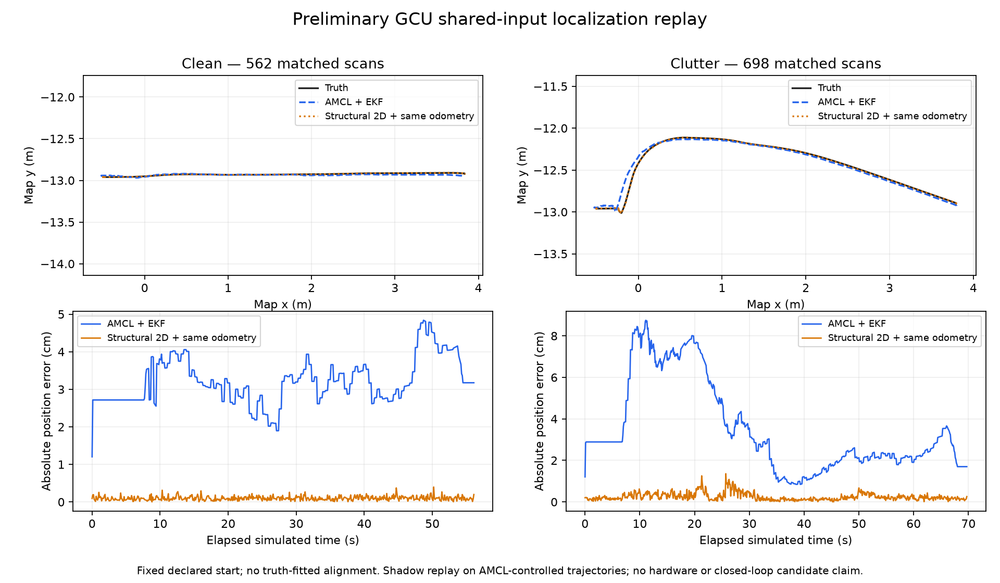

# Phase 08: preliminary localization study — closed

## Quick summary

- **Status:** Closed as a preliminary feasibility study by user decision on November 14, 2026. AMCL remains the production baseline.
- **Evidence:** 183 passing tests and 1,260 paired clean/occluded scan frames; separate structural 2D prototype and raw evidence retained.
- **Decision:** Defer further AGLoc implementation, recovery and TF/closed-loop integration. No controlled CPU/RAM advantage or Pi benefit has been established.
- **Next:** Phase 09 measures the existing navigation stack on the actual Pi 4B, with simulation/evaluation elsewhere; camera and language workloads follow.

## Closure decision — November 14, 2026

The user accepted the recommendation to retain the working AMCL localizer and
prioritize measured EdgeOsmAG deployment over further custom AGLoc development.
This closes the **preliminary feasibility study**, with the original integration
scope explicitly reduced. It does not certify a complete AGLoc/AGLoc++
implementation, global recovery, production TF handoff or candidate closed-loop
navigation. The two originally planned integration/evaluation groups are deferred,
not passed and not required to close this revised study.

The structural prototype remains separate for optional future experiments. Its
small errors in ideal simulation do not establish a practical resource advantage;
its latency tails motivate caution. The present data also do not establish that
the authors' implementation is unsuitable for a Pi. Revisit localization when
actual Pi profiling identifies AMCL as a material bottleneck, required navigation
cases expose localization failures, or a compatible author implementation becomes
available. Reopening it requires a fresh declared comparison scope.

For the paper, describe the deployed system as **osmAG-guided navigation with
AMCL** and document structural localization as a retained preliminary experiment.
Focus the main evaluation on navigation reliability and resource sharing with
perception and language. Whole-stack memory independence, exact osmAG-Nav
reproduction and Pi efficiency remain unproven claims.

## What we implemented

The [attached-paper audit](../GCU_LOCALIZATION_PAPER_AUDIT.md) checks the published
AGLoc method and current author source endpoint. The first implementation is a
**paper-inspired 2D reference**, not released AGLoc or AGLoc++. It cannot reproduce
the original 3D vertical clutter filtering with our single horizontal scan.

Implementations are separate under `experiments/localization_comparison/`:

- `baseline_amcl/` freezes the accepted native AMCL configuration/fixture inventory.
- `structural_2d/` contains vector-only map loading, ray associations, original
  Eq.8 robust weights, weighted point-to-line optimization, a deterministic
  corridorness weighting approximation and shared-odometry prediction.
- `common/` contains a read-only recorder, evaluator-only scoring, frozen-workspace
  verification and a scientific plot. Scoring includes an independent odometry-
  only diagnostic and never fits a transform to ground truth.

The prototype reports accepted, weak, rejected and lost frames. It preserves
odometry in unobserved directions. It has no global search/relocalization,
authoritative ROS TF adapter, semantic glass treatment, multi-floor transition
or AGLoc++ adaptive Kalman fusion. Both main variants share the declared start
and fused wheel/IMU odometry, but their estimation/uncertainty policies differ.

## Shared-input live capture

Fresh Ubuntu workspaces keep the accepted Phase 07 workspace untouched:

- `/home/ubuntu/edgeosmag_phase8_amcl_baseline_ws_01`
- `/home/ubuntu/edgeosmag_phase8_amcl_clutter_ws_01`

Native AMCL owns `map -> odom`. The existing accepted executor controls each
4.4 m mission. The observer subscribes to scans, TF, truth and AMCL measurement
messages; it publishes no TF, goals or wheel commands. The candidate is replayed
later in a separate Ubuntu process with one BLAS thread. It does not control the
robot during this group.

`observations.npz` contains scans, timestamps, sensor extrinsics, fused odometry
and the declared initial pose. `evaluation.npz` separately contains truth and
AMCL-derived poses. The candidate worker opens only the former and the OSM map;
truth is accessed only by scoring. Raw archives pin the native runtime and the
exact executed candidate/recorder sources. Configuration was fixed before the
batch and was not tuned against the results below.

The clean mission finishes in **138.67 wall seconds**; the obstacle mission in
**191.11 wall seconds**, each below its 300 s service budget. All five native
processes exit 0; truth-bridge and simulator shutdown checks pass. Both recorder
and candidate processes finish cleanly. The physical box is absent from the map
and measures 0.45 × 0.65 × 0.60 m at `(0.6, -12.9603)`.

## Initial tracking measurements

| Case | Matched / received scans | AMCL position RMSE | Structural 2D position RMSE | Odometry-only RMSE |
| --- | ---: | ---: | ---: | ---: |
| Clean | 562 / 580 | 0.03265 m | 0.001138 m | 0.008813 m |
| Physical obstacle / occlusion | 698 / 716 | 0.04146 m | 0.003103 m | 0.02887 m |

Matched coverage is 96.90% and 97.49%; each case excludes 18 startup frames before
truth/TF bracketing becomes available. No paired-stream gaps exceed **0.1 simulated
seconds**. Every paired frame is scored, including any rejected/lost frame; none
is discarded based on estimator error. Both candidates accept all frames and
have zero lost frames. The structural p95 position errors are **0.00199 m** and
**0.00603 m**; p95 heading errors are **0.0117°** and **0.0272°**. These satisfy the
initial tracking-only gate of 0.25 m p95 position / 5° p95 heading with no lost frames.

These are absolute fixed-frame localization errors at scan timestamps, not final
navigation-goal errors. Native AMCL emits 114 pose measurement messages in the
clean capture; its configured 0.03 m / 0.03 rad update thresholds and 120 selected
beams differ from the prototype's every-scan valid-return processing. Comparisons
use the complete AMCL-plus-odometry TF pose at each paired timestamp.



**Do not interpret millimetre simulation errors as physical-robot accuracy.** The
Gazebo walls and map share a construction source, the start is known and odometry
is very accurate. The odometry-only diagnostic is already within about 0.9 cm
RMSE in the clean case. These cases do not test long featureless corridors,
kidnapping recovery, inaccurate CAD geometry or a moving crowd. One physical
occluder is not a general dynamic-clutter benchmark.

## Cost findings supporting the closure decision

The prototype stores **55,712 bytes of numeric wall/passage arrays** for 1,673
physical segments, but Python/vector-library and temporary-array costs still
matter. Its median/p95 wall update times are **50.3 / 182.4 ms** clean and
**54.3 / 167.4 ms** with the obstacle. About **17.3% / 21.1%** of updates exceed
100 ms. This is a scheduling warning for 10 Hz online operation, not proof of
an observed closed-loop deadline failure: the candidate ran offline.

`profiling.json` retains native live component samples and separate standalone
candidate samples. For example, candidate post-tracking PSS is approximately
49,095 / 49,331 KiB, while native AMCL's recorded end samples are 32,536 / 31,945
KiB (with an additional live map-server component). Different co-resident processes,
update cadences and scheduling make this **an uncontrolled profiling comparison**.
No memory/CPU winner, total-stack scaling result or Pi result is claimed.

The accuracy result supports optional future evaluation, but does **not** justify
replacing AMCL. Further development is deferred. If reopened, test non-ideal
odometry/map/initialization and profile association cost before attempting
authoritative TF publication. The existing working navigation stack remains in use.

## Reproduction and evidence

The [research protocol](../EDGEOSMAG_LOCALIZATION_STUDY.md) records the proposed
paper contribution, hypotheses, fairness rules and reporting boundaries. The
[Phase 08 plan and scope decision](../plans/08_GCU_LOCALIZATION_COMPARISON.md)
preserve the original work groups as completed or deferred.

From the repository root, on the Mac using the existing project environment:

```bash
PYTHONDONTWRITEBYTECODE=1 docs/research/osm-AG/osm_cad_pipeline/osmAG-from-cad/venv/bin/python -m unittest discover -s tests
PYTHONDONTWRITEBYTECODE=1 docs/research/osm-AG/osm_cad_pipeline/osmAG-from-cad/venv/bin/python experiments/localization_comparison/common/verify.py --evidence simulation/gcu_ground_floor/phase8_diagnostics/clean_tracking --case clean
PYTHONDONTWRITEBYTECODE=1 docs/research/osm-AG/osm_cad_pipeline/osmAG-from-cad/venv/bin/python experiments/localization_comparison/common/verify.py --evidence simulation/gcu_ground_floor/phase8_diagnostics/clutter_tracking --case clutter
```

The verifier checks frozen native/runtime sources, exact candidate and recorder
hashes, input/map fingerprints, declared start, complete paired timestamps,
coverage and clean baseline navigation/shutdown before recomputing scores.
The archives preserve their actual executed versions; root evaluator changes
must remain distinguishable from those runtime snapshots. Synthetic geometry
unit tests support implementation correctness and are not localization benchmarks.

No additional user motion review is required to close this revised study: the
experimental estimator has no TF or navigation output. The retained shutdown
audit reports no remaining experiment processes. No additional simulation run
was needed for the documentation-only closure. Phase 09 profiles the accepted
navigation baseline on actual Pi hardware before adding perception/language load.
