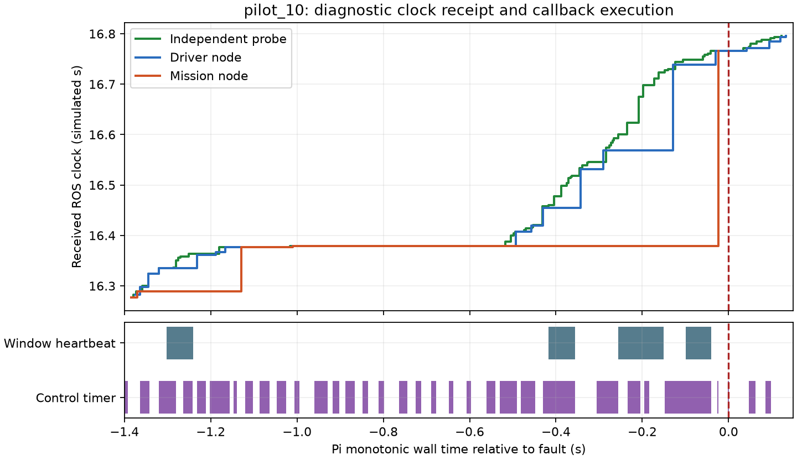

# Phase 09 diagnostic checkpoint: callback and scan delivery

## Quick summary

- **Scope:** Instrumented Pi-driven simulation with callback and scan delivery checks.
- **Result:** After the reported closer-router move, pilot 14 passes independent mission scoring at 0.2×; all 191 scans match. Higher-rate pilots 15/16 fail TF admission before any goal is sent.
- **Limits:** One slow mission is not a reliability or real-time capacity result. All 212 tests pass.
- **Remaining:** Isolate full-stack local processing from delivery delay, meet higher-rate admission/runtime gates, then freeze repeated measurements. Phase 09 remains open.

## Why this follows local replay

[Checkpoint 09C](09C_PI4B_LOCAL_REPLAY.md) reproduces an intermittent observation
gap without Wi-Fi sensor delivery. These pilots add two complementary views:

- Inside the mission process, wrappers record callback entry/return and ROS
  clock values for the control timer, clock, scans, IMU, grid updates, action
  callbacks, window heartbeat and driver loop.
- A separate Pi process records clock, scan, IMU and relevant TF callback
  receipts using the same host monotonic clock, without a simulated-time clock,
  commands or ground truth.

These are **callback timestamps**, not wire-arrival timestamps. Different DDS
readers may receive different subsets of best-effort data. The trace can expose
receiver/process differences; it cannot by itself isolate network, middleware,
callback-group scheduling, thread scheduling or lock waits. Retention is bounded
and total/retained counts are recorded. Instrumentation adds CPU/memory costs,
so these trials are not an uninstrumented performance benchmark.

## Retained bounded attempts

All motion attempts request the same approximately 1.5 m route across passage
`-93`, with the same map, 0.1 m/s command limit, 0.15 s TF/observation-gap limits
and 0.3 s scan-age limit. Pilots 10–14 target 0.2× physics; 15/16 target 1.0×.
These targets are not measurements of sustained simulator rate. Clock transport
is capped at 100 publications per wall second. Power saving is verified off;
after the Pi reboot preceding pilot 14, the user restores it before testing.

| Pilot | Declared experimental options | Recorded result |
| --- | --- | --- |
| 10 | Timing trace; original callback groups and scan transport | Goal accepted; stale-scan guard stops execution. |
| 11 | Trace + separate mission timer group | Actor confirms passage crossing; stale TF later stops execution before the final goal. |
| 12 | Trace + separate timer + reliable scan hop | Observer CLI integration error during startup. Pi owner deliberately stopped; no mission starts. Failed startup and shutdown reports retained. |
| 13 | Corrected observer CLI; same reliable scan-hop options | Goal accepted; stale-scan guard stops execution. Scan-hop verification also fails coverage. |
| 14 | Same normalized payload as 13; reported move closer to router, after reboot and power-saving restoration | **Independent mission scoring passes:** goal, passage crossing, rest, swept footprint and contacts checked. 191/191 scans match. |
| 15 | Same payload/settings as 14 except 1.0× physics target | Stale TF before mission admission; no navigation goal is sent. |
| 16 | 1.0× target plus bounded fresh-TF acquisition while the model is pristine/idle | TF remains stale within the bounded admission interval; no navigation goal is sent. |

These are sequential diagnostic variants, not randomized repetitions or a
success-rate comparison. Pilot 14 passes independent scoring; the earlier
attempts fail, and higher-rate 15/16 never dispatch a goal. The role owners
terminate their children. Independent truth records
sampled rest after the failures and no classified wall contacts; this does not
convert them into successful missions or general safety validation.

## Finding 1: mission-process clock lag

In pilot 10 the actor clock callback goes **0.987 wall seconds** without an
update while its control timer continues running. The independent Pi probe
records **39 clock callbacks during that interval**, and the driver node's clock
also advances before the actor's clock catches up. Some of the interval is a
shared receipt gap too; it is not exclusively an actor-only stall.

The actor eventually jumps from ROS time 16.379 to 16.766, processes an older
scan stamped 16.4, and stops on the existing scan-age guard. The independent
probe had already recorded scan 16.7. This demonstrates a receiver/callback
processing difference and motivates separating control work from the node's
default data callback group. It does not establish a unique root cause.



The optional timer change preserves the **same callback, state lock, steady
clock and 40 ms period**, but gives the timer its own mutually exclusive group.
Clock/sensor callbacks remain in the node's default group. Tests check that the
callback/clock identities and period are preserved and unexpected timer layouts
are rejected. No age, geometry or speed threshold changes.

Pilot 11 runs for 7.861 simulated seconds after dispatch, with approximately
0.771 m independently recorded net displacement and one actor-confirmed passage
crossing. It is better progress in that attempt, **not proof of a reliable fix**.

## Finding 2: scan delivery remains a separate problem

Near pilot 11's final fault, Ubuntu's source observer records scans 24.9, 25.0
and 25.1. None appears in the independent Pi probe's retained receipt log; it
records 24.8 and then 25.2. The map-to-odom TF last observed on the Pi is stamped
25.0, consistent with AMCL's configured 0.2 s transform tolerance after scan
24.8. When the actor clock reaches 25.162, the latest composed TF is too old
for the unchanged 0.15 s guard. The mission stops correctly under that policy.
Absence from a callback log is not a direct measurement of network packet loss.

The next variant adds a simulation-only reliable DDS scan hop: Ubuntu subscribes
to its local source scan, publishes `/phase9/remote_scan` with reliable depth-5
QoS, and a Pi receiver republishes the unchanged message locally as `/scan`.
The Ubuntu truth observer continues to observe the original source scan topic,
not the round-tripped Pi output. Both relay endpoints hash the serialized scan
and record the original header stamp. No scan is freshened by relabelling it.

Pilot 13 still fails. During its declared mission interval, the source observer
and sender each record three unique scan stamps; the receiver records two.
Stamp **18.1** is absent, and all matched scans have identical serialized hashes.
The receiver has a **2.301 s wall-time gap** between scans 18.0 and 18.2. The
mission stops before the latter is received, when its latest processed scan is
0.347 simulated seconds old. Reliable QoS alone did not establish timely or
complete callback receipt in this setup. No cross-host one-way latency is
inferred from unsynchronized host monotonic clocks. This remains the recorded
outcome of pilot 13; the closer-router retest below is a separate attempt.

## Closer-router retest: first independently verified Pi mission

The user selects moving the Pi close to the same router. Measured signal is
**−44 dBm** on the same SSID/BSSID, at 2412 MHz. The Pi has rebooted; power saving
initially returns to on, then the user restores off and SSH verifies it before
testing. Initial temperature is 43.8°C and the firmware reports
`throttled=0x0`. Physical distance and ambient temperature are not measured.

The [payload comparison](../../../../simulation/gcu_ground_floor/phase9_diagnostics/router_retest_14_source_comparison.json)
finds no unexpected differences from pilot 13 across 40 Pi and 98 simulator
payload files, normalizing only deployment paths/session IDs and regenerated
manifests. Reboot, session, temperature and elapsed-time differences remain, so
this sequential retest does not prove distance caused the improvement.

Pilot 14 passes all inherited independent correctness gates:

| Independent measurement | Result |
| --- | ---: |
| Final position / heading error | 0.0881 m / 1.503° |
| Localization p95 position / heading error | 0.0555 m / 0.496° |
| Truth/TF match coverage | 407 / 408 samples (99.75%) |
| Maximum truth observation gap | 0.050 simulated s |
| Confirmed / expected passages | 1 / 1 |
| Sampled physical swept-circle validation | Pass, 0.18 m radius |
| Classified wall contacts | 0; all 13 contact publishers present |
| Independent sampled rest | Confirmed over ≥1 simulated s |
| Source / received unique scans in evaluated interval | 191 / 191, no changed serialized hashes |

The evaluated mission lasts 19.128 simulated seconds and travels approximately
1.422 m. The native action's motion interval spans 89.604 wall seconds; observed
scan delivery is about 1.991 callbacks/wall second and 0.1991 header-simulated
seconds per wall second. These different intervals are explicit: the independent
mission score includes final rest observations, whereas the resource interval
ends at the last native success response.

The instrumented resource sample spans 88.604 wall seconds within that motion
interval, with a stable process set. Aggregate sampled domain-process CPU is
208.1% of **one core** and maximum sampled concurrent PSS is 404,327 KiB. These
include a separate receipt probe (~32.0% of one core), the Pi scan relay (~16.8%)
and in-process tracing. The osmAG/window/executor actor averages ~103.5% of one
core and AMCL ~7.1% in this slow run. Preprocessing, rest verification and
teardown are excluded from these CPU intervals. Sampling can miss peaks; the
sampler owner and offboard simulator are excluded. This is a preliminary
instrumented profile, not an uninstrumented or sustained navigation budget.

## Higher-rate admission remains open

Pilot 15 changes only the physics target from 0.2 to 1.0, aside from deployment
paths/session identifiers. It fails on stale TF before `model.start()` and sends
no navigation goal. Its old `stage: motion` label precedes admission; the idle
model and absence of send events establish what actually happened.

Pilot 16 makes that stage explicit and adds at most five wall seconds of fresh
TF acquisition. A retry is permitted only for `stale_robot_tf` while the model
is idle, has no contract/attempts, and owns no action handles. Once model start
or any action attempt occurs, no admission retry is allowed. The original begin
checks run on every attempt; running freshness limits, speed, path constraints
and action deadlines are unchanged. Tests cover eventual acquisition, timeout,
and refusal to retry after state/action changes or other failures.

Pilot 16 still times out on stale TF before any goal is sent. All 35 source
scans in its admission interval are eventually received with matching content,
which demonstrates that completeness alone is not a freshness guarantee. These
failures do not measure sustained moving performance at 1× and do not prove the
Pi lacks compute capacity. No more live retries are left running.

## Evidence and reproduction

- [Callback pilot summary](../../../../simulation/gcu_ground_floor/phase9_diagnostics/callback_pilot_summary.json): independent sampled displacement/rest and retained resource samples.
- [Pilot 10 correlation](../../../../simulation/gcu_ground_floor/phase9_diagnostics/pilot_10/callback_analysis.json).
- [Pilot 11 correlation](../../../../simulation/gcu_ground_floor/phase9_diagnostics/pilot_11/callback_analysis.json).
- [Pilot 13 scan-hop verification](../../../../simulation/gcu_ground_floor/phase9_diagnostics/pilot_13/scan_link_analysis.json).
- [Final process audit](../../../../simulation/gcu_ground_floor/phase9_diagnostics/callback_process_audit.json): no owned experiment processes on either host; operating systems/desktops left running.
- [First successful mission score](../../../../simulation/gcu_ground_floor/phase9_diagnostics/pilot_14/independent_score.json) and [scan verification](../../../../simulation/gcu_ground_floor/phase9_diagnostics/pilot_14/scan_link_analysis.json).
- [Pilot 14 sampled motion-interval resources](../../../../simulation/gcu_ground_floor/phase9_diagnostics/pilot_14/resource_interval_summary.json).
- [Higher-rate pilot 16](../../../../simulation/gcu_ground_floor/phase9_diagnostics/pilot_16/orchestration.json) and [admission scan verification](../../../../simulation/gcu_ground_floor/phase9_diagnostics/pilot_16/scan_link_analysis.json).
- [Post-retest process audit](../../../../simulation/gcu_ground_floor/phase9_diagnostics/router_retest_process_audit.json).
- [Harness scope and options](../../../../experiments/pi_baseline/README.md).

Each trial retains source/configuration archives, per-host manifests, native
logs, actor/probe traces, independent truth/contact observations and failed
mission scores. All **212 tests pass**, including trace delegation/exception
identity, bounded concurrent retention, same-host trace correlation, timer
preservation, bounded pre-dispatch TF acquisition, sampled CPU accounting and
rejection of missing/changed scan content.

From the repository root, regenerate a callback correlation with:

```bash
PYTHONDONTWRITEBYTECODE=1 docs/research/osm-AG/osm_cad_pipeline/osmAG-from-cad/venv/bin/python \
  experiments/pi_baseline/analyze_callbacks.py \
  --evidence simulation/gcu_ground_floor/phase9_diagnostics/pilot_11
```

Use `analyze_scan_link.py` for pilot 13 and `plot_callbacks.py` for the retained
failure plots. These analyzers do not replace independent mission scoring.

## What remains together in Phase 09

1. Isolate full-stack local processing from cross-host delivery delay and meet
   the higher-rate TF admission/runtime gates. The closer-router slow mission
   is successful; faster Internet alone is not a timing guarantee.
2. Freeze representative tasks/rates and repeat correctness/resource measurements.
   The single passing 0.2× mission does not prove full-rate Pi capacity or a
   sustained budget for camera/LLM workloads.

The original executor's production source and frozen Phase 07/08 baselines are
unchanged by these optional callback-group/scan-hop variants. They remain
explicit experimental profile flags, disabled by default. The fresh-TF acquisition
is a harness setup check, not a change to the production executor. Phase 09 is
not complete; camera/LLM headroom and a performance advantage remain unestablished.
