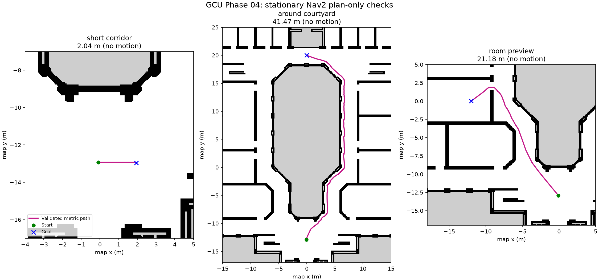

# Phase 04 plan: footprint-feasible autonomous metric navigation

## Quick summary

- **Scope:** Footprint-aware Nav2 planning, autonomous motion and failure handling in the GCU simulation.
- **Outcome:** All 16 original functional checks passed, including nine nominal repeats.
- **Open issues:** Consecutive-goal heading correction and evaluation-bridge shutdown crashes remain unresolved.
- **Next:** Repair those issues before osmAG routing and segmented execution; current global routes come from Nav2 A*.

Date: planned 2026-11-02; finalized 2026-11-03. Status: **original selected-route matrix passed;
consecutive-goal heading and evaluation-bridge shutdown issues remain open**. See [Checkpoint 04](../phases/04_GCU_AUTONOMOUS_METRIC_NAVIGATION.md)
for current results and full reproduction commands. The sections below retain
implementation history, including interrupted attempts.
Predecessor: [Phase 03](../phases/03_GCU_LOCALIZATION_AND_CONTROLLED_MOTION.md).

## Objective and integration boundary

Command a destination through Nav2 `NavigateToPose`, then let the planner and
controller generate and execute motion using AMCL, odometry, LiDAR and costmaps.
Phase 03 bounded motion used ground truth to supervise stopping distance/angle.
Phase 04 must remove that evaluation oracle from execution: Gazebo truth is used
only for measurement. No test script may steer or stop the successful route at
its desired ground-truth coordinate. Emergency test termination remains separately
logged as a failed/aborted trial, not an autonomous success.

This establishes the metric executor required by osmAG-Nav. Phase 05 will supply
area/passage-derived subgoals and segmented execution to this tested action stack.
A successful `NavigateToPose` trial alone is not an osmAG-Nav replication.
The current ROS osmAG planner's direct `FollowPath` bridge is an older baseline.
Its fallback paths and missing-TF start-pose substitution must not enter Phase 04;
keep that node disabled during this baseline and remove/collision-validate unsafe
fallbacks before its later integration.

## Sequence

1. **Freeze the navigation contract.** Preserve corrected robot, controller and
   AMCL versions; audit topic/TF ownership, simulation clocks, footprint, command
   limits and timeout behavior. Use one command owner. Derive footprint from the
   actual simulation collision geometry; check whether the existing 0.18 m radius
   conservatively covers it. Do not select a smaller radius to force a doorway pass.
2. **Validate costmaps without motion.** Add a GCU-specific Nav2 configuration and
   launch with static, obstacle and inflation layers, planner, controller and BT
   navigator. Inspect map/scan/footprint/global and local costmaps in Foxglove.
   Unknown courtyard/exterior is nontraversable. The known corner ray stays raw;
   check whether it creates a persistent costmap obstacle.
3. **Validate plans before execution.** Use `ComputePathToPose` for each chosen
   route. Check start, goal and full swept footprint against collision geometry,
   including door approaches and turning. A connected point graph is insufficient.
   Audit the 11 flagged narrow interfaces, publishing feasible/rejected reasons;
   do not force all 68 adapter passages to be robot traversable.
4. **First autonomous goal.** Execute a short straight corridor route, then a route
   with a turn. Keep speed <=0.10 m/s for this initial simulation baseline.
   Nav2 supplies commands and completion; ground truth only scores the result.
5. **Doorway and rejection tests.** Select one genuinely feasible room entrance.
   Test occupied/unknown goals and a fully blocked passage. Refuse an infeasible
   route or abort safely; never manufacture a straight-line path after failure.
   Add one obstacle-avoidance case whose alternate path is verified feasible.
6. **Freeze and repeat.** Separate tuning runs from acceptance. Select/record exact
   start/goal coordinates after feasibility inspection, freeze parameters and
   timeouts before acceptance, then rerun the case matrix below. Keep every attempt,
   including aborts. No tuning between acceptance trials.

## Proposed acceptance matrix (freeze before execution)

| Case | Repeats | Required result |
| --- | ---: | --- |
| Short corridor goal | 3 fresh starts | Reach target and stop autonomously |
| Corridor route with a turn | 3 fresh starts | Reach target without footprint overlap or loss of localization |
| Feasible room-entry goal | 3 fresh starts | Traverse entrance and reach interior target |
| Occupied / courtyard-unknown goals | One of each | Reject before driving toward an invalid destination |
| Fully blocked passage | 1 | No unsafe substitute path; reject or abort and stop |
| Obstacle with a feasible detour | 1 | Replan/avoid and reach target without contact |
| Cancel a moving goal | 1 | Action cancellation and stop observed |

These are small engineering acceptance trials, not a statistical success-rate
claim. If no room entrance is physically feasible with the audited footprint,
report that as a blocker and repair the CAD/portal/geometry contract before closure.
Do not replace the doorway case with another easy corridor run.

## Proposed quantitative gates

- All nine nominal runs succeed: Nav2 action success **and** independently measured
  final position error <=0.20 m and heading error <=10 degrees. Confirm rest for
  >=1 simulation second at <=0.01 m/s and <=0.02 rad/s. Action success alone is not
  enough; record final AMCL and ground-truth errors separately.
- Zero robot-to-wall/obstacle contacts and zero swept-footprint intrusion into
  occupied/unknown space in the acceptance runs. Add wall-contact instrumentation
  and verify it with a separate positive-control fixture; silence from an untested
  contact monitor is not evidence of no collisions. Cross-check against sampled
  ground-truth footprint/geometry intersections and report sampling limitations.
- P95 localization error <=0.25 m / 5 degrees on each nominal route, using
  timestamp-matched estimates and ground truth. Log persistent TF/clock gaps and
  abort on stale required state; freeze the precise stale-data limits in the test
  harness before acceptance.
- Cancellation/abort stopping within 1.0 simulation second of acknowledged cancel
  or abort request, without test-harness velocity commands creating the stop.
  Continue to record direct-controller watchdog behavior separately.
- For nominal routes, predeclare a simulation-time deadline after route length and
  speed limits are known. Record both simulation and wall-clock durations; do not
  count UTM slowdown as robot travel inefficiency or use wall time as simulation time.
- Invalid goals must be rejected; blocked-route tests must not return a false
  success. Timeout or harness emergency intervention is a failed/aborted case.

## Data and deliverables

Produce a GCU-specific Nav2 launch/config, feasible-portal report, fixed case list,
action-based evaluation harness, raw trial records and compact summary table.
Capture path length, shortest feasible reference length (same map/footprint),
planning/action latency, goal/heading errors, localization errors, minimum clearance,
contacts/intersections, replans, recoveries, cancellation/abort reason and duration.
Report CPU/RAM and real-time factor as development-machine observations, not Pi data.
Save representative Foxglove views and a ROS recording where practical.

Create `phases/04_GCU_AUTONOMOUS_METRIC_NAVIGATION.md` only after acceptance is
reviewed; include software/config hashes, all attempts, exact reproduction commands,
limits and next gate. Update the phase index and readiness guide. A blocked gate
stays explicitly open rather than being redefined after results are seen.

## Relationship to the complete project and research

| Project step | Evidence supplied |
| --- | --- |
| Phases 01–02 | CAD-derived area geometry and aligned simulator/map assets |
| Phase 03 | Local localization and supervised bounded movement checks |
| **Phase 04** | **Autonomous, footprint-aware metric goal execution baseline** |
| Next: osmAG-Nav integration | Areas/passages select ordered subgoals; rolling/segmented execution uses the tested Nav2 action stack; test room-to-room routing and blocked interfaces |
| Later: EdgeOsmAG | Measure baseline on Pi 4B; introduce edge scheduling, LLM intent and camera/object semantics incrementally, with ablations |

This phase provides the metric-only comparison for later osmAG-guided navigation:
use the same routes, footprint, controller and scoring, and distinguish full-map
from any future local/segmented map processing. Useful research outputs include
measured CAD-to-navigation feasibility loss, reproducible failure cases and a
controlled navigation baseline. These are potential evaluation material, not a
novel contribution or proof of memory/latency savings by themselves. UTM results
cannot substantiate constrained-hardware efficiency claims.

## References

- Existing local osmAG-Nav / osmAG paper boundary and integration notes in
  [GCU_SIMULATION_READINESS.md](../GCU_SIMULATION_READINESS.md).
- [Nav2 footprint setup](https://docs.nav2.org/rolling/configuration_and_development/first_time_robot_setup_guide/footprint/setup_footprint/).
- [Nav2 inflation layer](https://docs.nav2.org/jazzy/configuration_and_development/configuration_guide/core_servers/costmap_2d/costmap_plugins/inflation/).
- [Nav2 commander/action evaluation concepts](https://docs.nav2.org/rolling/configuration_and_development/simple_commander_api/simple_commander_api/).

Implementation must use APIs/plugins available in the installed Humble versions;
current online documentation may describe newer capabilities.


## Path visualization contract

The user requested click-to-goal visualization of the complete planned route.
The UI should show the current robot pose, clicked goal and full start-to-goal
path before/during execution, retaining the current route as the robot moves and
updating it when replanning occurs. Invalid or failed goals must show a reason
and clear/invalidate stale routes; they must never display a fabricated direct
line as a successful plan.

Phase 04 first exposes Nav2's metric plan (standard planner path topic, verified
against the actual installed configuration). A click handler will explicitly
bridge a `PoseStamped` goal to `NavigateToPose`; publishing `/goal_pose` alone is
not proof that a Nav2 action goal was accepted. Provide a plan-only preview mode
using `ComputePathToPose` before enabling execution.

The existing osmAG node already advertises `/osmag/global_path` (nav_msgs/Path)
and `/osmag/path_marker` (magenta LINE_STRIP marker) and subscribes to `/goal_pose`.
These interfaces were inspected in source, not validated for GCU navigation.
Keep this old node disabled during the metric baseline: its direct FollowPath
execution and fallback behavior still need review. Subsequent osmAG integration
will show its area/passage route separately from the locally feasible Nav2 path,
using distinct colors/topic labels so provenance is clear. A path drawn in
Foxglove is visualization evidence, not by itself evidence of clearance or execution.


## Initial footprint audit (2026-11-03)

Phase 04 implementation has started without movement. The corrected evaluation
URDF was expanded in Ubuntu and its 13 primitive collision geometries transformed
into the base_footprint frame at nominal joint positions. Their conservative XY
radius bound is 0.14485 m. The proposed 0.18 m circle covers those bounds with
0.03515 m radial margin; no footprint reduction is needed for the initial baseline.
Sphere/cylinder enclosing boxes deliberately overestimate shape extent. This does
not validate swept paths, contact behavior, costmap integration or joint-range
extents; those remain separate checks.

Reproduce from the repository root using the CAD venv:

```bash
docs/research/osm-AG/osm_cad_pipeline/osmAG-from-cad/venv/bin/python \
  scripts/audit_gcu_footprint.py \
  --urdf simulation/gcu_ground_floor/phase4_diagnostics/robot_collision_model.urdf \
  --output /tmp/gcu_footprint_audit.json
```

The saved expanded URDF is an audit input, not a portable launch model; mesh and
controller paths refer to the evaluated VM. Source fingerprint and bounds are in
`simulation/gcu_ground_floor/phase4_diagnostics/footprint_audit.json`.
At this initial audit checkpoint, costmap/preview validation and click-to-goal
execution were still pending. Later sections and Checkpoint 04 record completion.

## Plan-only implementation (2026-11-03)

`gcu_plan_only.launch.py` adds NavFn (`allow_unknown: false`, zero goal tolerance),
a global costmap and a standalone local rolling costmap to the existing simulator
and AMCL setup. Both costmaps use the audited 0.18 m radius, 0.02 m padding,
static/scan obstacle/inflation layers and simulation time. No Nav2 controller,
BT navigator or osmAG execution node is started.

The Humble standalone costmap executable fixes its node name to `/costmap/costmap`;
its occupancy grid is `/costmap/costmap` and its footprint is
`/costmap/published_footprint`. The planner's global costmap uses
`/global_costmap/costmap`. These are inspected runtime names, not the future
controller-owned local costmap names. Initial startup exposed this naming mismatch
and a reserved rclpy `handle` attribute collision; both were corrected before
acceptance. A VM stop interrupted the first corrected deployment; runtime results
must come from a complete subsequent run, not that interrupted attempt.

The preview node accepts map-frame `PoseStamped` on `/gcu/preview_goal`, requests
`ComputePathToPose` using the robot TF start, and publishes only validated full
paths on `/gcu/preview_path`. `/gcu/preview_status` is latched JSON with planning,
ready or rejected state; `/gcu/preview_target` shows the selected target. Failed,
superseded and timed-out requests clear the old displayed path. The public path
is separate from Nav2's raw `/plan` and the older `/osmag/global_path`.

Static validation samples each path segment no farther apart than map resolution/4,
checks exact point-to-blocked-cell rectangles, and adds half the sample spacing to
the radius to cover the gaps. Unknown and outside-map areas block paths. The reported
clearance is a capped lower bound, not an exact global minimum. Live obstacle
handling still depends on the planner/costmaps; this check is not collision sensing
or autonomous execution acceptance. Unit tests cover walls between clear endpoints,
unknown cells, free-center/blocked-footprint goals and invalid paths.

The stationary runtime checker exercises a short corridor preview, a path around
the courtyard, a room preview, and rejection of unknown/occupied/wrong-frame/
insufficient-clearance goals. It checks empty paths after rejection, full endpoints,
costmap lifecycle and footprint, forbidden courtyard cost, no nonzero commands and
no measured model drift. All three nominal goal footprints passed offline preflight.

### Try the no-motion preview in Foxglove

Keep the corrected GCU simulator, `gcu_amcl.launch.py` and Foxglove Bridge running
in domain 77 (the Phase 03 setup). Do not run the old fixed-transform alignment or
osmAG execution node. Add this in another Ubuntu terminal:

```bash
source /opt/ros/humble/setup.bash
source /home/ubuntu/lidarbot_ws/install/setup.bash
export ROS_DOMAIN_ID=77
ros2 launch /home/ubuntu/edgeosmag_test_ws/gcu_plan_only.launch.py \
  params:=/home/ubuntu/edgeosmag_test_ws/assets/nav2_plan_only.yaml
```

In Foxglove:

1. Keep fixed/display frames at `map`. Enable `/map`, `/scan`,
   `/gcu/preview_path` and `/gcu/preview_target` in the 3D panel; give the path a
   distinct visible color. Costmaps `/global_costmap/costmap` and
   `/costmap/costmap` can be enabled with transparency to inspect inflation.
2. In the 3D panel's Publish settings, select the **2D pose / goal** tool
   (`geometry_msgs/msg/PoseStamped`) and set its topic to `/gcu/preview_goal`.
   Do not choose the initial-pose estimate or point tool. Click-drag on a free
   location to set position and heading. These controls are described in the
   [official 3D panel documentation](https://docs.foxglove.dev/docs/visualization/panels/3d).
3. Add a Raw Messages panel for `/gcu/preview_status`. A valid goal should produce
   `planning` then `ready`, with path length and validation. The complete route
   appears in `/gcu/preview_path`; the robot stays stationary.
4. Try a nearby corridor goal, then a point in the top corridor beyond the central
   enclosure. The latter should show a detour around the courtyard. A point in the
   gray courtyard or on a wall must be `rejected` and clear the old path.

To request a deterministic example from another sourced domain-77 terminal:

```bash
ros2 topic pub --once /gcu/preview_goal geometry_msgs/msg/PoseStamped \
  '{header: {frame_id: map}, pose: {position: {x: 0.0, y: 20.0}, orientation: {w: 1.0}}}'
```

No `NavigateToPose` or `FollowPath` action is sent by the preview. It is a Nav2
metric path; it must not be labeled as an osmAG-generated route.

Before Ctrl-C of the planning terminal, shut down its lifecycle nodes cleanly:

```bash
source /opt/ros/humble/setup.bash
export ROS_DOMAIN_ID=77
ros2 service call /gcu_planning_lifecycle/manage_nodes \
  nav2_msgs/srv/ManageLifecycleNodes '{command: 4}'
```

Then Ctrl-C the planner launch. The first measured run passed all planning checks
but exposed a standalone-costmap unload abort on abrupt shutdown. Lifecycle
shutdown before SIGINT fixed it; the cleanup regression exited all launches with
code 0 and returned `success=True` from the lifecycle service.

### Reproduce the isolated test

On Ubuntu, the copied runner can start a fresh simulator/AMCL/planner test in
ROS domain 79, check preview goals without moving, and shut down automatically:

```bash
python3 /home/ubuntu/edgeosmag_test_ws/run_gcu_plan_only_test.py \
  --workspace /home/ubuntu/edgeosmag_test_ws \
  --robot-workspace /home/ubuntu/lidarbot_ws \
  --output /home/ubuntu/edgeosmag_test_ws/results/phase4_preview_repeat_01
```

Use a new output directory each time. From a fresh repository checkout on Ubuntu,
`python3 scripts/prepare_gcu_phase4_workspace.py --destination /tmp/gcu_phase4_ws`
prepares a new isolated workspace; pass that workspace to the copied runner.
The existing compatible installed robot workspace and logged-in sensor display
remain prerequisites.

The first portable-run attempt exposed a startup race: its map-server lifecycle
service timed out while simulator, AMCL and costmap initialization ran together,
so no map transform became available. That run failed readiness and is retained
as a rejected attempt. The portable runner now stages simulator startup, waits
for active AMCL/clock/map-to-base TF through `wait_gcu_localization.py`, and only
then starts planning. This readiness gate is also useful when launching manually:
do not add costmaps until AMCL is active. Acceptance limits are unchanged.


## Verified preview checkpoint

The ordered-startup portable runner passed all seven preview cases on 2026-11-03.
Planner and standalone costmap were active; the global courtyard cell remained
unknown (-1). The published padded local footprint radius was ~0.20917 m, covering
the 0.18 m reference radius. There were no observed nonzero velocity commands,
no measured ground-truth drift, and no Nav2 controller_server was present.
Lifecycle shutdown succeeded and all four launch processes exited with code 0.

| Goal case | Outcome |
| --- | --- |
| Short corridor | Complete validated path, ~2.04 m |
| Beyond the courtyard | Complete validated detour, ~41.47 m |
| Interior room preview | Complete validated path, ~21.18 m |
| Courtyard unknown cell | Rejected; old path cleared |
| Occupied wall | Rejected; old path cleared |
| Wrong goal frame | Rejected; old path cleared |
| Free center, insufficient footprint clearance | Rejected; old path cleared |

[Full report](../../../../simulation/gcu_ground_floor/phase4_diagnostics/plan_only_report.json),
[runner/cleanup status](../../../../simulation/gcu_ground_floor/phase4_diagnostics/plan_only_run.json)
and [tested input hashes/versions](../../../../simulation/gcu_ground_floor/phase4_diagnostics/tested_inputs.json).
The rejected concurrent-start report is retained alongside these files. Seventeen
Python tests pass. This checkpoint does not validate all 68 inferred interfaces,
autonomous goal execution, contact detection, cancellation or obstacle detours.



Historical user check: the no-motion previews were confirmed in Foxglove.
The subsequent controller/contact work and autonomous checks are recorded below;
current interactive commands are in Checkpoint 04.

## Autonomous implementation checkpoint (2026-11-03)

The new `gcu_contact_sim.launch.py` spawns a converted SDF of the corrected Phase
03 robot while publishing the original expanded URDF to ROS. All 13 physical
collision geometries have contact topics. A raised-box positive control reported
robot–obstacle contacts; ordinary ground support is excluded from wall-contact
counts. The Contact system publishes at physics rate in this Fortress build even
with a sensor update-rate request, so contact event details are capped while total
observed counts are retained. Empty sensor topics are not heartbeat messages.
Bridge discovery, the sensor manifest and the separate positive control establish
the instrumentation boundary; they do not certify contacts between samples.

`gcu_navigation.launch.py` starts NavFn, Regulated Pure Pursuit, controller-owned
local costmap and BT navigator. Both navigator interfaces use explicit strict
compute/follow trees. There are no backup/spin recovery branches or fabricated
fallback routes. Navigation uses `/odometry/filtered`, the actual existing EKF
output. The hardware controller and Phase 03 AMCL parameters are unchanged.
The drive command path is controller `/cmd_vel` -> navigation-only twist mux ->
`/diff_controller/cmd_vel_unstamped`; no joystick input is launched by this setup.

Early trials exposed a missing simulator plugin path, an unused default
through-poses recovery tree, an incorrect odometry topic, and too small an initial
turn command. The latter stalled at 0.05 rad/s; matching the controller's existing
1.5 rad/s² angular acceleration produced a 0.15 rad/s first command and restored
turning. Startup failures also occurred while an orphaned earlier Gazebo server
was running. That server was stopped, and subsequent trials use fresh ROS domains.
These are retained tuning/integration failures, not acceptance successes.

The short corridor trial reached its target autonomously with 0.0475 m / 5.72°
final ground-truth error. The corrected turning trial reached its target with
0.0953 m / 5.43° error, P95 localization 0.112 m / 2.63°, no observed wall contacts
and a clear independently checked swept footprint. These are development trials;
room entry and the frozen repeat/negative-case suite still determine closure.

Static interface inspection samples straight local crossings with a 0.18 m circle
against the original map, requiring endpoints inside the two incident area
polygons. It found crossings for 58 of 68 exported interfaces; 10 had none under
this search. A failed sampled straight crossing is not proof that all curved
crossings are impossible. This is a screening report for Phase 05 topology work,
not permission to execute every exported interface.

The room-entry target (-10, -7.5) lies in `gcu_gf_room_57`. The detour fixture adds
a LiDAR-visible 0.45 x 0.65 x 0.60 m box while retaining the original navigation
map. Its separate scoring map includes the obstacle. The blocked fixture closes
the entrance using a physical barrier and matching known-closure map. Offline
four-neighbor connectivity after conservative footprint inflation confirmed a
route exists in the detour fixture and the blocked goal is disconnected from the
spawn. The goal itself remains free in the blocked test.

The machine-readable contract is `simulation/gcu_ground_floor/navigation_acceptance.json`.
`run_gcu_navigation_suite.py` hashes inputs before acceptance, refuses changes
between trials, preserves every attempt and stops on the first failure. Results
must satisfy the original quantitative gates; tests additionally require >=90%
timestamp matching, truth gaps <=0.15 s, one velocity-command publisher and all
13 contact bridge publishers. Stop scoring checks translation and rotation over
a continuous one-second window, including cancellation, rather than accepting a
single near-zero velocity sample.

The Phase 04 readiness helper now has an explicit `--request-updates` option.
It can request up to six stationary AMCL sensor updates while waiting for the
map transform; it publishes neither a new pose estimate nor motion. Its default
remains read-only. The Phase 04 runner enables this option and records clock,
scan and TF diagnostics. In the next room trial this reached readiness in 0.96 s
with two requests. This addresses the initial stationary scan/prior ordering
without changing the map, covariance or AMCL tuning.

Implementation references: the installed Humble runtime is the compatibility
baseline. Relevant upstream examples are the
[Fortress contact-sensor world](https://github.com/gazebosim/gz-sim/blob/ign-gazebo6/examples/worlds/contact_sensor.sdf),
[ROS contact message](https://github.com/gazebosim/ros_gz/blob/ros2/ros_gz_interfaces/msg/Contact.msg),
[Humble controller odometry subscriber](https://github.com/ros-navigation/navigation2/blob/humble/nav2_dwb_controller/nav_2d_utils/include/nav_2d_utils/odom_subscriber.hpp)
and [Humble regulated controller](https://github.com/ros-navigation/navigation2/blob/humble/nav2_regulated_pure_pursuit_controller/src/regulated_pure_pursuit_controller.cpp).

## Interrupted acceptance and final transport freeze

The first frozen suite passed all nine nominal trials and the occupied, courtyard
and known-blocked-passage rejection cases. The obstacle case then failed before
motion: the BT navigator configured but could not deliver its lifecycle service
reply, leaving bringup incomplete. The log explicitly reports a reply timeout;
an earlier room run also logged a Fast DDS shared-memory port-lock failure. The
suite stopped on that failure and remains an interrupted acceptance attempt.
It must not be reported as a complete passing matrix.

A GCU-specific `fastdds_udp.xml` profile disables builtin shared-memory transport
and supplies UDPv4 for the isolated test processes. It does not change global
Ubuntu middleware settings. A subsequent obstacle development trial completed
successfully with 0.0929 m / 4.48° final error, no observed wall/obstacle events,
and a footprint-clear path against the map augmented with the obstacle.
The transport configuration follows the Fast DDS 2.6
[participant profile](https://fast-dds.docs.eprosima.com/en/2.6.x/fastdds/xml_configuration/domainparticipant.html)
and [transport descriptor](https://fast-dds.docs.eprosima.com/en/2.6.x/fastdds/xml_configuration/transports.html)
APIs. The first suite's failure motivates the change; a full repeat determines
whether the resulting bringup is reliable for this acceptance scope.

The first suite's room final-heading errors were 8.44–9.67°, close to the 10°
acceptance gate. Before the second full freeze, in-place turn speed was reduced
from 0.25 to 0.20 rad/s and the goal-checker heading tolerance tightened from 0.08
to 0.04 rad. The original acceptance gates, nominal routes and timeouts remain
unchanged. All cases are rerun; the earlier successes are not substituted for
second-suite repeats. The controller still uses 1.5 rad/s² angular acceleration
and a maximum requested linear speed of 0.10 m/s. Phase 03 robot/controller/AMCL
configuration is unchanged.

The second suite reproduced the same lifecycle reply failure on its third
corridor startup even with UDP-only Fast DDS. The UDP profile did not resolve the
fault and is retained only as an interrupted-middleware diagnostic. The final
runner uses `rmw_cyclonedds_cpp`, scoped to its child-process environment; manual
terminals must select that same backend explicitly. The supported Humble package
was installed in Ubuntu (seven new dependency packages, no package upgrades).
A separate cancellation trial then passed with an observed 0.30 simulation-second
stop delay and no contact events. A third full frozen suite is required for closure.

Cyclone package versions installed for the test are `ros-humble-rmw-cyclonedds-cpp`
1.3.5 and `ros-humble-cyclonedds` 0.10.5; exact distribution build strings belong
in the saved environment manifest. This is a tested middleware selection for the
VM setup, not proof of the underlying Fast DDS defect or a general benchmark
comparison between DDS implementations.

## Stable-route correction after obstacle oscillation

The Cyclone suite completed all nine nominal repeats and the three native
rejection cases without a startup failure. The static obstacle detour then
aborted with `Failed to make progress`. Its trace contained 47 published plans in
31.28 simulation seconds. Successive paths alternated above and below the
symmetrically placed box, and commands repeatedly switched the in-place turn
between positive and negative directions. Translation remained too small to
satisfy the unchanged progress watchdog. No collision was observed.

The behavior trees now request a new path when the goal changes, then keep the
route while Nav2's `IsPathValid` service accepts its remaining portion. Invalid
routes call the actual planner again. `GoalUpdatedController` ensures each new
navigation request computes a fresh route, including consecutive goals; it does
not reuse a previous goal's route. These are installed Humble BT plugins. The
`Fallback` control node chooses validation or real planning; it never creates a
straight-line substitute. No progress timeout or acceptance threshold was relaxed.
The first corrected detour development trial succeeded in 39.76 simulation seconds
with 0.0891 m / 2.22° final error and no observed contact.

Three fresh-start detour development trials and a two-goal sequential regression
are run before another full freeze. The latter checks that a new target on the
same running stack is reached rather than returning success on the old route.
The final matrix is rerun in its entirety. Mid-run insertion of a moving/new
obstacle is outside this fixed-fixture matrix; route invalidation is configured
through Nav2's service but is not claimed as a separately validated dynamic test.
References: [Humble goal-updated decorator](https://github.com/ros-navigation/navigation2/blob/humble/nav2_behavior_tree/plugins/decorator/goal_updated_controller.cpp),
[path-validity condition](https://github.com/ros-navigation/navigation2/blob/humble/nav2_behavior_tree/plugins/condition/is_path_valid_condition.cpp)
and [planner validity service](https://github.com/ros-navigation/navigation2/blob/humble/nav2_planner/src/planner_server.cpp).

## Bounded closeout scope

The stable-route change passed all three fresh detour regressions. The additional
sequential-goal check computed a fresh return route and reached the return point,
but aborted while correcting a large final heading. Final position error was
0.0677 m and final heading error 71.6°. The trace shows the follower switching
between final-heading correction and positional approach as rotation shifts the
estimated pose across the 0.10 m XY threshold. The unchanged progress watchdog
then aborts. This is a failed extra regression, not an autonomous success.

Closeout returns to the original 16-case matrix, retaining this as an explicit
open limitation. The original matrix is run once with the final configuration;
its result determines selected-route milestone acceptance. Arbitrary consecutive
goal orientations cannot be claimed reliable until the separate controller
interaction is repaired. No custom controller or broader test campaign is added
to this closeout.

## Historical user-requested pause (subsequently resumed)

At the pause, testing stopped. Cancellation was acknowledged for the active simulated goal;
all three launch groups exited with code 0, and no final-suite test processes
remain running. The packaging watcher was stopped as well. Ubuntu can remain
logged in; the completed outputs are saved on disk.

At the pause, the `acceptance_04` ledger had **nine completed passing cases**:
contact positive control, all three corridor repeats, all three turning repeats,
and room-entry repeats 1 and 2. The eight completed nominal navigation trials
retain their full reports. The interrupted third room repeat is archived at:

`/home/ubuntu/edgeosmag_test_ws/results/phase4/acceptance_04/user_interrupted_room_entry_03/`

This interruption is attributed to the user's pause and is not counted as a
navigation failure or success. Resume from a fresh spawn for `room_entry_03`,
then run occupied-goal rejection, courtyard rejection, blocked passage, obstacle
detour, moving-goal cancellation and UI courtyard rejection. Do not rerun the
nine completed cases or change the frozen inputs.

The archived [pause checkpoint](../../../../simulation/gcu_ground_floor/phase4_diagnostics/autonomous_acceptance/pause_checkpoint_2026-11-03.json)
contains the original completed-case summaries, seven remaining case names, frozen input
fingerprints, archive locations and continuation instructions. Its VM copy is
`/home/ubuntu/edgeosmag_test_ws/results/phase4/resume_checkpoint.json`.
The suite main entrypoint intentionally refuses an existing output directory;
continuation should use a helper under `results/phase4/` to verify the fingerprints,
run only remaining cases with the existing runner, and append to the same ledger.
Keep helper files outside the frozen workspace root. Restart evidence packaging
after continuing. No further test or finalization work is running during the pause.

The additional consecutive-goal final-heading regression remains open and must
stay visible in the eventual report. The remaining cases and documentation were subsequently completed as recorded
below. This section preserves the historical pause and continuation instructions.

## Final checkpoint

The user resumed testing on 2026-11-03. Frozen inputs and all saved results were
verified, and only unfinished cases ran. A detached continuation stopped during
the obstacle test before any result was recorded; that attempt is archived as
an external interruption with an unknown cause. It is neither a navigation pass
nor a navigation failure. The remaining cases subsequently ran as a durable
Ubuntu service. Both interrupted attempts are listed separately from acceptance.

The final frozen suite, using Cyclone DDS, passed all 16 selected-route cases with the original
acceptance limits. All nine nominal repeats passed; worst final errors were
0.091 m / 6.42°, and worst per-run P95 localization was
0.124 m / 4.48°. Contact control, static obstacle detour, native
occupied/unknown/blocked rejection, cancellation and UI route validation/clearing
passed. All launch groups exited with code 0; all 15 navigation lifecycle
shutdown calls returned success. The source verification confirms current
repository inputs match the tested files and the executed URDF matches the
footprint audit. See [Checkpoint 04](../phases/04_GCU_AUTONOMOUS_METRIC_NAVIGATION.md).

The child-process audit found two evaluation ground-truth bridge segfaults after
SIGINT during simulator teardown. Launch-group exit codes did not expose them.
The full logs and classification are retained in `teardown_review.json`. These
cleanup failures and the additional consecutive-goal heading regression remain
open; this is acceptance of the original functional matrix, with those limits.
The final VM process audit found no remaining GCU simulator/navigation processes.
