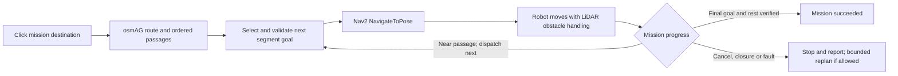

# Phase 06 plan: osmAG-guided segmented navigation in GCU

## Quick summary

- **Goal:** Turn an osmAG route into a complete simulated mission through ordered passages using Nav2 `NavigateToPose`.
- **Starting point:** Phase 05 is accepted: refined route preview, validated frames/passages, reliable metric execution and user visual confirmation.
- **Result wanted:** Click a destination, see the full osmAG route and active Nav2 segment, and observe verified crossings, final arrival, cancellation and closure handling.
- **Boundary:** Keep the static floor map, AMCL and tested controller. Rolling maps/proxy goals are Phase 07; structural localization is Phase 08. Bounded Phase 06 accepted November 13, 2026; see the [completion record](../phases/06_GCU_SEGMENTED_NAVIGATION.md).

Planned 2026-11-06. Predecessor: [Phase 05](../phases/05_GCU_OSMAG_ROUTE_PREVIEW_AND_RELIABLE_HANDOFF.md), merged in `253ce3c`. Forward sequence: [osmAG-Nav / EdgeOsmAG roadmap](../OSMAGNAV_PHASE_ROADMAP.md).

## Delivery in short checkpoints

The user requested separate checkpoints rather than an hours-long run. Finish, save evidence and report each batch before continuing to the next. Do not start an unattended combined acceptance suite. Runtime-test batches should fit a predeclared 20-minute wall-time budget; select short fixtures and terminate/clean up the test's own processes on timeout. If a required trial cannot fit, split the validation or report that limitation instead of silently extending the batch. Coding progress and remaining gates must stay visible.

| Batch | Scope and stopping point | Status |
| --- | --- | --- |
| **06A** | Pure mission geometry, ordered crossing monitor and action-state tests using fabricated callbacks. No ROS/UTM/Gazebo. | Passed: 32 new tests, 79 total tests and eight offline GCU cases. [Checkpoint record](../phases/06A_GCU_MISSION_CONTRACT.md). |
| **06B1** | ROS adapter against a mock navigator, synthetic TF and explicit cancellation/preemption faults. No physics or real robot commands. | Passed: ten ROS mock cases in 23.4 s, 80 local tests and clean teardown. [Checkpoint record](../phases/06B1_GCU_ROS_MISSION_MOCK.md). |
| **06C1** | Offline constraint-mask fixtures, then installed-Humble costmap/plan-only integration. No robot motion. | Passed for the synthetic static-layer fixture on Nov 8: 95 tests, seven GCU offline cases, all three native revisions and clean exits. [Record/limits](../phases/06C1_GCU_CONSTRAINT_MASKS.md). |
| **06B2A** | Stationary real GCU sensors, stamped local-frame checks, refreshed native filters and plan-only requests. | Sensor/planning checks passed, including 81 newly forbidden local cells. An earlier teardown failed; three identical fresh follow-up controls passed all gates in 15–16 s each. Intermittent hang root cause remains unresolved. [Record and preserved attempts](../phases/06B2A_GCU_SENSOR_CONSTRAINT_INTEGRATION.md). |
| **06B2B** | Add the live mission adapter and verify one isolated real-Nav2 crossing, retaining conditional shutdown diagnostics and strict exit auditing. | Passed for the single short fixture: ordered crossing, early handoff, final arrival/rest, independent replay and clean exits; 104 unit tests. Earlier failures remain archived. [06B2B record](../phases/06B2B_GCU_FIRST_SEGMENTED_CROSSING.md). |
| **06D/E** | Nominal/consecutive missions, fault controls and matched comparisons, then user acceptance. | Complete for bounded scope: 135 tests and retained automated gates pass; user confirmed short-distance visual behavior. Long manual timeout remains failed. [Completion record](../phases/06_GCU_SEGMENTED_NAVIGATION.md). |

The batches reorder the integration work below so constraints are verified before the first new motion test. The Phase 06A state model returns data-only intents. The 06B1 adapter adds ROS transport and freshness/deadline checks only in a token-verified mock scope; costmap readiness and independent physical rest measurement remain unverified.

## Paper alignment and deliberate adaptations

The reference is [osmAG-Nav v1, Section 5.4](https://arxiv.org/html/2603.28271v1#S5.SS4), printed page 20, together with the frame/action boundaries in Section 4.3. It retains the global passage route and sends intermediate `NavigateToPose` goals. Its passage-center goals use a heading toward the final destination; a configurable distance threshold triggers the next goal before a full stop. Section 5.4.1 handles goals outside the rolling map; that dependency is deferred here.

| Element | Phase 06 decision |
| --- | --- |
| Global routing | Reuse the accepted paper-based hierarchy, feasible passage IDs, refined geometry and graph reference. No exact author-runtime port is claimed. |
| Metric execution | Nav2 plans and controls each segment. The complete osmAG polyline is a mission reference, not a single `FollowPath` command or an exact trajectory Nav2 must reproduce. |
| Passage location | Default to the **validated crossing on the refined route**, with the same ordered passage ID. Preserve a declared `paper_center` comparison policy; validate its geometry before dispatch. The default is our adaptation to avoid reintroducing the broad-interface midpoint detour. |
| Heading | Start with the paper's passage-to-final-goal heading cue. Preserve the user's orientation for the terminal destination. Any later local-tangent heading variant must be separately named and measured. |
| Handoff | Preempt near the active passage without waiting for intermediate final-heading success. Confirm actual area transitions independently of action acknowledgements. |
| Topology enforcement | Add an execution constraint and crossing monitor so whole-floor Nav2 replanning cannot silently bypass the selected route or a logical closure. This is our engineering addition. |
| Map/localization | Keep the full-floor raster, 6 × 6 m controller costmap, AMCL/EKF and checked `AGmap`/`map` convention. No bounded whole-stack memory claim. |
| Later capabilities | Rolling raster and boundary proxy goals: Phase 07. AGLoc and structural localization: Phase 08. Multi-floor missions and edge/LLM/perception evaluation remain outside this phase. |

The `paper_center` policy is a comparison of goal placement, not proof of exact author-code equivalence. The graph still uses our conservative paired anchors. The [routing audit](../GCU_ROUTING_PAPER_AUDIT.md) records the remaining differences.

## Expected user experience

Foxglove will show the complete refined route, optional fixed-anchor reference, selected passage markers, active segment goal, Nav2's current metric plan and observed robot trail. The Nav2 segment can differ from the refined reference while staying within its permitted topological corridor. Intermediate passages should not cause an artificial stop-and-rotate cycle on an unobstructed straight run. Obstacle avoidance, necessary turns and final alignment may still slow or stop the robot.

## 06A — Freeze the mission and crossing contract without motion

Keep the pure implementation on a separate Phase 06 branch. Prepare an isolated Ubuntu runtime workspace when 06B1 begins; leave `/home/ubuntu/lidarbot_ws`, both accepted Phase 05 workspaces and their evidence unchanged. First reuse the pure planner and mocked action interfaces, without Gazebo or sensor rendering.

For each mission, freeze a mission ID, route revision, map/parameter hashes, start/goal, ordered area and passage IDs, chosen crossing coordinates, segment headings, closure revision and goal-placement policy. Replan from a fresh measured pose; never execute a stale preview cached before the robot moved. A same-sector route has only its final metric goal.

Derive crossing coordinates from `refinement.topology.crossings`, not from the old anchor midpoint. Validate that each belongs to its named interface, has correct incident areas and retains the original footprint clearance. A boundary goal may lie on two incident areas; it must not be rejected merely by reusing the final-goal helper's strict single-leaf containment rule. If a stable destination-side checkpoint is needed, derive and validate it explicitly; do not invent an unchecked offset.

Separate **last dispatched segment** from **last confirmed crossing**. Confirm passage traversal using successive localized poses crossing the declared interface in the correct direction into the expected destination area. Use a declared boundary hysteresis/persistence rule to avoid TF noise double-counting. Record the same events independently from sampled Gazebo truth in evaluation. Ground truth must never drive the mission executor.

**Gate:** Offline cases cover a wide virtual seam, a narrow door, a same-sector goal, a corner, repeated boundary samples, wrong-order crossing, a courtyard and a closed-but-raster-clear interface. Goal placement, headings, route revisions and rejection reasons are deterministic. Mock tests cover delayed action acceptance, out-of-order results, cancellation during dispatch and repeated requests. No robot velocity or navigation action is sent by these offline tests.

## 06B — Implement one mission owner and continuous handoff

Add a mission state machine with explicit idle, planning, dispatching, executing, handing-over, cancelling, replanning and terminal outcomes. Keep one component responsible for mission requests; Nav2's controller remains the velocity owner. Launch Phase 06 without the older `/gcu/navigation_goal` bridge or legacy osmAG executor. Audit direct `/goal_pose` inputs as well, so an unrelated click cannot preempt the mission unnoticed.

Proposed interfaces, to be frozen during implementation:

| Interface | Purpose |
| --- | --- |
| `/osmag/mission_goal` — `PoseStamped`, frame `map` | Explicit request to execute a simulated mission. |
| `/osmag/mission_cancel` — `Empty` | Cancel the whole mission, including pending dispatches. |
| `/osmag/mission_status` — structured JSON | Mission/route IDs, current area, dispatched/confirmed indices, action UUID, outcome and reason. |
| `/osmag/mission_path` — `Path`, frame `AGmap` | Frozen full refined route for the current mission. |
| `/osmag/segment_goal` — `PoseStamped`, frame `map` | Currently dispatched metric target. |
| `/osmag/passage_progress` | Selected crossings and confirmed transition events. |
| `/plan` | Existing Nav2 metric plan; verify the actual topic/remapping at launch. |

Keep `/osmag/preview_goal` motion-free. Reuse the planner library, rather than interpreting its display-only topics as an action contract. Use a single checked publisher for the existing semantic/metric alias; AMCL keeps ownership of `map -> odom`.

The normal handoff issues the next goal when the current goal's distance enters `goal_reach_threshold`, the next target is validated and the previous crossing obligations remain feasible. Permit at most one unconfirmed passage transition ahead; proximity must not skip an arbitrary chain of nearby portals. Crossing confirmation can occur after dispatching the next goal, but must occur before progressing beyond that allowance. A short goal already near the robot must not send it backward to an old midpoint.

Track mission generation, route revision and individual action UUIDs. A superseded intermediate action result is not a mission failure. A late accepted goal after cancellation must be cancelled; its callback must not restart the mission. Busy destination clicks are rejected with an explicit status initially; cancel before replacing the mission.

Use the same behavior tree for consecutive segment requests. The [Nav2 Humble navigator](https://github.com/ros-navigation/navigation2/blob/humble/nav2_bt_navigator/src/navigators/navigate_to_pose.cpp) accepts pending-goal preemption for the same tree; changing trees during handoff is not equivalent. Verify the installed version and actual callback/result behavior before relying on it. A cancel-wait-stop-send loop can be a debugging control, but does not satisfy the continuous-handoff gate.

**Gate:** A single isolated ROS contract session with a mock navigator demonstrates exactly one logical active mission, correct preemption, no stale-goal revival and complete cancellation. Then one short simulated passage crossing validates the real Nav2 behavior. Check action ownership, TF ownership and clean child exits before adding longer missions.

## 06C — Make topology and closures effective during metric execution

Passing passage waypoints alone does not ensure that Nav2 follows the selected topology on a full-floor raster. Preflight every segment plan, monitor subsequent replans and check observed crossings. Reject a route that crosses a disabled interface or exits the active permitted area corridor; a clear PGM line is insufficient.

The preferred constraint mechanism is a mission/segment-scoped Nav2 keepout mask applied to **both global and local costmaps**, alongside the unchanged physical map and obstacle layers. Use the installed Humble implementation, not unverified newer configuration. References: [official filter overview](https://docs.nav2.org/rolling/tutorials/general_tutorials/navigation2_with_keepout_filter/navigation2_with_keepout_filter/) and [Humble filter source](https://github.com/ros-navigation/navigation2/blob/humble/nav2_costmap_2d/plugins/costmap_filters/keepout_filter.cpp). The rolling documentation is conceptual guidance; installed Humble parameters must be inspected separately.

Permit only the active route corridor and eligible transitions, with sufficient overlap for the robot footprint during handoff. Block disabled and unselected interfaces even when both incident areas occur elsewhere in the mission. Keep the AMCL map unchanged. Do not close a mask around the current robot footprint, erase real walls, widen doors or reduce the audited footprint to make a mission pass. If a new logical closure overlaps the robot footprint, stop and report that conflict instead of claiming a valid alternate start.

Version mask changes with the route. Verify that both costmaps contain the expected restrictions before dispatch; subscriber counts or publishing a mask are insufficient evidence. Validate mask discretization, clearing of old constraints, full-footprint behavior and update ordering first on small fixtures. A path check only at mission start cannot protect later Nav2 replans.

For a closure update during a mission: cancel pending/active actions, confirm rest, replan from fresh localization with the new closure set, and resume only after the new constraints and route validate. Limit this to one explicit replan per injected event; if no route exists, report a terminal no-route outcome. General automatic obstacle-to-door classification is outside this phase. Local obstacles may be handled by Nav2 inside the current allowed corridor; blockage must not silently trigger an off-route shortcut.

**Gate:** A declared closed interface is not crossed in planned or actual paths. An unselected shortcut counterexample is prevented. A short blocked/detour fixture either follows a validated permitted alternate or stops with the expected reason. The 82 m `-93` alternate can remain an offline proof case; completing that long drive is not required for this engineering gate.

## 06D — Instrument success, handoff and failure

Record full osmAG reference, each dispatched target/action UUID, Nav2 plans and revisions, localized/ground-truth paths, area transitions, closures, masks, commands, contacts and process exits. Show route revision and policy in Foxglove so a stale preview cannot be mistaken for the executing mission.

| Measure | Proposed Phase 06 acceptance |
| --- | --- |
| Final arrival | Nav2 terminal success, all required crossings confirmed, position error ≤ 0.20 m and heading error ≤ 10°. |
| Final rest | At least 1 s of simulation time at speed ≤ 0.01 m/s and yaw rate ≤ 0.02 rad/s, with adequate truth sampling. |
| Localization | Position-error p95 ≤ 0.25 m; heading-error p95 ≤ 5°; timestamp match fraction ≥ 0.90 and maximum truth gap ≤ 0.15 s. |
| Geometry | Zero observed wall/obstacle contacts and original 0.18 m swept-circle validation of measured truth. Unknown courtyard/exterior remain excluded. |
| Topology | Required passages crossed in order; no closed or unselected transition crossed. Check from localization online and sampled truth offline; ambiguous/gapped evidence cannot count as success. |
| Handoff | Next-goal request recorded before current intermediate goal's terminal success; no mandatory final-yaw wait. On a predeclared straight, obstacle-free crossing, no handoff-induced rest interval ≥ 1 s. Report dwell/latency on other transitions without assuming every stop is an error. |
| Cancellation | No new segment after cancel; existing ≤ 1 s simulation-time cancellation-to-rest bound retained. An unacknowledged cancel/stop is a fault, not a confirmed cancellation. |
| Limits/ownership | Existing ≤ 0.10 m/s command cap, footprint, controller profile and single controller/TF ownership retained. |
| Cleanup | Ordered bridge/simulator shutdown, actual server exit and no critical child failures or leftover test processes. |

Missing/stale localization, a changed map, action rejection/abort or an unavailable navigator must stop mission advancement and produce an explicit fault. Use wall-clock deadlines for unavailable services, frozen clocks and pending action responses; use simulation time for physical motion metrics. Do not declare safe rest merely because an action returned or simulation time stopped.

Proposed initial handoff parameters are a 0.30 m reach threshold and a 0.06 m destination-area hysteresis with multiple fresh observations. These are **our development settings**, not reported author values. Resolve close-door geometry and sample-rate behavior in 06A, then freeze values before motion acceptance. The final destination always uses the final pose/rest gate, never the intermediate handoff threshold.

## 06E — Bounded acceptance sequence

Run cheap tests first; Gazebo software sensor rendering is unnecessary for pure geometry and action-state tests. The planned order is:

1. Offline/mock contract and mask fixtures; diagnose the first failure before proceeding.
2. One isolated real-Nav2 short crossing; inspect preemption, topology and teardown.
3. Freeze code, parameters, fixtures, route policies and timeouts. Execute the declared matrix once; retain every attempt.

| Test group | Proposed bounded set |
| --- | --- |
| Nominal missions | Two fresh runs each of: short adjacent-sector goal; corridor-to-enclosed-sector route through multiple passages; route between two verified enclosed sectors with a turn and at least three transitions. Six successful missions required. Freeze exact feasible starts/goals and IDs after the offline audit. |
| Consecutive missions | One two-goal sequence without restarting localization/Nav2: outbound, then return with requested final heading. |
| Local obstacle | One short predeclared detour/block fixture with the topology constraints active. |
| Cancellation | One live cancel near a handoff; additional dispatch/callback races stay in mock tests. |
| Closure update | One short fixture changes an upcoming passage while executing; verify stop plus valid replan or explicit no-route result. Choose a closure away from the current footprint. |
| No-motion rejection/faults | Courtyard/wall/outside goals, all passages closed, stale/missing TF, absent navigator, delayed acknowledgements, busy clicks and obsolete route/mask revisions; exercise live ROS interfaces without starting extra physics instances when practical. |
| Matched baseline | For the short and multi-passage queries, reuse frozen Phase 05 metric evidence only if inputs/endpoints truly match; otherwise run one fresh metric-only comparator per query with the same relevant constraints and controller. Report representations and constraint differences. |
| User acceptance | Foxglove click-to-mission, visible segment changes, actual arrival and cancellation, using the final documented commands. |

No full 16-case metric rerun is planned when only the mission dispatcher/constraint integration changes; targeted Phase 06 checks cover those changes. If controller, footprint, speed, localization or baseline behavior-tree behavior changes, assess the affected frozen baseline gates and rerun the required matrix once. Do not tune between accepted trials or hide failed attempts.

For each selected route, derive a fixed simulation timeout from its expected traversal length at 0.10 m/s plus turn/start/stop allowance. Set a separate wall timeout from observed UTM real-time factor before the freeze. Record both elapsed times. A 12 m journey already needs at least 120 simulation seconds at the speed cap; VM wall time can be much longer. One failed gate triggers diagnosis, not an unattended repeated suite. Long courtyard-circuit missions are deferred unless a specific remaining claim needs them.

## Deliverables and completion statement

Implementation should produce an isolated Phase 06 preparer/launch, pure segment/crossing helpers, one mission executor, a versioned execution-constraint configuration, mock and runtime checkers, and compact evidence under `simulation/gcu_ground_floor/phase6_diagnostics/`. Exact filenames/topics may change when the interface is frozen. No new execution command in this plan is claimed to work before those components exist.

After acceptance, create `phases/06_GCU_OSMAG_SEGMENTED_NAVIGATION.md` with a four-bullet summary, exact source/map/config revisions, results for all attempts, Ubuntu restart commands, Foxglove topics/images, limitations and the Phase 07 gate. Update readiness and the phase index then; do not mark a plan as an achieved phase.

Phase 06 is complete when an accepted mission demonstrably uses the selected osmAG passage sequence to guide Nav2, advances without mandatory intermediate stops, preserves physical/topological constraints, reaches the final pose, handles cancellation/closure/faults explicitly, and has clean reproducible evidence plus user visual acceptance. Preview appearance or final arrival alone does not meet this definition.

## Relationship to EdgeOsmAG research

This phase establishes the paper-based **topological planner → segmented Nav2 executor** baseline needed before testing edge hardware. Record graph/refinement length separately from executed length; measure handoff dwell, goal churn, route adherence and planning/dispatch latency. A small declared comparison of passage-center versus refined-crossing targets can investigate the open-seam detour, initially offline and with motion only if needed for a concrete claim.

The validated refined-crossing policy and closure-aware execution are possible experimental variants, not established novelty. Repeated controlled comparisons and broader maps would be needed for a research claim. UTM CPU load includes simulator/rendering/evaluation and is not Pi 4B navigation cost. Phase 07 will replace whole-floor metric planning support with the rolling raster/proxy mechanism; later phases address localization, constrained hardware, perception and reasoning.
