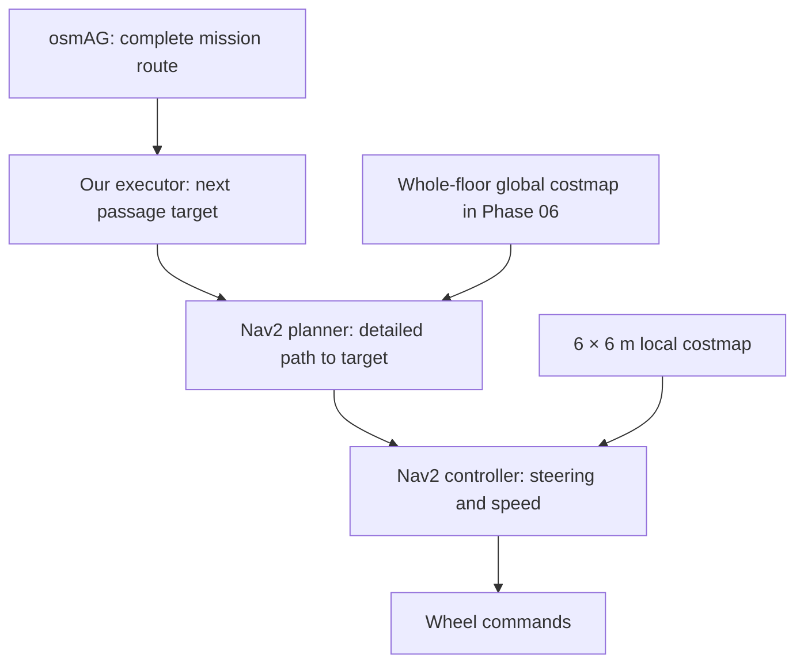
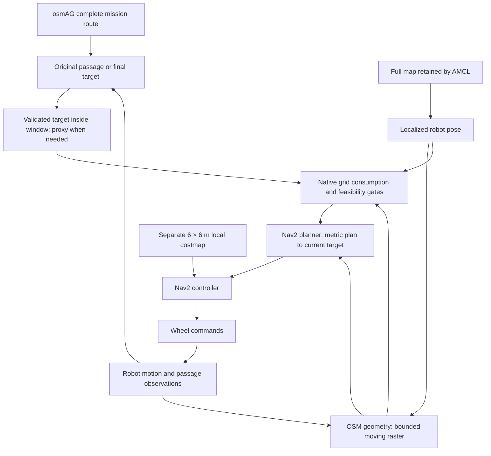

# Phase 07: rolling osmAG raster and boundary goals

## Quick summary

- **Goal:** Generate a bounded planning raster from nearby osmAG geometry while retaining the complete topological mission route.
- **Status:** Automated acceptance passes: 169 tests, native/offline gates, live forward/reverse/obstacle missions, source-loss/recovery and matched static-map comparison. User acceptance confirmed November 14, 2026; Phase 07 is complete for bounded simulation scope.
- **Paper link:** Addresses the rolling-map and out-of-window goal capabilities identified in the existing audit of osmAG-Nav Sections 5.1 and 5.4.1.
- **Finish when:** The robot crosses multiple map windows with valid proxy goals, stable map/TF/constraint alignment and measured planning-map resource use.

Accepted results and reproduction commands are in the [Phase 07 completion record](../phases/07_GCU_ROLLING_RASTER.md).

## Change from Phase 06

In Phase 06, osmAG supplies the route and passage targets while Nav2 plans on a
full-floor raster. Phase 07 keeps that complete graph route while generating
only the nearby raster needed for metric planning. A 6 × 6 m local controller
costmap alone does not meet this goal; it already exists.

### What happens after osmAG generates the route?

**Nav2 is the navigation system. The local controller is one component inside
Nav2. The 6 × 6 m size describes that component's local map, not Nav2's total
planning range.** In the Phase 06 baseline workflow:

1. osmAG chooses the complete route through areas and passages.
2. Our executor selects the next passage target and sends it to Nav2 using
   `NavigateToPose`. It does not pass the complete osmAG reference directly to
   the local controller as a path to follow.
3. Nav2's planner searches the whole-floor global costmap for a detailed path to
   that current target. This produces `/plan`.
4. Nav2's controller follows that path and calculates forward/turning velocities,
   using the 6 × 6 m local costmap to check nearby obstacles and immediate motion.
5. As the robot approaches a passage target, the executor supplies the next one.

For example, a passage target may be 20 metres away. The planner can calculate
the path to it even though the controller only checks a nearby 6 × 6 m window.
The path can extend much farther than the controller's local map.

Phase 07 replaces the diagram's **whole-floor global costmap input** with a
bounded planning raster generated from nearby osmAG geometry. A target outside
that raster needs a validated temporary proxy goal inside the window. The
complete osmAG route remains available, and the controller still has its local
window. AMCL initially keeps its full-floor map; whole-stack memory is not yet
independent of building size.

The implemented Phase 07 flow is:

The roadmap records the authors' 50 × 50 m / 10 Hz deployment. Treat those as
reference settings to evaluate, not measurements or a performance guarantee for
our VM or Pi. First choose a bounded fixture and explicit window/update budget;
report any departure from the paper's settings.

## Three bounded work groups

1. **Geometry and window generation, offline.** Rasterize nearby wall/region
   geometry in the existing `map` frame. Preserve metric scale, grid origins,
   unknown/forbidden regions and footprint padding. Compare overlapping windows
   against the accepted static reference. Test holes, window-edge obstacles and
   passage masks. Save small reproducible fixtures before using Gazebo.
2. **Native Nav2 integration and proxy goals.** Supply versioned raster updates
   to the global planning costmap without a hidden full-floor static layer.
   Rebuild constraints on the same grid. If the next graph target lies outside
   the usable window, select a route-consistent proxy inside its padded boundary.
   Validate native feasibility and map/constraint revision before dispatch.
   Preserve one TF owner; window shifts must not teleport the robot or reset
   localization. Define a stop/retry policy for stale or unavailable updates.
3. **Bounded motion and comparison.** Execute a route spanning at least three
   window origins; verify crossing order, continuous handoff, arrival and rest.
   Test an edge obstacle and interruption of raster updates. Compare against the
   frozen Phase 06 static-planning baseline using identical route, controller,
   footprint and sensors. Complete a short user visual review and record limits.

Keep runtime batches under the existing 20-minute budget. Admit routes and
timing budgets before launching physics, distinguish simulated and wall time,
and report each group's remaining work without proliferating checkpoint numbers.
Do not raise robot speed to disguise VM slowdown.

## Required evidence

- Constant bounded planning-grid dimensions as the mission moves; every window
  has recorded origin, resolution, geometry/constraint revision and timestamp.
- Nav2 metric targets remain inside the feasible window; graph/final destinations
  may remain outside. Unknown space beyond the window must not become a shortcut.
- No observed contacts; unchanged padded-clearance, crossing and arrival gates.
- Safe rest when required raster/constraint freshness is lost; verified recovery
  on the declared test case and clean teardown.
- Raster generation/update latency, cells allocated, component RAM/CPU, and
  route/arrival metrics, with startup, preprocessing and online work separated.
- Explicit inventory of remaining full-map users: AMCL remains full-floor in this
  phase, so bounded Nav2 raster memory does not imply bounded whole-stack memory.

## Research value and following phases

This tests whether an osmAG graph can support continuous navigation while
bounding the metric planning representation. Resource savings are a hypothesis
until measured across map sizes; one GCU journey alone cannot establish scaling.
Phase 08 evaluates structure-based localization, Phase 09 freezes the integrated
paper-aligned simulation baseline, and later phases measure navigation plus
camera/language workloads on Pi 4B. See the [roadmap](../OSMAGNAV_PHASE_ROADMAP.md).
