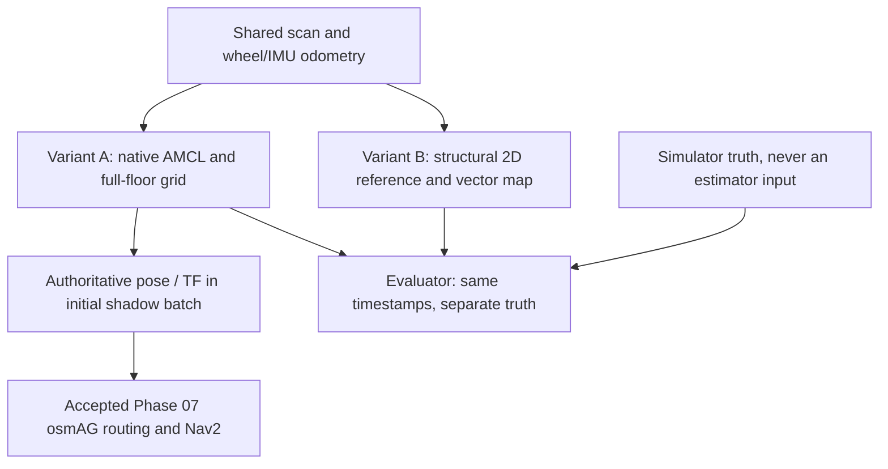

# Phase 08: structural localization versus the AMCL baseline

## Quick summary

- **Goal:** Assess whether structural localization merits further implementation for EdgeOsmAG's sensor and compute budget.
- **Status:** Closed as a preliminary feasibility study on November 14, 2026; 183 tests and 1,260 paired frames retained.
- **Decision:** Keep AMCL in production; preserve the separate 2D reference. Recovery, TF handoff and candidate closed-loop/resource qualification are deferred, not achieved.
- **Next:** Phase 09 profiles actual Pi navigation; camera and language workloads follow. No AGLoc/Pi efficiency claim is established.

The [closure record](../phases/08_GCU_LOCALIZATION_COMPARISON.md) defines the
accepted reduced scope. The user chose to stop custom AGLoc development for now.
The original work groups below are historical plans: group 1 is completed;
groups 2–3 are deferred and no longer active Phase 08 completion requirements.

## Research question and claims

**Does structural localization provide enough robustness or memory benefit to
justify its cost on constrained hardware?** This is a testable question, not an
assumed contribution or a preselected winning algorithm. Distinguish a systems
comparison/ablation from algorithmic novelty. Record negative results and failures.

The localization paper supplies the original AGLoc method.
[Robust Lifelong Indoor LiDAR Localization using the Area Graph](https://arxiv.org/abs/2308.05593v3)

Sections III-B/E/F/G respectively describe vertical
clutter removal, asymmetric signed-distance weighting, weighted point-to-line
tracking and corridorness downsampling. Section IV compares detailed-grid AMCL,
Area-Graph-grid AMCL and AGLoc. osmAG-Nav Section 6 adds AGLoc++ recovery,
structure filtering and adaptive odometry fusion. These are distinct baselines.

The original paper assumes a 64-line 3D cloud. Our sensor has one horizontal
360-beam ring and a 12 m range. A `LaserScan` to `PointCloud2` adapter cannot
supply missing vertical visibility. The current prototype uses the original
Eq.8 weighting and approximates Eq.10 downsampling with deterministic weights.
It predicts with the same wheel/IMU odometry as AMCL, preserving unobservable
motion rather than claiming ICP resolves a featureless corridor. It has no
WiFi/barometer initialization, global rescue, multi-floor transition, semantic
glass treatment or AGLoc++ adaptive Kalman implementation.

## Original work groups and disposition

1. **Completed — audit, isolation and shared-input shadow comparison.** Pin papers, source
   availability, map, sensor, baseline configs and candidate config. Unit-check
   geometry/weights/observability, then capture identical real simulated scans
   and fused odometry on a short accepted clean route and a physical-obstacle
   route. AMCL alone controls navigation; candidate replay has no TF/commands.
   Preserve truth separately and score all paired frames without truth alignment.
2. **Deferred — tracking/recovery and controlled localization handoff.** Test corridor
   degeneracy, stronger clutter, sensor dropout and initial-pose/relocalization
   errors on declared repeat/holdout cases. Implement explicit lost-state and
   bounded recovery policy before publishing authoritative TF. Compare any
   recovery prior/search budget fairly; a locally convergent ICP is not global
   localization. One estimator at a time owns `map -> odom`; retain the same
   odometry EKF and accepted navigation profile. Stop on stale/uncertain state.
3. **Deferred — bounded candidate end-to-end comparison.** Run the same accepted missions
   under each qualified estimator, measuring arrival, contacts, localization,
   recovery, latency, RAM/CPU and completion. Repeat with fixed seeds/initial
   uncertainty and report distributions, not a cherry-picked run. Freeze the
   result and user review; keep both launch profiles reproducible.

If this work is reopened, each simulation batch must have a predeclared wall-time bound of at most a few minutes;
report what passed and what remains together after each work group. Do not raise
speed, relax freshness or replace AMCL merely to make an experiment finish.

## Fairness and measurement rules

- A uses the accepted CAD-derived PGM; B uses vector walls/passages derived from
  the same CAD source. Record rasterization differences and map hashes. Include
  a detailed-clutter-map baseline only as an explicitly separate map variant.
- Match scan stream, range/extrinsics, timestamp policy and fused odometry. Freeze
  the candidate configuration before inspecting a batch; tune on development
  cases and keep holdout/repeat cases distinct.
- Truth is evaluator-only. The common recorder writes `observations.npz` for B
  and `evaluation.npz` for scoring. Never initialize B from AMCL or truth poses
  beyond the shared declared start prior.
- Report paired coverage and max gap, absolute position/yaw error, p95/max error,
  lost/weak/rejected frames, recovery time and failed trials. Do not silently
  discard difficult frames or align estimated trajectories to truth afterwards.
- Record AMCL's actual scan-update thresholds, beam/particle count and measurement
  message rate; B updating every scan is a configuration difference to report.
- Distinguish preprocessing from tracking, wall from simulated time, and component
  RSS/PSS/CPU from whole-stack memory. Python/C++ and online/offline scheduling
  differences prevent treating a prototype timing as an algorithmic speedup.
- The online AMCL trajectory is a conditioning variable: shadow replay is not a
  closed-loop navigation comparison. Pi tests must run estimators on Pi while the
  simulator/evaluator runs elsewhere; camera/LLM workload contention comes later.

## Architecture and separation

Implementations live under `experiments/localization_comparison/`. Separate VM
workspaces/results preserve Phase 07. The current candidate publishes no pose/TF
or wheel commands. Qualification precedes a one-owner Nav2 localization adapter.

## Relation to following phases

This addresses the structural-localization capability in osmAG-Nav Section 6,
with sensor-driven departures stated explicitly. The closed study retains AMCL and leaves the authors' structural-localization
capability unreproduced. Phase 09 profiles the accepted navigation stack on the
actual Pi 4B, with Gazebo/evaluation on another machine. Subsequent phases add
camera perception, language tasks and controlled combined-workload evaluation. An AMCL win, or a useful 2D
adaptation with different tradeoffs, is a valid outcome; original AGLoc++ parity
cannot be claimed from the current sensor and unavailable runtime.
