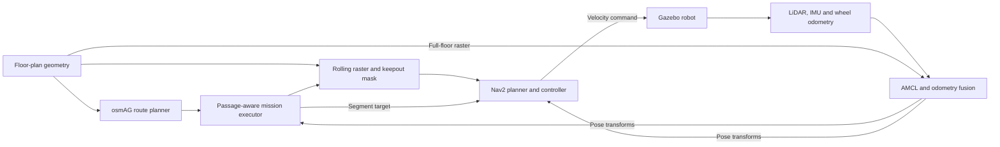

# EdgeOsmAG for Resource-Budgeted Semantic Navigation on Edge Hardware

*Working manuscript. Current evidence covers simulated navigation and Raspberry Pi experiments. The integrated perception and language evaluation is planned.*

## Abstract

Indoor assistive robots must localize and navigate while sharing onboard computation with perception and task interpretation. EdgeOsmAG uses a hierarchical area-and-passage map to select a route and generates a bounded metric planning window for native ROS 2 navigation. We study this design in a single-floor simulation with navigation running on a 4 GB Raspberry Pi 4B. A matched simulated mission used 16,384 cells in the rolling grid and 844,000 cells in the static grid. Two stationary-input replays each sustained eight seconds of navigation control at 1× input timing, averaging 2.39 Pi CPU cores and reaching about 330 MiB of sampled concurrent proportional memory, including the replay process. Three consecutive closed-loop corridor trials passed at 0.669–0.717× measured simulation rate with zero contacts and final position errors of 0.070–0.113 m. During motion the Pi averaged 2.19–2.21 CPU cores and reached about 370 MiB of sampled concurrent proportional memory. These measurements define a short-corridor navigation baseline for subsequent perception and language experiments. [Matched simulation comparison](../../simulation/gcu_ground_floor/phase7_diagnostics/matched_comparison.json) · [Pi corridor baseline](../../docs/research/osm-AG/phases/09_PI4B_NAVIGATION_BASELINE.md)

## 1. Introduction

An indoor assistive robot needs a map that can express rooms, corridors and restricted passages, as well as enough geometric detail to plan around walls and nearby obstacles. A topometric map combines those representations by attaching geometry to connected areas. It can select a building-scale route in terms of places and passages while a metric planner handles the segment closest to the robot. This design gives the system a way to bound the active planning grid. Other parts of the system, including localization, can still depend on the full map. [osmAG, Sections III–IV](https://arxiv.org/html/2309.04791v1#S3) · [osmAG-Nav, Section 5](https://arxiv.org/html/2603.28271v1#S5)

We ask how much computation is needed to sustain this navigation architecture on a small onboard computer, and how to distinguish that cost from delays introduced by the test environment. The study first measures navigation alone on the target computer. A subsequent evaluation will measure what happens when camera-based semantic observations and language-guided task requests share that computer. The navigation-only baseline gives those comparisons a common starting point for mission accuracy, deadline misses, memory and CPU use. [Evaluation protocol](../evidence/EXPERIMENT_PLAN.md)

The experiments address three questions.

1. How does the rolling raster change the planner's active grid and sampled memory on a matched mission?
2. What timing and resource use does navigation alone sustain on the Pi under recorded inputs and under live simulator feedback?
3. How do perception and language affect navigation timing, mission outcomes and their own task quality when they share the Pi?

The present work integrates an osmAG-derived route, passage-aware execution, bounded costmaps and native Nav2 with AMCL. Its evaluation combines an independently scored Gazebo mission, a matched comparison of rolling and static planning grids, and a Pi-local replay that exercises the navigation workload without a network sensor path. The two Pi test configurations expose different constraints. The replay measures whether the local stack can process a fixed workload and issue control. The closed-loop test measures whether commands reach a simulated robot that responds to them and completes the mission. [System validation](../../docs/research/osm-AG/phases/07_GCU_ROLLING_RASTER.md) · [Pi experiment harness](../../experiments/pi_baseline/README.md)

## 2. Related work

Feng et al. use OpenStreetMap XML to represent a hierarchy of areas, the geometry of their boundaries, and passages between them. Path queries attach start and goal poses to a passage graph using metric connections within an area. Zhang et al. extend the approach in osmAG-Nav with hierarchical search, rolling metric map generation, segmented execution and structure-based localization. EdgeOsmAG adapts these ideas for a Pi-based resource study. Its implementation uses a single-floor map, validates footprint clearance for route refinements and uses AMCL as the live localizer. [osmAG](https://arxiv.org/html/2309.04791v1) · [osmAG-Nav](https://arxiv.org/html/2603.28271v1) · [Implementation comparison](../../docs/research/osm-AG/GCU_ROUTING_PAPER_AUDIT.md)

Area-graph localization can associate LiDAR returns with structural map features. Xie and Schwertfeger use three-dimensional scans and prioritize structural observations to improve localization as clutter changes. Our preliminary comparison uses a separate two-dimensional implementation on shared simulated scan and odometry inputs. The deployed AMCL configuration provides the common localization baseline for comparing planning and computational workloads. Nav2 provides ROS 2 navigation orchestration, grid planning and the Regulated Pure Pursuit controller used in these experiments. [Area-graph localization](https://arxiv.org/html/2308.05593v3) · [Localization comparison](../../docs/research/osm-AG/phases/08_GCU_LOCALIZATION_COMPARISON.md) · [Navigation2](https://arxiv.org/abs/2003.00368) · [Regulated Pure Pursuit](https://arxiv.org/abs/2305.20026)

Prior osmAG work already incorporates language and object perception. Xie et al. use an LLM to interpret external information and influence passage costs during LiDAR navigation. The osmAG-LLM system retrieves candidate object locations from a semantic map and uses visual detection and verification at those locations. These studies motivate measuring the overhead of language and perception against a navigation baseline, alongside the quality of the task interpretation and object observations themselves. [LiDAR navigation with an LLM copilot, Section III](https://arxiv.org/html/2409.08493v3#S3) · [osmAG-LLM, Section III](https://arxiv.org/html/2507.12753v2#S3)

## 3. System design

### 3.1 Map preparation and hierarchical routing

The GCU ground-floor map is reconstructed from a CAD drawing. The accepted reconstruction contains 34 regions and 35 interfaces. The pipeline segments the floor and reconstructs area polygons from occupancy, retaining the central enclosure as excluded geometry. At run time, leaf areas define traversable regions and passages join adjacent areas. The planner caches feasible passage-to-passage connections within each leaf and uses the hierarchy to reduce the search. It can fall back to search on the validated passage graph. For execution, it shortens the reference route with line-of-sight segments only when those segments preserve footprint clearance, the ordered passage sequence and active closures. [CAD reconstruction](../../docs/research/osm-AG/phases/01_GCU_CAD_TO_OSMAG.md) · [Routing and refinement](../../docs/research/osm-AG/GCU_ROUTING_PAPER_AUDIT.md)

### 3.2 Windowed metric execution

The route contract records the ordered areas and passages, the target pose and the map and closure revisions. The executor publishes a raster of the local area geometry on a fixed lattice. The global planning window has 128 × 128 cells at about 0.05864 m per cell, spanning approximately 7.51 × 7.51 m. The controller has a separate rolling local costmap of approximately 6 × 6 m. The raster marks walls, excluded geometry and the window boundary as nontraversable. A keepout mask encodes active passage and area constraints. The planner can send an intermediate target inside the current window when the next route target lies farther away. The system verifies that both native costmaps have consumed the relevant constraints before admitting the target. Pose observations verify actual passage crossings. Final acceptance requires reaching the original target and observing rest. AMCL retains its full-floor map and the route planner retains building geometry and caches. [Rolling raster and target projection](../../docs/research/osm-AG/phases/07_GCU_ROLLING_RASTER.md)

### 3.3 Timing checks

The executor checks the age of LiDAR, IMU and localization transforms and the interval between accepted poses. It also verifies source ownership and fresh native-costmap observations. In the Pi experiments, the 40 ms mission timer and the time-sensitive input subscriptions have dedicated ROS executors. Before dispatch, a bounded wait permits fresh observations to arrive while the mission is idle. A running mission cancels on an expired input. The pose observation limit remains 150 ms in simulated time. To reduce repeated computation, the costmap check caches the projection of an immutable mask onto the native grid geometry. Each new costmap is still checked for its actual occupied cells and observation time. [Pi timing diagnostics](../../docs/research/osm-AG/phases/09E_PI4B_FULL_STACK_REPLAY.md)

## 4. Experimental setup

### 4.1 Hardware and execution placement

The navigation computer is a Raspberry Pi 4 Model B Rev 1.4 with 4 GB RAM, Ubuntu 22.04.5 on AArch64 and ROS 2 Humble. The Pi runs route preprocessing, mission execution, window rasterization, AMCL, wheel/IMU odometry fusion and the Nav2 planner, controller and navigator. Gazebo runs with software rendering in a four-vCPU Ubuntu guest on an Apple M4 Mac with 16 GiB RAM. The guest supplies scan, odometry, IMU and clock data over Cyclone DDS. The offboard scorer compares the simulated robot's ground-truth pose and contacts with the mission result. The Pi's control commands drive only the simulated robot in these experiments. The closed-loop trials reported here used Wi-Fi and the retained Nav2 1.1.20 Pi environment. The later power-bank trials followed an initial undervoltage diagnosis, with firmware status and temperature sampled during each run. [Pi inventory and software versions](../../docs/research/osm-AG/phases/09A_PI4B_DEPLOYMENT_READINESS.md) · [Power qualification](../../docs/research/osm-AG/phases/09E_PI4B_FULL_STACK_REPLAY.md)

### 4.2 Test conditions

The rolling and static planning conditions use the same map, query, world and localization profile for one matched simulation mission per variant. The Pi closed-loop fixture is a short ground-floor corridor crossing with one required osmAG passage and a 0.10 m/s linear command limit. The scorer checks final position and heading within 0.20 m and 10°, p95 localization error at most 0.25 m and 5°, at least 90% matched truth coverage, and a truth pose gap of at most 0.15 simulated seconds. It also checks ordered passage completion, swept-footprint validity, contacts and at least one second of rest at the end. Failed attempts remain in the experimental record. [Matched configuration](../../simulation/gcu_ground_floor/phase7_diagnostics/matched_comparison.json) · [Independent scorer](../../experiments/pi_baseline/score.py)

For the loopback experiment, the full Pi navigation stack receives a five-second stationary clip of simulated LiDAR, IMU and wheel odometry on localhost. The sender repeats the clip at 1× with a per-repeat timestamp offset that preserves source cadence. The clip contains 50 scans, 500 IMU samples and 250 odometry samples. An isolated sink records the controller's commands during an eight-second action interval, then the harness verifies cancellation. The recorded pose is independent of the commands, so the measured outcome is sustained input processing and control output. [Replay construction and protocol](../../docs/research/osm-AG/phases/09E_PI4B_FULL_STACK_REPLAY.md)

### 4.3 Measurement

CPU use is reported in equivalent cores as accumulated process CPU seconds divided by the elapsed wall time of the sampling interval. The peak concurrent sampled proportional set size (PSS) apportions shared memory pages and sums the sampled process set. The relay is counted in closed-loop measurements and the input player is counted in replay measurements. Preprocessing is recorded separately from motion-interval CPU and memory. We estimate the achieved simulator rate from the span of source scan timestamps divided by the corresponding span of wall-clock receipt times at the simulator. We report this rate alongside the configured physics target. [Resource analysis](../../experiments/pi_baseline/analyze_pilot_resources.py) · [Simulator rate calculation](../../experiments/pi_baseline/score.py)

The trial is the unit for reporting mission success. Scan and pose samples describe timing and estimation within a trial. For the closed-loop reporting batch, the same corridor, task parameters and scoring rules are used for three consecutive runs after link qualification. Sampled CPU and PSS describe their observed intervals, and the simulator rate and link conditions accompany each result. [Reporting sequence](../evidence/EXPERIMENT_PLAN.md)

## 5. Results

### 5.1 Planning window and localization

In the matched simulation comparison, the rolling global grid contained 16,384 cells, about 1.94% of the 844,000 cells in the static grid. Final position errors were 0.0973 m and 0.0976 m with rolling and static planning, respectively. Planner-server resident set size measured after the missions was 27,444 KiB and 116,580 KiB, respectively. These measurements cover the planner process in one Ubuntu trial per configuration. [Matched planning results](../../simulation/gcu_ground_floor/phase7_diagnostics/matched_comparison.json)

In the separate localization feasibility study, two captured simulated missions provided 1,260 paired scan frames. AMCL position RMSE was 0.0327 m on the clean capture and 0.0415 m on the occluded capture. The structural prototype obtained 0.00114 m and 0.00310 m, respectively, on the same known-start inputs. The map and worlds share a construction source, and odometry alone obtained 0.00881 m RMSE in the clean capture. The paired frames are temporally related and the structural estimator ran offline. These conditions support a tracking feasibility observation while leaving localization recovery and onboard resource trade-offs to a separate study. [Shared-input localization results](../../docs/research/osm-AG/phases/08_GCU_LOCALIZATION_COMPARISON.md)

### 5.2 Pi navigation baseline

| Condition | Outcome | Motion-interval measurement |
| --- | --- | --- |
| Wi-Fi closed loop, 0.2× target | Two passes and one stale-scan cancellation | The passes achieved 0.196× and 0.198×, with 0.074 m and 0.059 m final position errors. Each averaged 1.68 Pi CPU cores. Peak sampled PSS was 341 MiB and 340 MiB. [Matched pilot batch](../../simulation/gcu_ground_floor/phase9_diagnostics/power_bank_navigation_summary.json) |
| Pi-local full-stack replay, 1× | Two completed eight-second intervals on the same stationary clip | Each emitted 80 nonzero linear commands. Maximum recorded pose gaps were 100 and 70 ms. The sampled workload averaged 2.39 CPU cores and reached 329.5 and 329.2 MiB concurrent PSS. [Replay 19](../../simulation/gcu_ground_floor/phase9_diagnostics/stack_replay_19/resource_interval_summary.json) · [Replay 20](../../simulation/gcu_ground_floor/phase9_diagnostics/stack_replay_20/resource_interval_summary.json) |
| Wi-Fi closed-loop retest, 1.0× target | Cancelled on stale robot TF after goal acceptance | Source scan cadence was about 0.65× over the attempted motion interval. The Pi relay recorded six of 11 source scans. The observer recorded no motion in that interval. [Mission score](../../simulation/gcu_ground_floor/phase9_diagnostics/pilot_43/independent_score.json) · [Scan report](../../simulation/gcu_ground_floor/phase9_diagnostics/pilot_43/scan_link_analysis.json) |
| Later Wi-Fi retests, 1.0× target | Two pose observation gap cancellations with complete observed scan delivery | Measured rate was about 0.96× over each attempted motion interval. The Pi relay recorded all 55 and 30 source scans, respectively. [Pilot 44](../../simulation/gcu_ground_floor/phase9_diagnostics/pilot_44/scan_link_analysis.json) · [Pilot 47](../../simulation/gcu_ground_floor/phase9_diagnostics/pilot_47/scan_link_analysis.json) |
| Subsequent costmap timing tests, 1.0× target | One stopped at first-action admission and one cancelled during motion on stale local costmap data | Native local costmap ages were 543 and 530 ms, respectively, against a 500 ms lease. The second attempt received all 42 source scans in its motion interval. [Pilot 48](../../simulation/gcu_ground_floor/phase9_diagnostics/pilot_48/independent_score.json) · [Pilot 51](../../simulation/gcu_ground_floor/phase9_diagnostics/pilot_51/independent_score.json) |
| Revision-only keepout mask diagnostic, 1.0× target | One link interruption during startup and one stale-TF cancellation after dispatch | The retry recorded all eight source scans and achieved about 0.70× over the attempted motion interval. [Pilot 54 startup log](../../simulation/gcu_ground_floor/phase9_diagnostics/pilot_54/pi_results/actor.log) · [Pilot 55 score](../../simulation/gcu_ground_floor/phase9_diagnostics/pilot_55/independent_score.json) |
| Hotspot closed loop, 1.0× target, reliable sensor relays | One independent pass and one stale-TF stop during a window update | The pass achieved 0.695×, with 0.077 m final position error, 0.048 m p95 localization position error and zero contacts. During motion the Pi averaged 2.18 CPU cores and reached 372 MiB sampled concurrent PSS. Both runs received every source scan. [Pilot 64 score](../../simulation/gcu_ground_floor/phase9_diagnostics/pilot_64/independent_score.json) · [Pilot 64 resources](../../simulation/gcu_ground_floor/phase9_diagnostics/pilot_64/resource_interval_summary.json) · [Pilot 65 score](../../simulation/gcu_ground_floor/phase9_diagnostics/pilot_65/independent_score.json) |
| Hotspot closed loop, revised window lookup, 1.0× target | One independent pass and one preflight timeout before dispatch | The pass achieved 0.633×, with 0.081 m final position error, 0.042 m p95 localization position error and zero contacts. The Pi averaged 2.14 CPU cores and reached 372 MiB sampled concurrent PSS during motion. In the failed preflight interval, the Pi relay recorded 16 of 40 source scans by stamp. [Pilot 67 score](../../simulation/gcu_ground_floor/phase9_diagnostics/pilot_67/independent_score.json) · [Pilot 67 resources](../../simulation/gcu_ground_floor/phase9_diagnostics/pilot_67/resource_interval_summary.json) · [Preflight evidence](../../docs/research/osm-AG/phases/09E_PI4B_FULL_STACK_REPLAY.md#matched-retest-after-changing-the-window-lookup) |
| Pixel 2.4 GHz, 10 Hz global costmap, 1.0× target | Three consecutive corridor passes with all source LiDAR scans matched | Measured rate 0.669–0.717×, endpoint error 0.070–0.113 m, Pi CPU 2.19–2.21 cores, and peak sampled concurrent PSS about 370 MiB. Six in-motion window commits took 279–349 ms from publication in simulated time. [Final baseline](../../docs/research/osm-AG/phases/09_PI4B_NAVIGATION_BASELINE.md) |

Earlier attempts at a 0.5× target also stopped on scan or TF freshness checks. After the 0.65× retest, all 70 ICMP probes to each of the Mac and the Ubuntu guest received a reply, with maximum round-trip delays of 2.03 s and 2.25 s, respectively. The later Wi-Fi recheck recorded a maximum round-trip time of 53.8 ms across six concurrent ROS echo streams per direction. The traced run under the improved link recorded a mission callback of 226 ms, including a 169 ms goal dispatch callback, as new clock and TF messages continued arriving. The round-trip and callback measurements describe distinct parts of the system. [Timing and link experiments](../../docs/research/osm-AG/phases/09E_PI4B_FULL_STACK_REPLAY.md)

## 6. Discussion and limitations

Bounding the active planning grid reduces the number of cells presented to the native planner. The matched route shows that the smaller grid can support a comparable endpoint error for that mission. The sample size and retained full-map operations limit any inference about total memory scaling or speed. Longer routes, map changes and a repeated comparison under a common software profile are needed to estimate these effects. [Matched comparison scope](../../simulation/gcu_ground_floor/phase7_diagnostics/matched_comparison.json)

The Pi-local results establish that the tested stack can process a stationary 1× sensor stream and generate commands for eight seconds. Closed-loop completion additionally requires timely inputs and a command path to the simulator. The slower passes allow more wall time per unit of simulated motion, which limits their use in estimating real-time compute demand. Conversely, an input delivery failure in the split-host test has a different interpretation from a missed deadline on loopback. Repeating both experiments preserves this distinction when evaluating new workloads. The current mission tests use simulated motion and idealized sensors on one floor, which limits transfer to physical wheelchair operation. [Pi replay and split-host evidence](../../docs/research/osm-AG/phases/09E_PI4B_FULL_STACK_REPLAY.md)

The later trials show that complete scan coverage can coexist with missed navigation deadlines. Scan hashes establish eventual receipt of the source payloads. Timestamped callback traces and native costmap ages establish whether those parts of the stack kept pace during motion. The six diagnostic trials varied in runtime configuration and achieved simulator speed. They identify timing failure modes for the next matched experiment. [Diagnostic outcomes](../../simulation/gcu_ground_floor/phase9_diagnostics/link_recheck_20261123/retest_summary.json)

An additional instrumented trial compared wheel odometry and IMU message stamps on Ubuntu and the Pi. In the two simulated seconds before stale-TF cancellation, the Pi probe recorded 69 of the 100 wheel odometry stamps and 104 of the 200 IMU stamps observed on Ubuntu. The latest odometry transform stamp was 271 ms behind the mission clock. The independent probe and mission agreed on the latest transform and costmap stamps. This observation places a gap upstream of the mission callback in that run. The probes record callback observations, which include middleware and application scheduling. They cannot measure one-way network delay. [Pipeline trace](../../simulation/gcu_ground_floor/phase9_diagnostics/pilot_59/pipeline_timing_analysis.json)

The sensor-rate load checks reproduced delivery gaps with navigation inactive. Ubuntu replayed the recorded sensor payloads for 20 s at 50 Hz wheel odometry, 100 Hz IMU and 10 Hz LiDAR alongside a 100 Hz clock. In the first check, the Pi received 1,708 of 2,000 IMU stamps and 972 of 1,000 wheel odometry stamps. The longest Pi callback gaps were 455 ms and 223 ms, respectively. All 200 LiDAR stamps eventually arrived despite a 375 ms callback gap. A reliable IMU and odometry variant received every sensor stamp under steadier concurrent link conditions. A repeat of the original profile also received all 5,200 messages. These checks establish that the link can exhibit the gaps without Nav2 load. The variation in concurrent round-trip delay limits attribution to the delivery policy. [Sensor-rate load checks](../../docs/research/osm-AG/phases/09E_PI4B_FULL_STACK_REPLAY.md#sensor-rate-wi-fi-load-checks)

The live topic audit found reliable odometry and IMU offers from Gazebo and best-effort subscriptions on the Pi. An optional Pi relay requested reliable delivery for both streams and forwarded their original payloads to the localizer. The instrumented attempt stopped on stale LiDAR even though the newest relayed odometry and IMU were 16 and 46 ms old at that instant. The next LiDAR scan reached the Pi receiver 686 ms after cancellation by the same host's monotonic clock. This trial shows that recent odometry and IMU can coexist with inadequate LiDAR delivery. The reporting batch remains pending. [Live QoS audit](../../simulation/gcu_ground_floor/phase9_diagnostics/qos_audit_01/endpoints.json) · [Reliable input timing](../../simulation/gcu_ground_floor/phase9_diagnostics/pilot_63/reliable_input_timing_summary.json)

### Reproducibility

The experiment records link the frozen source archives, configuration hashes, simulator and navigation logs, and independent scores. They also preserve the recorded replay input and its timestamp bounds. Repeat the window comparison with the same query, footprint and localization configuration. Repeat the Pi replay with the archived source clip at 1×. For closed-loop trials, record the network configuration and the achieved simulator rate alongside the Pi measurements. The records provide commands and expected outputs for these checks. [Window comparison protocol](../../docs/research/osm-AG/phases/07_GCU_ROLLING_RASTER.md) · [Pi reproduction instructions](../../experiments/pi_baseline/README.md)

## 7. Planned perception and language evaluation

The perception workload will associate time-stamped camera detections with the robot pose and mapped area. The language workload will map supported requests to validated room or object targets and passage-status updates. A comparison will measure navigation alone, navigation with perception, navigation with language and navigation with both. The main variables are mission completion and error, detection and interpretation quality, input freshness, inference latency, CPU, PSS and thermal behavior. Onboard and offboard inference must be reported by execution placement. A declared workload and matched repetitions on the same hardware will test whether the additional tasks can run without compromising navigation timing. [Experiment plan](../evidence/EXPERIMENT_PLAN.md)

## 8. Conclusion

EdgeOsmAG combines area-graph routing with bounded metric planning and an AMCL-based navigation stack. The Pi sustained two fixed-rate stationary-input replay intervals and passed three consecutive closed-loop trials on a short corridor at 0.669–0.717× measured simulation rate. Full-rate moving navigation and physical deployment remain open measurements. The workload comparison will measure the resource cost of camera perception and language tasks and evaluate whether the combined stack preserves navigation performance.

## References

1. D. Feng, C. Li, Y. Zhang, C. Yu, and S. Schwertfeger. *osmAG: Hierarchical Semantic Topometric Area Graph Maps in the OSM Format for Mobile Robotics*. 2023. [arXiv:2309.04791v1](https://arxiv.org/abs/2309.04791v1)
2. Y. Zhang, J. Zhang, C. Li, F. Xie, and S. Schwertfeger. *osmAG-Nav: A Hierarchical Semantic Topometric Navigation Stack for Robust Lifelong Indoor Autonomy*. 2026. [arXiv:2603.28271v1](https://arxiv.org/abs/2603.28271v1)
3. F. Xie and S. Schwertfeger. *Robust Lifelong Indoor LiDAR Localization Using the Area Graph*. [Versioned preprint](https://arxiv.org/abs/2308.05593v3) · [Journal DOI](https://doi.org/10.1109/LRA.2023.3334158)
4. S. Macenski, F. Martín, R. White, and J. G. Clavero. *The Marathon 2: A Navigation System*. 2020. [arXiv:2003.00368](https://arxiv.org/abs/2003.00368)
5. S. Macenski, S. Singh, F. Martín, and J. G. Clavero. *Regulated Pure Pursuit for Robot Path Tracking*. [arXiv:2305.20026](https://arxiv.org/abs/2305.20026)
6. F. Xie, J. Zhang, and S. Schwertfeger. *Intelligent LiDAR Navigation: Leveraging External Information and Semantic Maps with LLM as Copilot*. [arXiv:2409.08493v3](https://arxiv.org/abs/2409.08493v3)
7. F. Xie, S. Schwertfeger, and H. Blum. *osmAG-LLM: Zero-Shot Open-Vocabulary Object Navigation via Semantic Maps and Large Language Models Reasoning*. [Versioned preprint](https://arxiv.org/abs/2507.12753v2) · [Journal DOI](https://doi.org/10.1109/LRA.2026.3653280)
